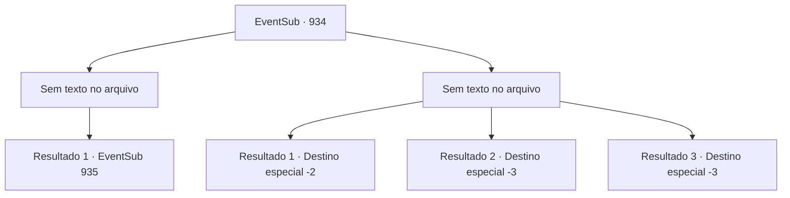

# Eventos secundários · 934

[Índice da tabela](index.md) · [Índice geral](../index.md)

ID: `pt:EventSub:934` · Fonte: `EventSub4` · Versão: 1.2.47.

Mapeamento estático dos arquivos; a disponibilidade e a execução dependem do estado da run.

## Texto do evento

*Sem texto no arquivo.*

## Dados de entrada

```json
{
  "id": 934,
  "grade": 1,
  "subEvent": "",
  "required": ""
}
```

## Mapa das escolhas



## Escolhas e resultados

### Escolha 1

*Sem texto no arquivo; o papel dessa opção depende da interface do jogo.*

Requisitos e outros campos da escolha:

```json
{
  "required": ""
}
```

#### Resultado 1.1

Você dá uma boa surra nos soldados, ganhando tempo para explorar a mina. Erina te olha com olhos brilhantes. Ela parece impressionada com suas habilidades de combate. 

 "Uau...! Você é um lutador incrível!"

 Você acena com a cabeça para mostrar sua gratidão, então avança mais fundo na mina. Logo, você começa a ouvir gemidos - alguém está com dor. 

 "Acho que alguém está chorando... Está vindo dali."

 Antes que você possa detê-la, Erina sai correndo.

Continuação registrada: [Evento 935](0935.md) na mesma tabela.

```json
{
  "required": "",
  "chance": "1",
  "nextEvent": 935,
  "type": 2,
  "reward": ""
}
```

### Escolha 2

*Sem texto no arquivo; o papel dessa opção depende da interface do jogo.*

Requisitos e outros campos da escolha:

```json
{
  "required": ""
}
```

#### Resultado 2.1

Enquanto você está ocupado apanhando dos soldados, Erina pega uma pá do chão. Com ela, ela corajosamente recolhe uma pilha de pedras próximas e as arremessa nos soldados. 

 "ARGH! SUA PESTE!"

 Você aproveita a oportunidade, agarrando Erina e fugindo. Finalmente, você consegue mergulhar de volta na piscina, escapando por pouco da perseguição. Você conseguiu escapar. Lupin está esperando por você fora da vila. 

 "Encontrou alguma coisa?"

 Você balança a cabeça. Você pode perceber que Lupin está desapontado ao ouvir a notícia. 

 "Entendo. Obrigado pela ajuda."

 Assim que Lupin está prestes a partir, Erina pede para segui-lo. Mas Lupin imediatamente diz não. 

 "Venha, garota. Vamos levá-la para casa."

 Erina é escoltada - ou levada à força - de volta para sua casa. Você retorna à sua aventura.

Continuação registrada: [Destino especial `-2`](../destinos-especiais.md).

```json
{
  "required": "1_0_2|1_1_2",
  "chance": "1",
  "nextEvent": -2,
  "type": 2,
  "reward": "12_12_-1|0_0_-1|0_1_-1"
}
```

#### Resultado 2.2

Um dos soldados te nocauteia com sua lança. Você perde a consciência.

Continuação registrada: [Destino especial `-3`](../destinos-especiais.md).

```json
{
  "required": "2_0_2",
  "chance": "1",
  "nextEvent": -3,
  "type": 2,
  "reward": "0_0_-1|0_1_-1"
}
```

#### Resultado 2.3

Um dos soldados te nocauteia com sua lança. Você perde a consciência.

Continuação registrada: [Destino especial `-3`](../destinos-especiais.md).

```json
{
  "required": "2_1_2",
  "chance": "1",
  "nextEvent": -3,
  "type": 2,
  "reward": "0_0_-1|0_1_-1"
}
```

## Referências que chegam a este evento

- [Evento 933 · escolha 1 · resultado 1](0933.md#escolha-1)
- [Evento 933 · escolha 2 · resultado 2](0933.md#escolha-2)
- [Evento 933 · escolha 3 · resultado 2](0933.md#escolha-3)
- [Evento 933 · escolha 4 · resultado 2](0933.md#escolha-4)
