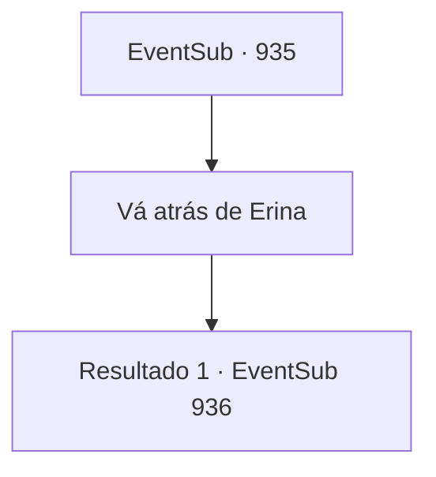

# Eventos secundários · 935

[Índice da tabela](index.md) · [Índice geral](../index.md)

ID: `pt:EventSub:935` · Fonte: `EventSub4` · Versão: 1.2.47.

Mapeamento estático dos arquivos; a disponibilidade e a execução dependem do estado da run.

## Texto do evento

*Sem texto no arquivo.*

## Dados de entrada

```json
{
  "id": 935,
  "grade": 1,
  "subEvent": "",
  "required": ""
}
```

## Mapa das escolhas



## Escolhas e resultados

### Escolha 1

Vá atrás de Erina

Requisitos e outros campos da escolha:

```json
{
  "required": ""
}
```

#### Resultado 1.1

Você segue o som até sua origem. Você chega a um espaço estreito, que não parece tão abandonado em comparação com o resto da mina. Alguns baús de madeira estão espalhados aqui e ali. Você também nota uma mesa, junto com uma pena e alguns pedaços de pergaminho sobre ela. Do outro lado da sala há uma porta de ferro gradeada. Você se aproxima cuidadosamente da porta e olha para dentro. Lá, você percebe uma criança pequena, agachada em um canto, tremendo. O menino tem pele pálida e cabelo branco prateado. Você nota hematomas e cicatrizes de chicotadas por todo o corpo dele. Seus olhos estão cheios de medo e confusão. |drawing_chainedEdward|

Continuação registrada: [Evento 936](0936.md) na mesma tabela.

```json
{
  "required": "",
  "chance": "1",
  "nextEvent": 936,
  "type": 2,
  "reward": ""
}
```

## Referências que chegam a este evento

- [Evento 933 · escolha 2 · resultado 1](0933.md#escolha-2)
- [Evento 933 · escolha 3 · resultado 1](0933.md#escolha-3)
- [Evento 933 · escolha 3 · resultado 3](0933.md#escolha-3)
- [Evento 933 · escolha 4 · resultado 1](0933.md#escolha-4)
- [Evento 934 · escolha 1 · resultado 1](0934.md#escolha-1)
