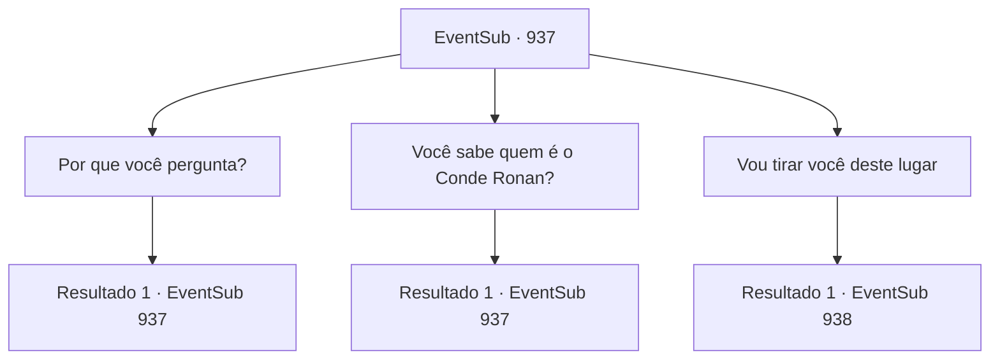

# Eventos secundários · 937

[Índice da tabela](index.md) · [Índice geral](../index.md)

ID: `pt:EventSub:937` · Fonte: `EventSub4` · Versão: 1.2.47.

Mapeamento estático dos arquivos; a disponibilidade e a execução dependem do estado da run.

## Texto do evento

*Sem texto no arquivo.*

## Dados de entrada

```json
{
  "id": 937,
  "grade": 1,
  "subEvent": "",
  "required": ""
}
```

## Mapa das escolhas



## Escolhas e resultados

### Escolha 1

Por que você pergunta?

Requisitos e outros campos da escolha:

```json
{
  "required": "5_782_0"
}
```

#### Resultado 1.1


 "M- Senhor Lukas...! Ele... cuida de mim! Quando eu me comporto bem e sou um bom menino... ele me recompensa com passas. Se eu não... ele me chicoteia."

 Os hematomas no corpo do menino devem ser obra do próprio Lukas.

Continuação registrada: [Evento 937](0937.md) na mesma tabela.

```json
{
  "required": "",
  "chance": "1",
  "nextEvent": 937,
  "type": 2,
  "reward": "5_782_1"
}
```

### Escolha 2

Você sabe quem é o Conde Ronan?

Requisitos e outros campos da escolha:

```json
{
  "required": "5_781_1"
}
```

#### Resultado 2.1

Você pergunta ao menino se ele sabe quem é o Conde Ronan. Erina levanta a mão ansiosamente para responder, mas você a abaixa gentilmente. Você volta a olhar para o menino, que apenas responde balançando a cabeça. 

 "Ronan? ...Nunca ouvi falar de alguém com esse nome."


Continuação registrada: [Evento 937](0937.md) na mesma tabela.

```json
{
  "required": "",
  "chance": "1",
  "nextEvent": 937,
  "type": 2,
  "reward": "5_781_2"
}
```

### Escolha 3

Vou tirar você deste lugar

Requisitos e outros campos da escolha:

```json
{
  "required": "5_782_1"
}
```

#### Resultado 3.1

O rosto do menino se ilumina ao ouvir você. 

 "R- realmente?! Mas ele disse que eu não posso..."

 Erina interrompe o menino com um sorriso travesso. 

 "Ah, tudo o que os adultos dizem é tão CHATO. Você os escuta o dia todo e nunca vai se divertir!"

 O menino pondera algo em sua mente por um tempo. Ele fala novamente, aparentemente tendo tomado uma decisão. 

 "Eu... eu quero sair."

 Ao ouvir a determinação do menino, Erina cerra os punhos e faz uma declaração. 

 "Espere um minuto! Vou encontrar uma maneira de te tirar daqui!"

 Ela imediatamente começa a pular, procurando uma chave para destrancar a porta.

Continuação registrada: [Evento 938](0938.md) na mesma tabela.

```json
{
  "required": "",
  "chance": "1",
  "nextEvent": 938,
  "type": 2,
  "reward": "5_782_3"
}
```

## Referências que chegam a este evento

- [Evento 936 · escolha 1 · resultado 1](0936.md#escolha-1)
- [Evento 936 · escolha 1 · resultado 2](0936.md#escolha-1)
- [Evento 936 · escolha 1 · resultado 3](0936.md#escolha-1)
- [Evento 937 · escolha 1 · resultado 1](0937.md#escolha-1)
- [Evento 937 · escolha 2 · resultado 1](0937.md#escolha-2)
