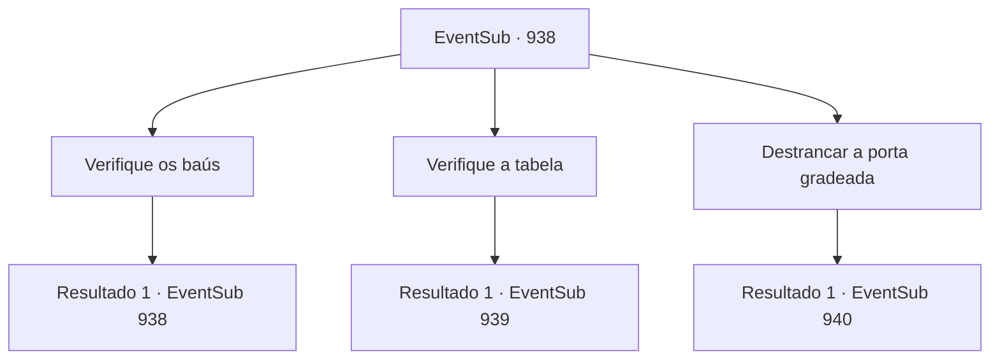

# Eventos secundários · 938

[Índice da tabela](index.md) · [Índice geral](../index.md)

ID: `pt:EventSub:938` · Fonte: `EventSub4` · Versão: 1.2.47.

Mapeamento estático dos arquivos; a disponibilidade e a execução dependem do estado da run.

## Texto do evento

*Sem texto no arquivo.*

## Dados de entrada

```json
{
  "id": 938,
  "grade": 1,
  "subEvent": "",
  "required": ""
}
```

## Mapa das escolhas



## Escolhas e resultados

### Escolha 1

Verifique os baús

Requisitos e outros campos da escolha:

```json
{
  "required": "5_783_0"
}
```

#### Resultado 1.1

Você ia procurar em um dos baús de madeira, mas Erina é mais rápida que você. Ela pega uma chave velha e enferrujada de algum lugar e a entrega para você com alegria. 

 "Encontrei! Esta deve ser a chave que abre a porta gradeada!"


Continuação registrada: [Evento 938](0938.md) na mesma tabela.

```json
{
  "required": "",
  "chance": "1",
  "nextEvent": 938,
  "type": 2,
  "reward": "5_783_1|3_364_1|3_363_1"
}
```

### Escolha 2

Verifique a tabela

Requisitos e outros campos da escolha:

```json
{
  "required": "5_784_0"
}
```

#### Resultado 2.1

Você verifica a mesa. Nela há uma carta inacabada. Você percebe que quem a escreveu foi Lukas, enviada para alguém chamado 'Hazel'. O conteúdo da carta é o que você encontraria em uma carta de amor trocada entre amantes. Você nota que a mesa tem um armário trancado. Ao contrário das outras partes da mesa, que são feitas de madeira, esta prateleira trancada é feita de aço, junto com um grande e pesado cadeado protegendo-a.

Continuação registrada: [Evento 939](0939.md) na mesma tabela.

```json
{
  "required": "",
  "chance": "1",
  "nextEvent": 939,
  "type": 2,
  "reward": "5_784_1"
}
```

### Escolha 3

Destrancar a porta gradeada

Requisitos e outros campos da escolha:

```json
{
  "required": "-1|5_783_1|8_363_1"
}
```

#### Resultado 3.1

Com a chave que você encontrou no baú, você destranca a porta de ferro gradeada. Imediatamente, Erina pega as mãos do menino, ajudando-o a se levantar. 

 "Vamos! Vamos te salvar!"

 Você percebe que o menino está corando. Você escolta as crianças de volta para a piscina. Poucos momentos depois, vocês três emergem da água corrente. O impacto dos seus corpos afugenta o cardume de peixinhos próximos - o menino olha para isso animadamente. As crianças já estão ocupadas brincando na água. Enquanto isso, você decide usar esse tempo para secar suas roupas.

Continuação registrada: [Evento 940](0940.md) na mesma tabela.

```json
{
  "required": "",
  "chance": "1",
  "nextEvent": 940,
  "type": 2,
  "reward": ""
}
```

## Referências que chegam a este evento

- [Evento 937 · escolha 3 · resultado 1](0937.md#escolha-3)
- [Evento 938 · escolha 1 · resultado 1](0938.md#escolha-1)
- [Evento 939 · escolha 1 · resultado 1](0939.md#escolha-1)
- [Evento 939 · escolha 2 · resultado 1](0939.md#escolha-2)
- [Evento 939 · escolha 2 · resultado 3](0939.md#escolha-2)
- [Evento 939 · escolha 3 · resultado 1](0939.md#escolha-3)
- [Evento 939 · escolha 3 · resultado 3](0939.md#escolha-3)
- [Evento 939 · escolha 4 · resultado 1](0939.md#escolha-4)
