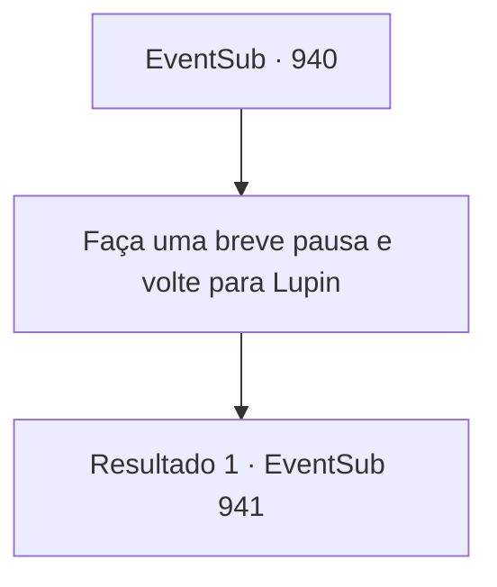

# Eventos secundários · 940

[Índice da tabela](index.md) · [Índice geral](../index.md)

ID: `pt:EventSub:940` · Fonte: `EventSub4` · Versão: 1.2.47.

Mapeamento estático dos arquivos; a disponibilidade e a execução dependem do estado da run.

## Texto do evento

*Sem texto no arquivo.*

## Dados de entrada

```json
{
  "id": 940,
  "grade": 1,
  "subEvent": "",
  "required": ""
}
```

## Mapa das escolhas



## Escolhas e resultados

### Escolha 1

Faça uma breve pausa e volte para Lupin

Requisitos e outros campos da escolha:

```json
{
  "required": ""
}
```

#### Resultado 1.1

Depois de descansar um pouco, você retorna para onde Lupin está esperando por você, com Erina e o garoto de cabelos brancos acompanhando. Lupin já está vagando pela área da vila - logo, ele percebe e caminha em sua direção. Erina vê Lupin e começa a pular de alegria. 

 "UOU! UM CAVALEIRO! UM CAVALEIRO DE VERDADE!"

 Lupin sorri calorosamente, acariciando gentilmente a cabeça da garota. Ele então volta sua atenção para você. 

 "Encontrou alguma coisa?"

 Erina alegremente compartilha os eventos que ocorreram na mina de prata, movendo o garoto - que estava se escondendo atrás de você o tempo todo - para a frente, tentando contar uma história mais clara para Lupin. Assim que Lupin vê o garoto, seus olhos se arregalam. 

 "N- não pode ser...! Jovem Mestre Edward?! Não pode ser! Pensar que ele estava preso na mina o tempo todo...!"

 Lupin se ajoelha como um sinal de respeito. Edward apenas fica lá, silencioso e confuso, tentando entender o que tudo isso significava. 

 "Edward, hein?! Esse é um NOME TÃO LEGAL!"

 Erina faz um elogio a Edward. Suas bochechas ficam vermelhas em resposta. 

 "Uh... Obrigado..."

 Lupin se levanta, olha para você e Erina, e então continua. 

 "Você fez um ótimo trabalho, aventureiro. Eu cuido disso a partir daqui. Vou levar o Jovem Mestre Edward para um lugar seguro."

 Lupin soa determinado. 

 "A verdadeira questão é, por que Lukas cometeria um ato tão hediondo em primeiro lugar... Alguma ideia?"


Continuação registrada: [Evento 941](0941.md) na mesma tabela.

```json
{
  "required": "",
  "chance": "1",
  "nextEvent": 941,
  "type": 2,
  "reward": ""
}
```

## Referências que chegam a este evento

- [Evento 938 · escolha 3 · resultado 1](0938.md#escolha-3)
