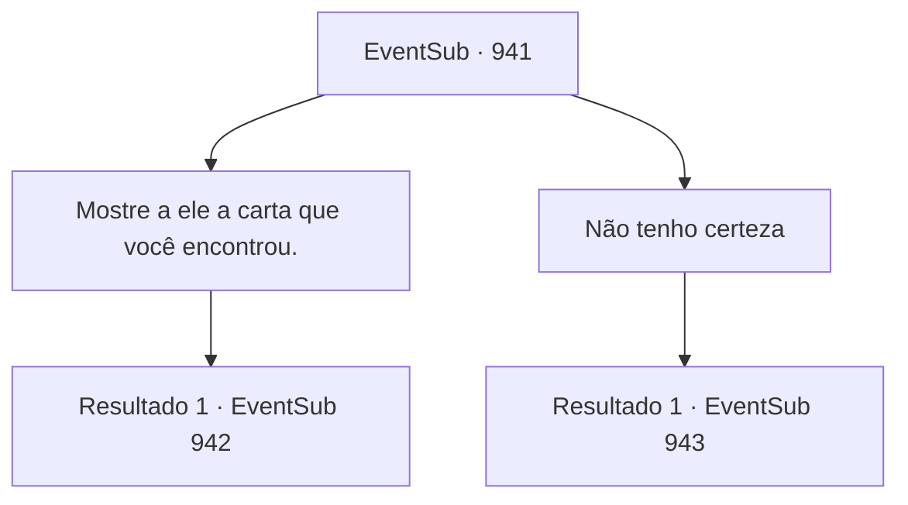

# Eventos secundários · 941

[Índice da tabela](index.md) · [Índice geral](../index.md)

ID: `pt:EventSub:941` · Fonte: `EventSub4` · Versão: 1.2.47.

Mapeamento estático dos arquivos; a disponibilidade e a execução dependem do estado da run.

## Texto do evento

*Sem texto no arquivo.*

## Dados de entrada

```json
{
  "id": 941,
  "grade": 1,
  "subEvent": "",
  "required": ""
}
```

## Mapa das escolhas



## Escolhas e resultados

### Escolha 1

Mostre a ele a carta que você encontrou.

Requisitos e outros campos da escolha:

```json
{
  "required": "8_365_1"
}
```

#### Resultado 1.1

A expressão de Lupin escurece de raiva enquanto ele passa os olhos pela carta. Agora tudo faz sentido... Então Lukas era um ratinho traiçoeiro o tempo todo. Ele bajula o Conde, fingindo lealdade, mas por trás das cortinas ele estava preparando coisas tão indescritíveis com Hazel!

Continuação registrada: [Evento 942](0942.md) na mesma tabela.

```json
{
  "required": "",
  "chance": "1",
  "nextEvent": 942,
  "type": 2,
  "reward": "4_365_1"
}
```

### Escolha 2

Não tenho certeza

Requisitos e outros campos da escolha:

```json
{
  "required": ""
}
```

#### Resultado 2.1

Lupin estala a língua para mostrar sua decepção. 

 "Ah, bem. Agradeço novamente de qualquer forma. O Conde em breve entrará em contato com você, aventureiro. Agora, desejo-lhe sorte em suas viagens."

 Ele se despede de você e se prepara para partir com Edward. Mas então, Edward olha para ele e fala. 

 "E- espere..."

 Edward finalmente reúne coragem. 

 "A Erina não pode... hum, vir conosco?"

 Você pode perceber que Erina já está animada com essa ideia. Ela já está olhando para Lupin. Lupin esboça um sorriso, mas você pode ver que é forçado. 

 "Embora eu adorasse fazer isso, Jovem Mestre, é perigoso lá fora. Os pais de Erina também vão ficar preocupados."


Continuação registrada: [Evento 943](0943.md) na mesma tabela.

```json
{
  "required": "",
  "chance": "1",
  "nextEvent": 943,
  "type": 2,
  "reward": "12_12_2"
}
```

## Referências que chegam a este evento

- [Evento 940 · escolha 1 · resultado 1](0940.md#escolha-1)
