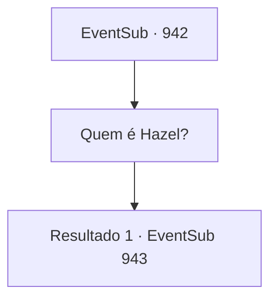

# Eventos secundários · 942

[Índice da tabela](index.md) · [Índice geral](../index.md)

ID: `pt:EventSub:942` · Fonte: `EventSub4` · Versão: 1.2.47.

Mapeamento estático dos arquivos; a disponibilidade e a execução dependem do estado da run.

## Texto do evento

*Sem texto no arquivo.*

## Dados de entrada

```json
{
  "id": 942,
  "grade": 1,
  "subEvent": "",
  "required": ""
}
```

## Mapa das escolhas



## Escolhas e resultados

### Escolha 1

Quem é Hazel?

Requisitos e outros campos da escolha:

```json
{
  "required": ""
}
```

#### Resultado 1.1

Hazel é a segunda esposa do Conde Ronan. Aquela mulher ingrata! O Conde a acolhe de sua família humilde e é assim que ela o retribui?! Isso é inaceitável! Lupin logo consegue se acalmar, então começa a murmurar. Espere... Se o Jovem Mestre Edward voltasse, quem sabe que novos planos os vilões poderiam tramar... Após cuidadosa consideração, Lupin finalmente entrega sua conclusão, colocando a mão em seu ombro. Devo pedir que você encontre Lukas e... elimine-o. Eu assumirei total responsabilidade por qualquer coisa que aconteça depois disso. Por favor, ajude-me a corrigir as coisas. De uma vez por todas. Ele se despede de você e se prepara para partir com Edward. Mas então, Edward olha para ele e fala. E- espere... Edward finalmente reúne coragem. A Erina não pode... hum, vir conosco? Você pode perceber que Erina já está animada com essa ideia. Ela já está olhando fixamente para Lupin. Lupin esboça um sorriso, mas você pode ver que é forçado. Embora eu adorasse fazer isso, Jovem Mestre, é perigoso lá fora. Os pais de Erina também vão ficar preocupados.

Continuação registrada: [Evento 943](0943.md) na mesma tabela.

```json
{
  "required": "",
  "chance": "1",
  "nextEvent": 943,
  "type": 2,
  "reward": "12_12_3"
}
```

## Referências que chegam a este evento

- [Evento 941 · escolha 1 · resultado 1](0941.md#escolha-1)
