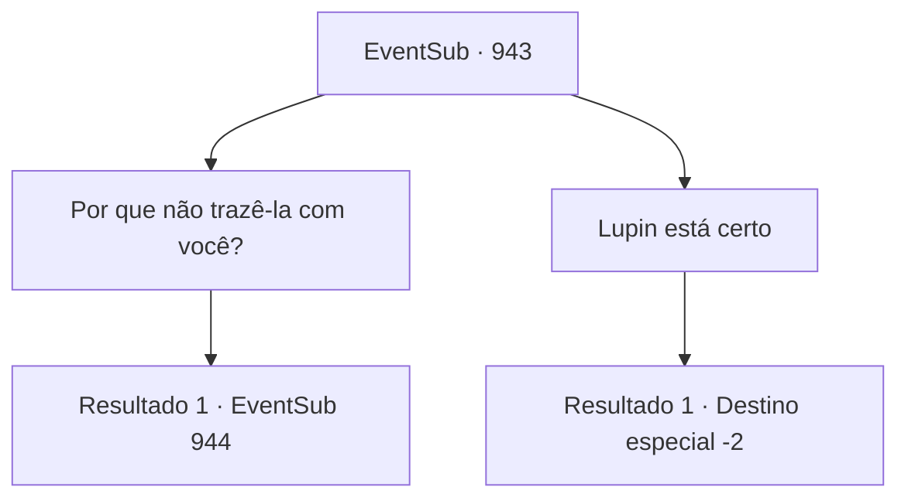

# Eventos secundários · 943

[Índice da tabela](index.md) · [Índice geral](../index.md)

ID: `pt:EventSub:943` · Fonte: `EventSub4` · Versão: 1.2.47.

Mapeamento estático dos arquivos; a disponibilidade e a execução dependem do estado da run.

## Texto do evento

*Sem texto no arquivo.*

## Dados de entrada

```json
{
  "id": 943,
  "grade": 1,
  "subEvent": "",
  "required": ""
}
```

## Mapa das escolhas



## Escolhas e resultados

### Escolha 1

Por que não trazê-la com você?

Requisitos e outros campos da escolha:

```json
{
  "required": ""
}
```

#### Resultado 1.1

Lupin responde soltando um longo suspiro. 

 "Você está tornando isso ainda mais difícil... Sim, todo item dentro das terras do Conde é legitimamente dele, mas mover uma pessoa como um objeto é uma história diferente. Mesmo que conseguíssemos que os pais dela concordassem com isso, como você planeja trazer a garota de volta para esta vila?"


Continuação registrada: [Evento 944](0944.md) na mesma tabela.

```json
{
  "required": "",
  "chance": "1",
  "nextEvent": 944,
  "type": 2,
  "reward": ""
}
```

### Escolha 2

Lupin está certo

Requisitos e outros campos da escolha:

```json
{
  "required": ""
}
```

#### Resultado 2.1

Você apoia Lupin. Você percebe que Edward fica triste ao ouvir isso, apenas pela maneira como ele fala. 

 "Desculpe... Eu não deveria ter mencionado isso desde o início."

 Erina dá um tapinha nas costas dele, tentando animá-lo. 

 "Tudo bem! Só teremos que nos ver em outra ocasião! Porque somos AMIGOS!"

 "C- certo... Amigo..."

 Edward tenta dizer algo, mas não consegue. Então, Lupin se aproxima de Edward, segurando firmemente suas mãos. 

 "Vamos nos mover, Jovem Mestre."

 Ele ajuda Edward a subir em seu cavalo e depois sobe também. 

 "De qualquer forma, agradeço mais uma vez por toda a ajuda. Meu senhor entrará em contato com você em breve. Até lá, desejo-lhe sorte em suas viagens."

 Ele se despede de você e parte.

Continuação registrada: [Destino especial `-2`](../destinos-especiais.md).

```json
{
  "required": "",
  "chance": "1",
  "nextEvent": -2,
  "type": 2,
  "reward": ""
}
```

## Referências que chegam a este evento

- [Evento 941 · escolha 2 · resultado 1](0941.md#escolha-2)
- [Evento 942 · escolha 1 · resultado 1](0942.md#escolha-1)
