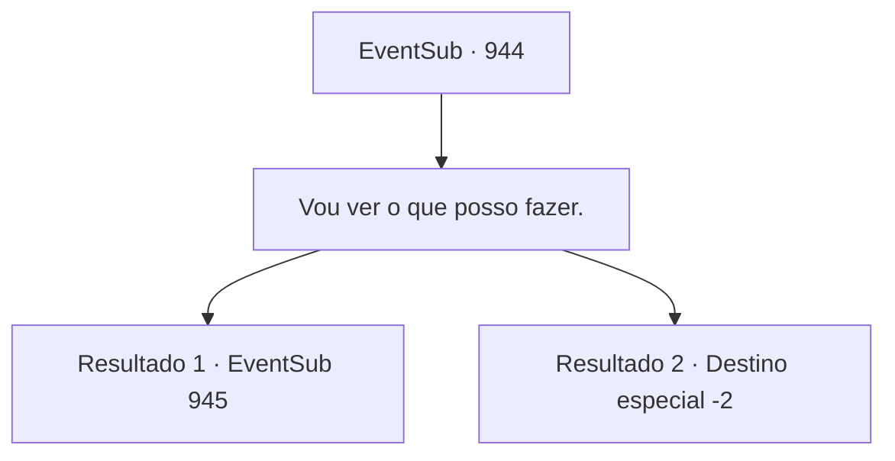

# Eventos secundários · 944

[Índice da tabela](index.md) · [Índice geral](../index.md)

ID: `pt:EventSub:944` · Fonte: `EventSub4` · Versão: 1.2.47.

Mapeamento estático dos arquivos; a disponibilidade e a execução dependem do estado da run.

## Texto do evento

*Sem texto no arquivo.*

## Dados de entrada

```json
{
  "id": 944,
  "grade": 1,
  "subEvent": "",
  "required": ""
}
```

## Mapa das escolhas



## Escolhas e resultados

### Escolha 1

Vou ver o que posso fazer.

Requisitos e outros campos da escolha:

```json
{
  "required": ""
}
```

#### Resultado 1.1

Lupin solta um longo suspiro e então continua. 

 "Não faço ideia do porquê você está insistindo nisso, mas... Claro, vá em frente. Encontre-se com os pais da Erina e veja se consegue convencê-los a se separar da filha ou algo assim. Uma vez que você conseguir isso, prometo que a deixarei montar o cavalo também."

 Erina sorri brilhantemente e puxa suas mãos. 

 "Venha, venha! Vamos! Bem ali!"

 A casa de Erina fica bem ao lado do local onde você e Lupin se encontraram, perto do moinho de água. É uma cabana humilde localizada nos arredores da vila. Cercas de madeira antigas e mal conservadas marcam uma pequena área para o cultivo de plantas. A porta já está aberta - você entra cuidadosamente, para encontrar quem deve ser a mãe de Erina. Assim que ela vê a filha, suspira. 

 "O que você andou aprontando hoje, hein..."

 Ela então olha para cima, percebendo que você a acompanhou no caminho. 

 "Ahem... E quem é você? O que você quer de nós?"

 Ela te lança um olhar cauteloso, posicionando-se subconscientemente entre você e Erina.

Continuação registrada: [Evento 945](0945.md) na mesma tabela.

```json
{
  "required": "",
  "chance": "1|0_12_1",
  "nextEvent": 945,
  "type": 0,
  "reward": ""
}
```

#### Resultado 1.2

Você tenta convencer Lupin, mas ele permanece inflexível. 

 "Já chega. Não quero me sobrecarregar voluntariamente. Minha missão é levar o Jovem Mestre Edward para um lugar seguro. Nada mais."

 Ele ajuda Edward a subir em seu cavalo e depois monta também. 

 "De qualquer forma, agradeço mais uma vez por toda a ajuda. Meu senhor entrará em contato com você em breve. Até lá, desejo-lhe sorte em suas viagens."

 Ele se despede de você e parte.

Continuação registrada: [Destino especial `-2`](../destinos-especiais.md).

```json
{
  "required": "",
  "chance": "16",
  "nextEvent": -2,
  "type": 1,
  "reward": ""
}
```

## Referências que chegam a este evento

- [Evento 943 · escolha 1 · resultado 1](0943.md#escolha-1)
