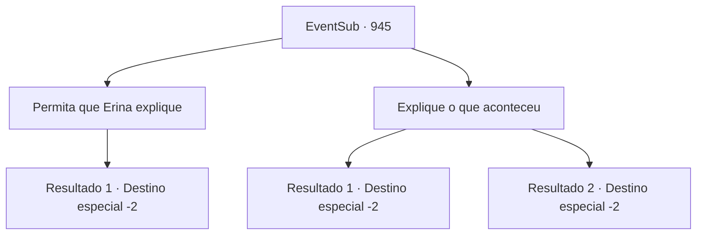

# Eventos secundários · 945

[Índice da tabela](index.md) · [Índice geral](../index.md)

ID: `pt:EventSub:945` · Fonte: `EventSub4` · Versão: 1.2.47.

Mapeamento estático dos arquivos; a disponibilidade e a execução dependem do estado da run.

## Texto do evento

*Sem texto no arquivo.*

## Dados de entrada

```json
{
  "id": 945,
  "grade": 1,
  "subEvent": "",
  "required": ""
}
```

## Mapa das escolhas



## Escolhas e resultados

### Escolha 1

Permita que Erina explique

Requisitos e outros campos da escolha:

```json
{
  "required": ""
}
```

#### Resultado 1.1

Erina começa a contar à sua mãe as aventuras que teve hoje. À medida que suas histórias de aventura progridem, você percebe o rosto da mãe ficando cada vez mais chocado. Depois que sua história chega ao fim, ela começa a culpá-lo. 

 "Você se atreve a levar minha filhinha a lugares tão perigosos?! Você está fora de si? E agora quer levá-la ao castelo do Conde?"

 Ela anuncia firmemente sua decisão, abraçando Erina com força. 

 "MINHA RESPOSTA É NÃO! Como posso confiar em você para cuidar da minha filha?! E você, Erina - pare de falar bobagens e vá para o seu quarto!"

  Você retorna a Lupin para lhe contar que falhou em convencer a mãe de Erina. Lupin simplesmente dá de ombros e sorri, como se essa fosse a notícia que ele esperava ouvir. 

 "Bom. Minha missão é levar o Jovem Mestre Edward para segurança. Nada mais."

 Ele ajuda Edward a subir em seu cavalo, depois monta ele mesmo. 

 "De qualquer forma, agradeço mais uma vez por toda a ajuda. Meu senhor entrará em contato com você em breve. Até lá, desejo-lhe sorte em suas viagens."

 Ele se despede de você, conduz seu cavalo e parte.

Continuação registrada: [Destino especial `-2`](../destinos-especiais.md).

```json
{
  "required": "",
  "chance": "1",
  "nextEvent": -2,
  "type": 2,
  "reward": ""
}
```

### Escolha 2

Explique o que aconteceu

Requisitos e outros campos da escolha:

```json
{
  "required": ""
}
```

#### Resultado 2.1

Você nota o olhar preocupado nos olhos da mãe e faz o seu melhor para fazer a 'aventura' de Erina com você parecer o mais segura possível. Você enfatiza especialmente a parte em que Erina teve um papel crucial em salvar o filho do Conde Ronan na mina de prata. 

 "...Então você está dizendo que Erina ajudou a salvar o bebê do Conde? E é por isso que ela precisa visitar o castelo?"

 Ainda não totalmente convencida, a mulher continua a olhar cuidadosamente para você. Erina prontamente intervém para falar. 

 "Certo! Tem um cavaleiro me esperando lá embaixo na colina! Qual era o nome dele... ah, Sr. Lupin! Isso mesmo!"

 A mãe de Erina examina a área. Seu olhar preocupado se desfaz. Ela então solta um suspiro e finalmente acena com a cabeça. 

 "Então é verdade, realmente há um cavaleiro esperando... Ok, tudo bem. Mas certifique-se de trazê-la de volta sã e salva!"

 Você retorna para Lupin com Erina. Edward parece satisfeito ao ver isso, mas a expressão de Lupin diz o contrário. 

 "Oh, bem... Ok. Acho que é uma coisa boa, no final? O Jovem Mestre parece realmente feliz..."

 Ele solta um longo suspiro, ajuda tanto Erina quanto Edward a subir no cavalo, depois pega o cavalo pelas rédeas. 

 "De qualquer forma, agradeço mais uma vez por toda a ajuda. Meu senhor entrará em contato com você em breve. Até lá, desejo-lhe sorte em suas viagens."

 Ele se despede de você e parte.

Continuação registrada: [Destino especial `-2`](../destinos-especiais.md).

```json
{
  "required": "",
  "chance": "1|0_7_1",
  "nextEvent": -2,
  "type": 0,
  "reward": "5_792_1"
}
```

#### Resultado 2.2

Você descreve as aventuras que você e Erina tiveram hoje. À medida que suas histórias de aventura progridem, você percebe o rosto da mãe ficando cada vez mais chocado. 

 "Você se atreve a levar minha filhinha a lugares tão perigosos?! Você está fora de si? E agora quer levá-la ao castelo do Conde?"

 Ela anuncia firmemente sua decisão, abraçando Erina com força. 

 "MINHA RESPOSTA É NÃO! Como posso confiar em você para cuidar da minha filha?! E você, Erina - pare de falar bobagens e vá para o seu quarto!"

  Você volta para Lupin para lhe contar que falhou em convencer a mãe de Erina. Lupin simplesmente dá de ombros e sorri, como se essa fosse a notícia que ele esperava ouvir. 

 "Bom. Minha missão é levar o Jovem Mestre Edward para um lugar seguro. Nada mais."

 Ele ajuda Edward a subir em seu cavalo, depois monta na sela. 

 "De qualquer forma, agradeço mais uma vez por toda a ajuda. Meu senhor entrará em contato com você em breve. Até lá, desejo-lhe sorte em suas viagens."

 Ele se despede de você, guia seu cavalo e parte.

Continuação registrada: [Destino especial `-2`](../destinos-especiais.md).

```json
{
  "required": "",
  "chance": "14",
  "nextEvent": -2,
  "type": 1,
  "reward": ""
}
```

## Referências que chegam a este evento

- [Evento 944 · escolha 1 · resultado 1](0944.md#escolha-1)
