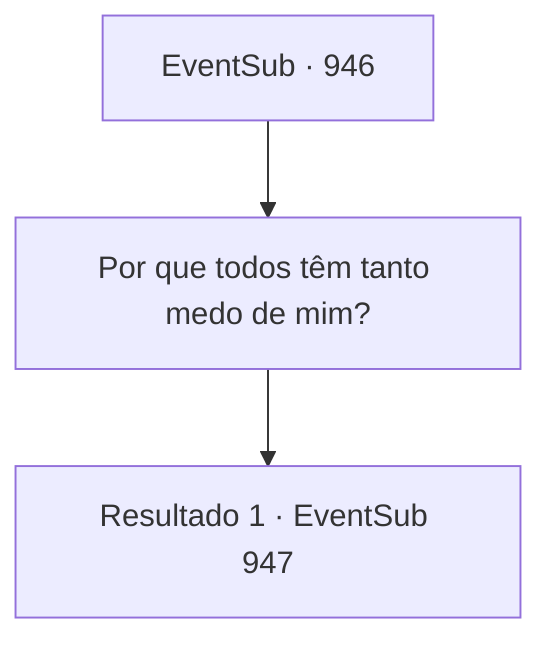

# Eventos secundários · 946

[Índice da tabela](index.md) · [Índice geral](../index.md)

ID: `pt:EventSub:946` · Fonte: `EventSub4` · Versão: 1.2.47.

Mapeamento estático dos arquivos; a disponibilidade e a execução dependem do estado da run.

## Texto do evento

*Sem texto no arquivo.*

## Dados de entrada

```json
{
  "id": 946,
  "grade": 1,
  "subEvent": "",
  "required": ""
}
```

## Mapa das escolhas



## Escolhas e resultados

### Escolha 1

Por que todos têm tanto medo de mim?

Requisitos e outros campos da escolha:

```json
{
  "required": ""
}
```

#### Resultado 1.1

O velho lhe conta sobre a época em que os moradores da vila juntaram dinheiro para contratar homens capazes de lidar com o diabo. 

 "Mas a maioria deles falhou e fugiu. Alguns... nunca voltaram. Ou pior, foram encontrados mortos."

 Ele dirige seu olhar para a igreja da cidade em construção. 

 "E então surge o Bispo Lukas do nada e declara que selou o diabo na mina de prata. Tenho certeza de que agora você entende por que os moradores não gostam tanto de aventureiros ou mercenários."


Continuação registrada: [Evento 947](0947.md) na mesma tabela.

```json
{
  "required": "",
  "chance": "1",
  "nextEvent": 947,
  "type": 2,
  "reward": ""
}
```

## Referências que chegam a este evento

- [Evento 909 · escolha 3 · resultado 1](0909.md#escolha-3)
