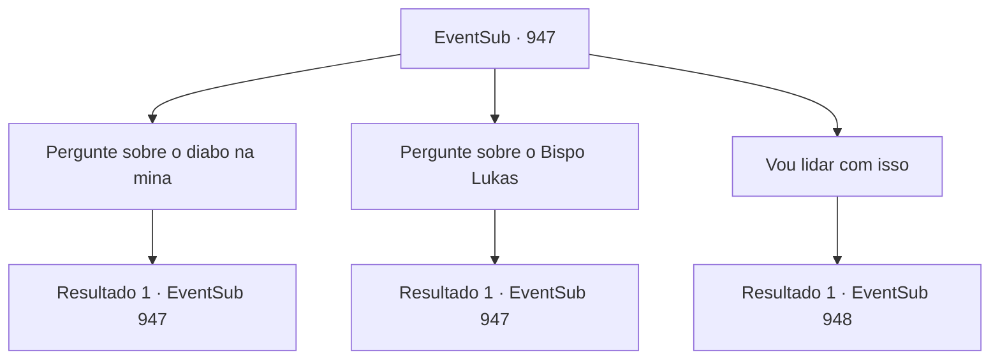

# Eventos secundários · 947

[Índice da tabela](index.md) · [Índice geral](../index.md)

ID: `pt:EventSub:947` · Fonte: `EventSub4` · Versão: 1.2.47.

Mapeamento estático dos arquivos; a disponibilidade e a execução dependem do estado da run.

## Texto do evento

*Sem texto no arquivo.*

## Dados de entrada

```json
{
  "id": 947,
  "grade": 1,
  "subEvent": "",
  "required": ""
}
```

## Mapa das escolhas



## Escolhas e resultados

### Escolha 1

Pergunte sobre o diabo na mina

Requisitos e outros campos da escolha:

```json
{
  "required": "5_793_0"
}
```

#### Resultado 1.1

Você pede ao velho mais informações sobre esse diabo. Mas o homem apenas balança a cabeça em resposta, dizendo que não será de muita ajuda. 

 "Nunca vi esse diabo pessoalmente, porque nunca tive a chance de entrar na mina em primeiro lugar. Mas..."

 Ele remonta suas memórias e então continua. 

 "Eu realmente fiquei cara a cara com um diabo quando era mais jovem."

 Ele começa a contar toda uma história de seus companheiros aventureiros e cavaleiros que foram enviados para derrotar aquele diabo, a maioria dos quais foi morta no processo. 

 "Uma criatura temível e beligerante, aquela. Um encontro verdadeiramente horripilante."

 O velho suspira novamente, então volta seu olhar para a mina. 

 "Se todos os aventureiros que entraram na mina realmente foram derrotados pelo diabo, então presumo que não seja um monstro comum. Mas um bispo e alguns de seus homens conseguindo fazer o trabalho assim tão facilmente? Difícil de acreditar, para ser honesto."

 Com mais um suspiro, o velho continua. 

 "A mina de prata era praticamente a única fonte de renda confiável da aldeia. A aldeia vai passar fome a menos que volte a funcionar. Ah, se ao menos alguém lidasse com aquele diabo..."


Continuação registrada: [Evento 947](0947.md) na mesma tabela.

```json
{
  "required": "",
  "chance": "1",
  "nextEvent": 947,
  "type": 2,
  "reward": "5_793_1"
}
```

### Escolha 2

Pergunte sobre o Bispo Lukas

Requisitos e outros campos da escolha:

```json
{
  "required": "5_794_0"
}
```

#### Resultado 2.1

O velho coça a cabeça na tentativa de recordar informações. 

 "Bem... Tudo o que sei sobre ele é que é um clérigo do Deus do Amor. Nunca falei com ele pessoalmente."

 Mas ele logo acrescenta que testemunhou Lukas entrando e saindo da mina várias vezes. 

 "Uma vez perguntei a esse homem, que tipo de negócio o arrasta de volta para aquele lugar miserável repetidamente."

 Você ouve o velho em silêncio. 

 "A resposta dele foi que o selo precisa ser verificado regularmente. Mas... Não acho que seja isso que está realmente acontecendo."

 O velho balança a cabeça e termina sua resposta.

Continuação registrada: [Evento 947](0947.md) na mesma tabela.

```json
{
  "required": "",
  "chance": "1",
  "nextEvent": 947,
  "type": 2,
  "reward": "5_794_1"
}
```

### Escolha 3

Vou lidar com isso

Requisitos e outros campos da escolha:

```json
{
  "required": ""
}
```

#### Resultado 3.1

Por um breve momento, os olhos do velho brilham com esperança. Mas logo, seus olhos voltam ao normal enquanto ele balança a cabeça em resposta. 

 "O Bispo Lukas tem seus homens posicionados como guardas na entrada da mina. Eles têm impedido todos de entrar na mina."

 Ele acrescenta que não será fácil passar por eles.

Continuação registrada: [Evento 948](0948.md) na mesma tabela.

```json
{
  "required": "",
  "chance": "1",
  "nextEvent": 948,
  "type": 2,
  "reward": ""
}
```

## Referências que chegam a este evento

- [Evento 946 · escolha 1 · resultado 1](0946.md#escolha-1)
- [Evento 947 · escolha 1 · resultado 1](0947.md#escolha-1)
- [Evento 947 · escolha 2 · resultado 1](0947.md#escolha-2)
