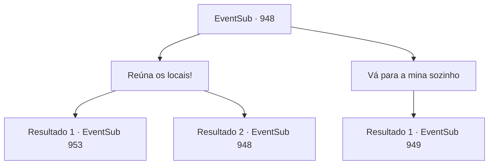

# Eventos secundários · 948

[Índice da tabela](index.md) · [Índice geral](../index.md)

ID: `pt:EventSub:948` · Fonte: `EventSub4` · Versão: 1.2.47.

Mapeamento estático dos arquivos; a disponibilidade e a execução dependem do estado da run.

## Texto do evento

*Sem texto no arquivo.*

## Dados de entrada

```json
{
  "id": 948,
  "grade": 1,
  "subEvent": "",
  "required": ""
}
```

## Mapa das escolhas



## Escolhas e resultados

### Escolha 1

Reúna os locais!

Requisitos e outros campos da escolha:

```json
{
  "required": "5_795_0"
}
```

#### Resultado 1.1

Com a ajuda do velho, você consegue reunir um número adequado de locais. Eles se reuniram ao redor do poço no centro da praça da cidade para ouvir você. As pessoas são imediatamente capturadas por seu carisma e lógica impecável. Você prossegue para liderar o grupo de aldeões até a mina. Os guardas respondem ameaçando você com suas lanças. 

 "RETORNEM IMEDIATAMENTE! O Bispo ordenou claramente que NINGUÉM deve entrar na mina de prata!"

 Os aldeões irritados respondem furiosamente. 

 "SE VOCÊS QUEREM QUE TEMAMOS ESSE DEMÔNIO, MOSTREM-NOS!!"

 "QUANDO PODEREMOS TRABALHAR NA MINA NOVAMENTE?!"

 Os guardas sozinhos não são suficientes para parar a multidão furiosa. Esses aldeões são todos ex-mineiros; com picaretas na mão, eles parecem preparados para bater em qualquer coisa que se interponha em seu caminho. A mina abandonada está envolta em escuridão total. Confiando em uma luz fraca, você avança cuidadosamente. O cheiro de ferro e umidade enche o ar. Você logo se depara com outro grupo de soldados no caminho. 

 "H- HÃ?! Como diabos vocês todos entraram?!"

 Surpresos, os soldados rapidamente sacam suas lanças e preparam formações. A tensão começa a aumentar entre os aldeões e os soldados.

Continuação registrada: [Evento 953](0953.md) na mesma tabela.

```json
{
  "required": "",
  "chance": "1|0_12_1",
  "nextEvent": 953,
  "type": 0,
  "reward": ""
}
```

#### Resultado 1.2

Com a ajuda do velho, você consegue reunir um número adequado de moradores. Eles se reuniram ao redor do poço no centro da praça da cidade para ouvir você. Mas seu discurso não consegue capturar seus corações. 

 "Não estamos interessados. Por que você não vai sozinho?"

 Os moradores todos deixam a praça e voltam para suas casas.

Continuação registrada: [Evento 948](0948.md) na mesma tabela.

```json
{
  "required": "",
  "chance": "25",
  "nextEvent": 948,
  "type": 1,
  "reward": "5_795_9"
}
```

### Escolha 2

Vá para a mina sozinho

Requisitos e outros campos da escolha:

```json
{
  "required": ""
}
```

#### Resultado 2.1

Sozinho, você se aproxima da mina de prata. Os guardas lá te avistam e respondem gritando com lanças em punho. 

 "RETORNE IMEDIATAMENTE! O Bispo ordenou claramente que NINGUÉM deve entrar na mina de prata!"


Continuação registrada: [Evento 949](0949.md) na mesma tabela.

```json
{
  "required": "",
  "chance": "1",
  "nextEvent": 949,
  "type": 2,
  "reward": ""
}
```

## Referências que chegam a este evento

- [Evento 947 · escolha 3 · resultado 1](0947.md#escolha-3)
- [Evento 948 · escolha 1 · resultado 2](0948.md#escolha-1)
