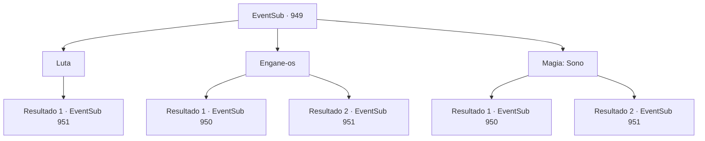

# Eventos secundários · 949

[Índice da tabela](index.md) · [Índice geral](../index.md)

ID: `pt:EventSub:949` · Fonte: `EventSub4` · Versão: 1.2.47.

Mapeamento estático dos arquivos; a disponibilidade e a execução dependem do estado da run.

## Texto do evento

*Sem texto no arquivo.*

## Dados de entrada

```json
{
  "id": 949,
  "grade": 1,
  "subEvent": "",
  "required": ""
}
```

## Mapa das escolhas



## Escolhas e resultados

### Escolha 1

Luta

Requisitos e outros campos da escolha:

```json
{
  "required": ""
}
```

#### Resultado 1.1

Você ataca os soldados. Eles imediatamente revidam, brandindo suas lanças.

Continuação registrada: [Evento 951](0951.md) na mesma tabela.

```json
{
  "required": "",
  "chance": "1",
  "nextEvent": 951,
  "type": 2,
  "reward": "6_0_135",
  "place": 6
}
```

### Escolha 2

Engane-os

Requisitos e outros campos da escolha:

```json
{
  "required": ""
}
```

#### Resultado 2.1

Você diz a eles que é 'um amigo próximo' do Bispo Lukas, aqui para verificar a segurança da mina em seu lugar. Eles são completamente enganados pela sua atitude confiante. 

 "Oh - desculpe! Nada fora do comum."

 Você pega despreocupadamente uma tocha de um dos soldados, avançando mais para dentro da mina. A mina abandonada está envolta em escuridão total. Confiando em uma luz fraca, você avança cuidadosamente. O cheiro de ferro, umidade e silêncio preenche o ar. Após alguns minutos de caminhada, você se depara com dois soldados patrulhando. 

 "H- HÃ?! Quem diabos é você?!"

 Você usa o mesmo truque para enganá-los. Eles não parecem totalmente convencidos, mas deixam você passar de qualquer maneira.

Continuação registrada: [Evento 950](0950.md) na mesma tabela.

```json
{
  "required": "",
  "chance": "1|0_12_1",
  "nextEvent": 950,
  "type": 0,
  "reward": "3_42_1|5_790_1"
}
```

#### Resultado 2.2

Você diz a eles que é 'um amigo próximo' do Bispo Lukas, aqui para verificar a segurança da mina em seu lugar. Mas ou os guardas eram mais perceptivos do que você esperava, ou sua atuação era ainda mais horrível do que você pensava. 

 "Besteira! Cai fora."

 Eles atacam você imediatamente, apontando suas lanças na sua direção.

Continuação registrada: [Evento 951](0951.md) na mesma tabela.

```json
{
  "required": "",
  "chance": "16",
  "nextEvent": 951,
  "type": 1,
  "reward": "6_0_135",
  "place": 6
}
```

### Escolha 3

Magia: Sono

Requisitos e outros campos da escolha:

```json
{
  "required": "20_0_1|1_1_2"
}
```

#### Resultado 3.1

Você rapidamente lança um feitiço para colocá-los para dormir. 

 "Uh... Ughhhhh..."

 Os soldados caem em um sono tranquilo. Isso lhe dá tempo para explorar a mina de prata sem ser perturbado. Você saqueia as tochas dos corpos inconscientes e vai mais fundo. A mina abandonada está envolta em escuridão total. Confiando em uma luz fraca, você avança cuidadosamente. O cheiro de ferro, umidade e silêncio preenche o ar. Depois de alguns minutos de caminhada, você se depara com dois soldados patrulhando. 

 "H- HÃ?! Quem diabos é você?!"

 Assim como da última vez, você usa sua magia mais uma vez para lidar com eles.

Continuação registrada: [Evento 950](0950.md) na mesma tabela.

```json
{
  "required": "",
  "chance": "1|0_7_1|0_12_1",
  "nextEvent": 950,
  "type": 0,
  "reward": "3_42_1|0_1_-1|5_790_1"
}
```

#### Resultado 3.2

Você tenta lançar magia, mas eles não estão deixando você fazer isso. 

 "Feitiçaria vil! Como se fôssemos deixar você!"

 Os soldados sacam suas lanças e avançam contra você.

Continuação registrada: [Evento 951](0951.md) na mesma tabela.

```json
{
  "required": "",
  "chance": "22",
  "nextEvent": 951,
  "type": 1,
  "reward": "6_0_135",
  "place": 6
}
```

## Referências que chegam a este evento

- [Evento 948 · escolha 2 · resultado 1](0948.md#escolha-2)
