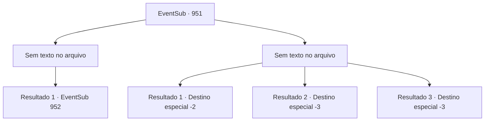

# Eventos secundários · 951

[Índice da tabela](index.md) · [Índice geral](../index.md)

ID: `pt:EventSub:951` · Fonte: `EventSub4` · Versão: 1.2.47.

Mapeamento estático dos arquivos; a disponibilidade e a execução dependem do estado da run.

## Texto do evento

*Sem texto no arquivo.*

## Dados de entrada

```json
{
  "id": 951,
  "grade": 1,
  "subEvent": "",
  "required": ""
}
```

## Mapa das escolhas



## Escolhas e resultados

### Escolha 1

*Sem texto no arquivo; o papel dessa opção depende da interface do jogo.*

Requisitos e outros campos da escolha:

```json
{
  "required": ""
}
```

#### Resultado 1.1

Você luta com os guardas na entrada, nocauteando um deles. O outro, no entanto, consegue fugir para dentro da mina. Você saqueia a tocha do soldado nocauteado e entra na mina. A mina abandonada está envolta em uma escuridão total. Confiando em uma luz fraca, você avança cuidadosamente. O cheiro de ferro, umidade e silêncio preenche o ar. Após alguns minutos de caminhada, você se depara com dois soldados patrulhando. Eles imediatamente avançam contra você com suas lanças.

Continuação registrada: [Evento 952](0952.md) na mesma tabela.

```json
{
  "required": "",
  "chance": "1",
  "nextEvent": 952,
  "type": 2,
  "reward": "3_42_1|6_3_135",
  "place": 6
}
```

### Escolha 2

*Sem texto no arquivo; o papel dessa opção depende da interface do jogo.*

Requisitos e outros campos da escolha:

```json
{
  "required": ""
}
```

#### Resultado 2.1

Os soldados te dão uma boa surra. Infelizmente, você não tem escolha a não ser deixar a vila, incapaz de cumprir o pedido de Lupin. Lupin está esperando por você fora da vila. 

 "Encontrou alguma coisa?"

 Você balança a cabeça. Você pode perceber que Lupin está desapontado ao ouvir a notícia. 

 "Entendo. Obrigado pela ajuda."

 Você se despede dele e retorna à sua aventura.

Continuação registrada: [Destino especial `-2`](../destinos-especiais.md).

```json
{
  "required": "1_0_2|1_1_2",
  "chance": "1",
  "nextEvent": -2,
  "type": 2,
  "reward": "12_12_-1"
}
```

#### Resultado 2.2

Os guardas te empurram com suas lanças. Infelizmente, sua aventura chega ao fim.

Continuação registrada: [Destino especial `-3`](../destinos-especiais.md).

```json
{
  "required": "2_0_2",
  "chance": "1",
  "nextEvent": -3,
  "type": 2,
  "reward": "0_0_-1|0_1_-1"
}
```

#### Resultado 2.3

Os guardas te empurram com suas lanças. Infelizmente, sua aventura chega ao fim.

Continuação registrada: [Destino especial `-3`](../destinos-especiais.md).

```json
{
  "required": "2_1_2",
  "chance": "1",
  "nextEvent": -3,
  "type": 2,
  "reward": "0_0_-1|0_1_-1"
}
```

## Referências que chegam a este evento

- [Evento 949 · escolha 1 · resultado 1](0949.md#escolha-1)
- [Evento 949 · escolha 2 · resultado 2](0949.md#escolha-2)
- [Evento 949 · escolha 3 · resultado 2](0949.md#escolha-3)
