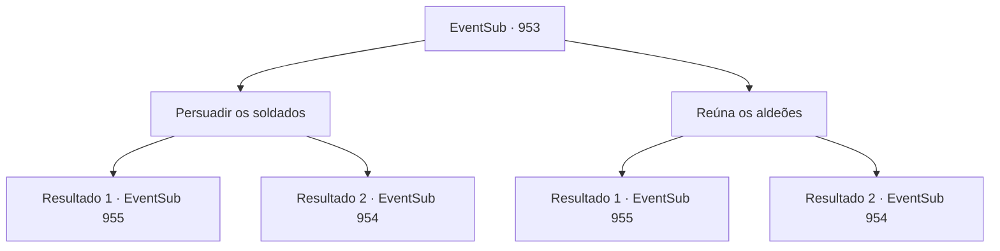

# Eventos secundários · 953

[Índice da tabela](index.md) · [Índice geral](../index.md)

ID: `pt:EventSub:953` · Fonte: `EventSub4` · Versão: 1.2.47.

Mapeamento estático dos arquivos; a disponibilidade e a execução dependem do estado da run.

## Texto do evento

*Sem texto no arquivo.*

## Dados de entrada

```json
{
  "id": 953,
  "grade": 1,
  "subEvent": "",
  "required": ""
}
```

## Mapa das escolhas



## Escolhas e resultados

### Escolha 1

Persuadir os soldados

Requisitos e outros campos da escolha:

```json
{
  "required": ""
}
```

#### Resultado 1.1

Você persuade com sucesso os soldados com uma lógica impecável. Eles recuam suas lanças, abrindo caminho para o seu grupo. Você lidera as pessoas até o nível mais profundo da mina. 

 Enquanto você segue o trilho no chão da mina, ouve gemidos - alguém está com dor. Você rastreia o som até sua origem. Você chega a um espaço estreito, que não parece tão abandonado em comparação com o resto da mina. Alguns baús de madeira estão espalhados aqui e ali. Você também nota uma mesa, junto com uma pena e alguns pedaços de pergaminho sobre ela. Do outro lado da sala há uma porta de ferro gradeada. Você se aproxima cuidadosamente da porta e olha para dentro. Lá, você nota uma criança pequena, agachada em um canto, tremendo. O menino tem pele pálida e cabelo branco prateado. Você nota hematomas e cicatrizes de chicotadas por todo o corpo dele. Seus olhos estão cheios de medo e confusão. |drawing_chainedEdward|

Continuação registrada: [Evento 955](0955.md) na mesma tabela.

```json
{
  "required": "",
  "chance": "1|0_7_1",
  "nextEvent": 955,
  "type": 0,
  "reward": ""
}
```

#### Resultado 1.2

Você tenta persuadir os soldados. Mas suas palavras não os alcançam. 

 "Você deve ser o líder desta rebelião!"

 Eles avançam contra você com suas lanças.

Continuação registrada: [Evento 954](0954.md) na mesma tabela.

```json
{
  "required": "",
  "chance": "10",
  "nextEvent": 954,
  "type": 1,
  "reward": "6_0_135",
  "place": 1
}
```

### Escolha 2

Reúna os aldeões

Requisitos e outros campos da escolha:

```json
{
  "required": ""
}
```

#### Resultado 2.1

Você inspira os aldeões com um discurso motivador. Atacados pela multidão furiosa, os guardas finalmente fogem do local da mina. 

 "HURRAAAAAYY-!!"

 Após emergirem vitoriosos, os aldeões soltam um grito de excitação. Você lidou com os guardas. Você prossegue para liderar o povo até o nível mais profundo da mina. 

 Enquanto você segue o trilho no chão da mina, ouve gemidos - alguém está com dor. Você rastreia o som até sua origem. Você chega a um espaço estreito, que não parece tão abandonado em comparação com o resto da mina. Alguns baús de madeira estão espalhados aqui e ali. Você também nota uma mesa, junto com uma pena e alguns pedaços de pergaminho sobre ela. Do outro lado da sala há uma porta de ferro gradeada. Você se aproxima cuidadosamente da porta e olha para dentro. Lá, você nota uma criança pequena, agachada em um canto, tremendo. O menino tem pele pálida e cabelo branco-prateado. Você nota hematomas e cicatrizes de chicotadas por todo o corpo dele. Seus olhos estão cheios de medo e confusão. |drawing_chainedEdward|

Continuação registrada: [Evento 955](0955.md) na mesma tabela.

```json
{
  "required": "",
  "chance": "1|0_12_1",
  "nextEvent": 955,
  "type": 0,
  "reward": ""
}
```

#### Resultado 2.2

Você tenta reunir os aldeões para atacar os guardas. Mas suas palavras não os alcançam. Nenhum dos aldeões toma a iniciativa, em vez disso, olham uns para os outros para decidir como agir. Enquanto isso, os guardas se aproximam de você, lanças em punho. 

 "Você deve ser o líder desta rebelião!"


Continuação registrada: [Evento 954](0954.md) na mesma tabela.

```json
{
  "required": "",
  "chance": "10",
  "nextEvent": 954,
  "type": 1,
  "reward": "6_0_135",
  "place": 1
}
```

## Referências que chegam a este evento

- [Evento 948 · escolha 1 · resultado 1](0948.md#escolha-1)
