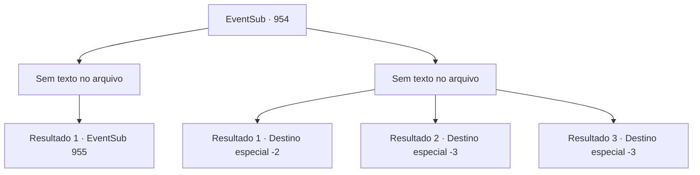

# Eventos secundários · 954

[Índice da tabela](index.md) · [Índice geral](../index.md)

ID: `pt:EventSub:954` · Fonte: `EventSub4` · Versão: 1.2.47.

Mapeamento estático dos arquivos; a disponibilidade e a execução dependem do estado da run.

## Texto do evento

*Sem texto no arquivo.*

## Dados de entrada

```json
{
  "id": 954,
  "grade": 1,
  "subEvent": "",
  "required": ""
}
```

## Mapa das escolhas



## Escolhas e resultados

### Escolha 1

*Sem texto no arquivo; o papel dessa opção depende da interface do jogo.*

Requisitos e outros campos da escolha:

```json
{
  "required": ""
}
```

#### Resultado 1.1

Os guardas não são páreo para você. Eles finalmente fogem do local da mina. 

 "HURRAAAAAYY-!!"

 Após emergirem vitoriosos, os aldeões soltam um grito de excitação. Você lidou com os guardas. Você prossegue para liderar as pessoas até o nível mais profundo da mina.  Enquanto você segue o trilho no chão da mina, ouve gemidos - alguém está com dor. Você rastreia o som até sua origem. Você chega a um espaço estreito, que não parece tão abandonado em comparação com o resto da mina. Alguns baús de madeira estão espalhados aqui e ali. Você também nota uma mesa, junto com uma pena e alguns pedaços de pergaminho sobre ela. Do outro lado da sala há uma porta de ferro gradeada. Você se aproxima cuidadosamente da porta e olha para dentro. Lá, você nota uma criança pequena, agachada em um canto, tremendo. O menino tem pele pálida e cabelo branco-prateado. Você nota hematomas e cicatrizes de chicotadas por todo o corpo dele. Seus olhos estão cheios de medo e confusão. |drawing_chainedEdward|

Continuação registrada: [Evento 955](0955.md) na mesma tabela.

```json
{
  "required": "",
  "chance": "1",
  "nextEvent": 955,
  "type": 2,
  "reward": ""
}
```

### Escolha 2

*Sem texto no arquivo; o papel dessa opção depende da interface do jogo.*

Requisitos e outros campos da escolha:

```json
{
  "required": ""
}
```

#### Resultado 2.1

Os guardas te derrotam na batalha, depois zombam dos aldeões. 

 "Se mais alguém quiser outra surra, fique à vontade!"

 Alguns homens de aparência capaz vão atrás deles. Mas eles também não conseguem fazer muito contra os soldados bem armados. Infelizmente, você e os aldeões são mandados embora da mina, derrotados. 

 "Bem, nós tentamos... Mas acho que é isso."

 Os aldeões voltam para suas casas, entristecidos. Você deixa a aldeia para informar a Lupin que a missão falhou. Você percebe que Lupin fica desapontado ao ouvir a notícia. 

 "Entendo. Obrigado pela ajuda."

 Você se despede dele e retorna à sua aventura.

Continuação registrada: [Destino especial `-2`](../destinos-especiais.md).

```json
{
  "required": "1_0_2|1_1_2",
  "chance": "1",
  "nextEvent": -2,
  "type": 2,
  "reward": "12_12_-1|0_0_-1|0_1_-1"
}
```

#### Resultado 2.2

Os guardas te empurram com suas lanças. Infelizmente, sua aventura chega ao fim.

Continuação registrada: [Destino especial `-3`](../destinos-especiais.md).

```json
{
  "required": "2_0_2",
  "chance": "1",
  "nextEvent": -3,
  "type": 2,
  "reward": "0_0_-1|0_1_-1"
}
```

#### Resultado 2.3

Os guardas te empurram com suas lanças. Infelizmente, sua aventura chega ao fim.

Continuação registrada: [Destino especial `-3`](../destinos-especiais.md).

```json
{
  "required": "2_1_2",
  "chance": "1",
  "nextEvent": -3,
  "type": 2,
  "reward": "0_0_-1|0_1_-1"
}
```

## Referências que chegam a este evento

- [Evento 953 · escolha 1 · resultado 2](0953.md#escolha-1)
- [Evento 953 · escolha 2 · resultado 2](0953.md#escolha-2)
