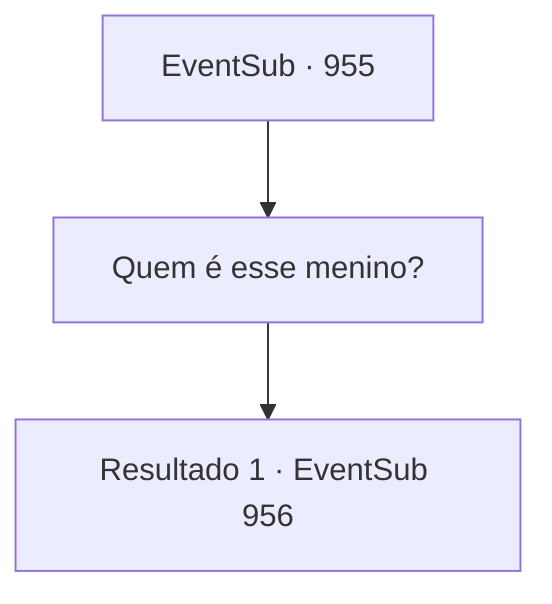

# Eventos secundários · 955

[Índice da tabela](index.md) · [Índice geral](../index.md)

ID: `pt:EventSub:955` · Fonte: `EventSub4` · Versão: 1.2.47.

Mapeamento estático dos arquivos; a disponibilidade e a execução dependem do estado da run.

## Texto do evento

*Sem texto no arquivo.*

## Dados de entrada

```json
{
  "id": 955,
  "grade": 1,
  "subEvent": "",
  "required": ""
}
```

## Mapa das escolhas



## Escolhas e resultados

### Escolha 1

Quem é esse menino?

Requisitos e outros campos da escolha:

```json
{
  "required": ""
}
```

#### Resultado 1.1

Você olha para o grupo de aldeões, perguntando se alguém já viu esse menino antes. Uma das aldeãs - uma mulher de meia-idade - fala, aterrorizada. 

 "P- poderia ser este o diabo de que o Bispo nos falou?!"

 Isso desperta suspeitas entre a multidão. Então, o velho que você conheceu antes sai para a frente para dar uma olhada no menino ele mesmo. Após uma breve inspeção, ele declara sua conclusão. 

 "De jeito nenhum. Este menino não é um diabo."

 Ele rapidamente acrescenta uma evidência para apoiar sua afirmação, provavelmente esperando que as pessoas rebatam. 

 "Eu mesmo lutei contra um diabo, na minha juventude!"


Continuação registrada: [Evento 956](0956.md) na mesma tabela.

```json
{
  "required": "",
  "chance": "1",
  "nextEvent": 956,
  "type": 2,
  "reward": ""
}
```

## Referências que chegam a este evento

- [Evento 953 · escolha 1 · resultado 1](0953.md#escolha-1)
- [Evento 953 · escolha 2 · resultado 1](0953.md#escolha-2)
- [Evento 954 · escolha 1 · resultado 1](0954.md#escolha-1)
