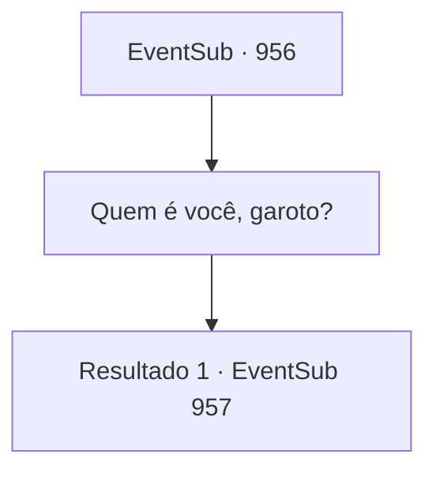

# Eventos secundários · 956

[Índice da tabela](index.md) · [Índice geral](../index.md)

ID: `pt:EventSub:956` · Fonte: `EventSub4` · Versão: 1.2.47.

Mapeamento estático dos arquivos; a disponibilidade e a execução dependem do estado da run.

## Texto do evento

*Sem texto no arquivo.*

## Dados de entrada

```json
{
  "id": 956,
  "grade": 1,
  "subEvent": "",
  "required": ""
}
```

## Mapa das escolhas



## Escolhas e resultados

### Escolha 1

Quem é você, garoto?

Requisitos e outros campos da escolha:

```json
{
  "required": ""
}
```

#### Resultado 1.1

O menino responde com uma voz quase inaudível, sem nem mesmo olhar para você. 

 "E... Eu não sei."

 O menino parece terrivelmente assustado com algo. Seus olhos vermelhos continuam a examinar os arredores, tentando se manter alerta. Os aldeões começam a discutir entre si sobre quem o menino poderia ser. Então, o velho ofega, como se tivesse acabado de perceber algo sério. 

 "Não pode ser...!"

 Um jovem ao lado dele pergunta ao velho o que está acontecendo. 

 "D- diga logo, velho! O que é?"

 Tremendo, o velho responde. 

 "O cabelo branco-prateado... Os olhos vermelhos como carmesim... Há apenas uma pessoa em toda a propriedade com uma aparência assim. Irema Ronan - a primeira esposa do Conde Ronan! Este menino deve ser o filho!"

 A multidão começa a murmurar. Alguns simplesmente não conseguem acreditar - alguns estão instigando as pessoas a libertá-lo do cativeiro. Alguns já começaram voluntariamente a procurar uma chave para abrir a porta gradeada.

Continuação registrada: [Evento 957](0957.md) na mesma tabela.

```json
{
  "required": "",
  "chance": "1",
  "nextEvent": 957,
  "type": 2,
  "reward": "5_781_1"
}
```

## Referências que chegam a este evento

- [Evento 955 · escolha 1 · resultado 1](0955.md#escolha-1)
