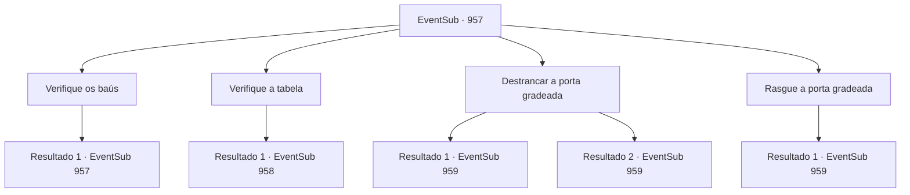

# Eventos secundários · 957

[Índice da tabela](index.md) · [Índice geral](../index.md)

ID: `pt:EventSub:957` · Fonte: `EventSub4` · Versão: 1.2.47.

Mapeamento estático dos arquivos; a disponibilidade e a execução dependem do estado da run.

## Texto do evento

*Sem texto no arquivo.*

## Dados de entrada

```json
{
  "id": 957,
  "grade": 1,
  "subEvent": "",
  "required": ""
}
```

## Mapa das escolhas



## Escolhas e resultados

### Escolha 1

Verifique os baús

Requisitos e outros campos da escolha:

```json
{
  "required": "5_783_0"
}
```

#### Resultado 1.1

Você examina um dos baús de madeira. Ao abri-lo, o fedor de madeira podre e ferrugem invade suas narinas. Dentro do baú há passas secas e um chicote ensanguentado. Debaixo deles, você encontra uma pequena chave. Você pega os itens do baú e o fecha novamente.

Continuação registrada: [Evento 957](0957.md) na mesma tabela.

```json
{
  "required": "",
  "chance": "1",
  "nextEvent": 957,
  "type": 2,
  "reward": "5_783_1|3_364_1|3_363_1"
}
```

### Escolha 2

Verifique a tabela

Requisitos e outros campos da escolha:

```json
{
  "required": "5_784_0"
}
```

#### Resultado 2.1

Você verifica a mesa. Nela há uma carta inacabada. Você percebe que quem a escreveu foi Lukas, enviada para alguém chamado 'Hazel'. O conteúdo da carta é o que você encontraria em uma carta de amor trocada entre amantes. Alguns dos aldeões também se interessaram pelas cartas - infelizmente, eles não conseguem entender o que as cartas significavam. Então, alguém encontra um armário trancado e te notifica. 

 "Aqui - apenas veja como essa coisa é suspeita."


Continuação registrada: [Evento 958](0958.md) na mesma tabela.

```json
{
  "required": "",
  "chance": "1",
  "nextEvent": 958,
  "type": 2,
  "reward": "5_784_1"
}
```

### Escolha 3

Destrancar a porta gradeada

Requisitos e outros campos da escolha:

```json
{
  "required": "-1|8_363_1|20_0_1|5_783_1"
}
```

#### Resultado 3.1

Com a chave que você encontrou no baú, você destranca a porta de ferro gradeada. 

 "Nossa, nossa... Veja como ele está desnutrido...!"

 "Quão assustado o garotinho deve ter ficado...!"

 Os aldeões observam o menino com compaixão. Algumas das mulheres estão até derramando lágrimas. O próprio menino, no entanto, simplesmente fica ali quieto, visivelmente confuso sobre o que está acontecendo.

Continuação registrada: [Evento 959](0959.md) na mesma tabela.

```json
{
  "required": "8_363_1",
  "chance": "1",
  "nextEvent": 959,
  "type": 2,
  "reward": ""
}
```

#### Resultado 3.2

Você abre a porta gradeada com magia. 

 "Ora, ora... Veja como ele está desnutrido...!"

 "Como o garotinho deve ter ficado assustado...!"

 Os aldeões observam o menino com compaixão. Algumas das mulheres estão até derramando lágrimas. O próprio menino, no entanto, simplesmente fica ali quieto, visivelmente confuso sobre o que está acontecendo.

Continuação registrada: [Evento 959](0959.md) na mesma tabela.

```json
{
  "required": "20_0_1",
  "chance": "1",
  "nextEvent": 959,
  "type": 2,
  "reward": ""
}
```

### Escolha 4

Rasgue a porta gradeada

Requisitos e outros campos da escolha:

```json
{
  "required": "5_785_0"
}
```

#### Resultado 4.1

Com a ajuda dos aldeões, você consegue abrir a porta gradeada.  'CR-EEAAAAK--!!  As grades de ferro cedem, soltando um grito horrendo. O menino consegue rastejar pela abertura para a liberdade. 

 "Nossa, nossa... Veja como ele está desnutrido...!"

 "Quão assustado o garotinho deve ter estado...!"

 Os aldeões observam o menino com compaixão. Algumas das mulheres até derramam lágrimas. O próprio menino, no entanto, simplesmente fica ali quieto, visivelmente confuso sobre o que está acontecendo.

Continuação registrada: [Evento 959](0959.md) na mesma tabela.

```json
{
  "required": "",
  "chance": "1",
  "nextEvent": 959,
  "type": 2,
  "reward": ""
}
```

## Referências que chegam a este evento

- [Evento 956 · escolha 1 · resultado 1](0956.md#escolha-1)
- [Evento 957 · escolha 1 · resultado 1](0957.md#escolha-1)
- [Evento 958 · escolha 1 · resultado 1](0958.md#escolha-1)
- [Evento 958 · escolha 2 · resultado 1](0958.md#escolha-2)
- [Evento 958 · escolha 3 · resultado 1](0958.md#escolha-3)
- [Evento 958 · escolha 3 · resultado 3](0958.md#escolha-3)
