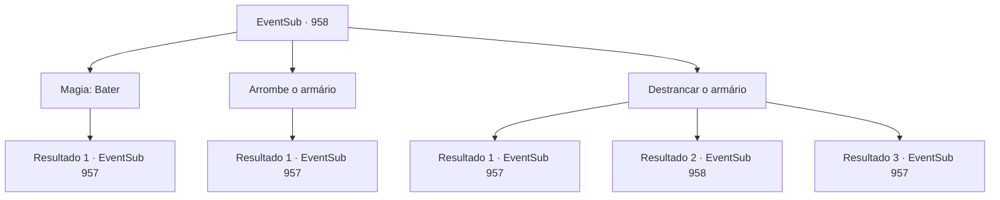

# Eventos secundários · 958

[Índice da tabela](index.md) · [Índice geral](../index.md)

ID: `pt:EventSub:958` · Fonte: `EventSub4` · Versão: 1.2.47.

Mapeamento estático dos arquivos; a disponibilidade e a execução dependem do estado da run.

## Texto do evento

*Sem texto no arquivo.*

## Dados de entrada

```json
{
  "id": 958,
  "grade": 1,
  "subEvent": "",
  "required": ""
}
```

## Mapa das escolhas



## Escolhas e resultados

### Escolha 1

Magia: Bater

Requisitos e outros campos da escolha:

```json
{
  "required": "20_0_1"
}
```

#### Resultado 1.1

Você usa sua magia para abrir o armário trancado. Dentro há uma coleção de cartas que Lukas recebeu de Hazel. Você cuidadosamente desdobra as cartas para examinar seu conteúdo.  'Atrase Ronan, o máximo que puder. Ele não é um homem paciente. Afirme sua opinião repetidamente, e ele acabará cedendo.'  'Irema é uma cobra - astuta, inteligente e tenaz. Não devemos nos apressar. Vamos capturar lentamente a lealdade de seus subordinados primeiro.'  Escritos nas cartas estão planos e esquemas de Hazel e Lukas para tomar o controle da família real do Conde Ronan. A última carta da coleção diz o seguinte - 'Pelo bem de nosso filho, Edward NÃO PODE se reunir com Ronan. Não deixe pontas soltas.'

Continuação registrada: [Evento 957](0957.md) na mesma tabela.

```json
{
  "required": "",
  "chance": "1",
  "nextEvent": 957,
  "type": 2,
  "reward": "3_365_1|5_786_1"
}
```

### Escolha 2

Arrombe o armário

Requisitos e outros campos da escolha:

```json
{
  "required": "5_787_0"
}
```

#### Resultado 2.1

Você consegue abrir o armário à força com a ajuda dos aldeões. Finalmente, a fechadura se quebra, revelando o que ela estava guardando tão fielmente. Dentro há uma coleção de cartas que Lukas recebeu de Hazel. Você cuidadosamente desdobra as cartas para examinar seu conteúdo.  'Atrase Ronan, o máximo que puder. Ele não é um homem paciente. Afirme sua opinião repetidamente, e ele acabará cedendo.'  'Irema é uma cobra - astuta, inteligente e tenaz. Não devemos nos apressar. Vamos capturar lentamente a lealdade de seus subordinados primeiro.'  Escritos nas cartas estão os planos e esquemas de Hazel e Lukas para tomar o controle da família real do Conde Ronan. A última carta da coleção diz o seguinte - 'Pelo bem do nosso filho, Edward NÃO PODE se reunir com Ronan. Não deixe pontas soltas.'

Continuação registrada: [Evento 957](0957.md) na mesma tabela.

```json
{
  "required": "",
  "chance": "1",
  "nextEvent": 957,
  "type": 2,
  "reward": "3_365_1|5_786_1"
}
```

### Escolha 3

Destrancar o armário

Requisitos e outros campos da escolha:

```json
{
  "required": "5_788_0"
}
```

#### Resultado 3.1

Com uma habilidade surpreendente, você rapidamente destranca o armário. Dentro há uma coleção de cartas que Lukas recebeu de Hazel. Você cuidadosamente desdobra as cartas para examinar seu conteúdo.  'Atrase Ronan o máximo que puder. Ele não é um homem paciente. Afirme sua opinião repetidamente, e ele acabará cedendo.'  'Irema é uma cobra - astuta, inteligente e tenaz. Não devemos nos apressar. Vamos capturar lentamente a lealdade de seus subordinados primeiro.'  Escritos nas cartas estão os planos e esquemas de Hazel e Lukas para tomar o controle da família real do Conde Ronan. A última carta da coleção diz o seguinte - 'Pelo bem de nosso filho, Edward NÃO PODE se reunir com Ronan. Não deixe pontas soltas.'

Continuação registrada: [Evento 957](0957.md) na mesma tabela.

```json
{
  "required": "10_41_1",
  "chance": "1|0_6_1",
  "nextEvent": 957,
  "type": 0,
  "reward": "3_365_1|5_786_1"
}
```

#### Resultado 3.2

Você tenta destrancar o armário, mas ele permanece fechado.

Continuação registrada: [Evento 958](0958.md) na mesma tabela.

```json
{
  "required": "10_41_1",
  "chance": "14",
  "nextEvent": 958,
  "type": 1,
  "reward": "5_788_9"
}
```

#### Resultado 3.3

Você usa a chave para abrir o armário trancado. Dentro há uma coleção de cartas que Lukas recebeu de Hazel. Você cuidadosamente desdobra as cartas para examinar seu conteúdo.  'Atrase Ronan, o máximo que puder. Ele não é um homem paciente. Afirme sua opinião repetidamente, e ele acabará cedendo.'  'Irema é uma cobra - astuta, inteligente e tenaz. Não devemos nos apressar. Vamos capturar lentamente a lealdade de seus subordinados primeiro.'  Escritos nas cartas estão planos e esquemas de Hazel e Lukas para tomar o controle da família real do Conde Ronan. A última carta da coleção diz o seguinte - 'Pelo bem de nosso filho, Edward NÃO PODE se reunir com Ronan. Não deixe pontas soltas.'

Continuação registrada: [Evento 957](0957.md) na mesma tabela.

```json
{
  "required": "8_41_1",
  "chance": "1",
  "nextEvent": 957,
  "type": 2,
  "reward": "3_365_1|5_786_1"
}
```

## Referências que chegam a este evento

- [Evento 957 · escolha 2 · resultado 1](0957.md#escolha-2)
- [Evento 958 · escolha 3 · resultado 2](0958.md#escolha-3)
