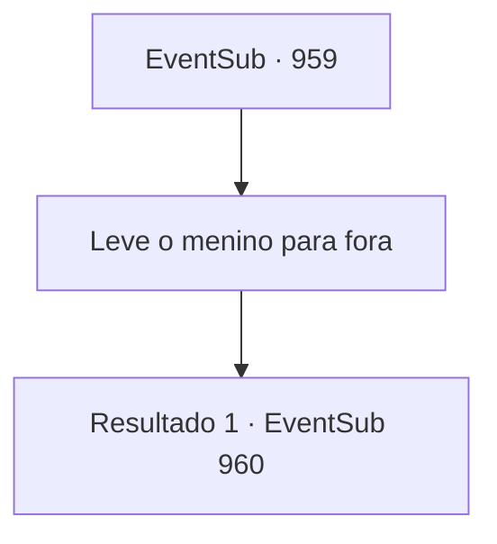

# Eventos secundários · 959

[Índice da tabela](index.md) · [Índice geral](../index.md)

ID: `pt:EventSub:959` · Fonte: `EventSub4` · Versão: 1.2.47.

Mapeamento estático dos arquivos; a disponibilidade e a execução dependem do estado da run.

## Texto do evento

*Sem texto no arquivo.*

## Dados de entrada

```json
{
  "id": 959,
  "grade": 1,
  "subEvent": "",
  "required": ""
}
```

## Mapa das escolhas



## Escolhas e resultados

### Escolha 1

Leve o menino para fora

Requisitos e outros campos da escolha:

```json
{
  "required": ""
}
```

#### Resultado 1.1

Você e os aldeões escoltam Edward para fora da mina. Mas Lukas e seus homens encontram vocês primeiro, antes mesmo de chegarem à saída. Lukas grita furiosamente com os aldeões. 

 "O QUE DIABOS VOCÊS ESTÃO FAZENDO?!"

 Dominados por sua presença, a multidão fica em silêncio. Lukas dá um passo à frente, dirigindo-se a todos com raiva. 

 "Esse garoto é um HOSPEDEIRO! O próprio selo que está impedindo o diabo de invadir nossa dimensão! Vocês, tolos, sequer percebem o que estão tentando fazer?!"

 Sua voz ecoa pelo túnel da mina. Mas os aldeões não parecem convencidos. 

 "C- como um garoto tão fraco e impotente poderia ser um hospedeiro de um diabo...?"

 "Certo! Prove, se isso for verdade!"

 Lukas responde imediatamente apontando para o cabelo de Edward. 

 "A cor fantasmagórica do cabelo dele! Seus olhos diabolicamente vermelhos! Não conseguem ver?!"

 Lukas prossegue afirmando que a Condessa Irema é de uma família que foi amaldiçoada por um diabo. 

 "Portanto, essa COISA deve ser mantida presa na mina! No momento em que se tornar o Conde, nossa propriedade estará condenada!!"

 Lukas parece um pouco desesperado, mas os aldeões já tiveram o suficiente. Eles não confiam em uma palavra do que ele diz. Percebendo que não está conseguindo convencê-los, Lukas prossegue gritando ordens para seus homens. 

 "PRENDAM TODOS! EU VOU JULGÁ-LOS POR TRAIÇÃO!!"


Continuação registrada: [Evento 960](0960.md) na mesma tabela.

```json
{
  "required": "",
  "chance": "1",
  "nextEvent": 960,
  "type": 2,
  "reward": ""
}
```

## Referências que chegam a este evento

- [Evento 957 · escolha 3 · resultado 1](0957.md#escolha-3)
- [Evento 957 · escolha 3 · resultado 2](0957.md#escolha-3)
- [Evento 957 · escolha 4 · resultado 1](0957.md#escolha-4)
