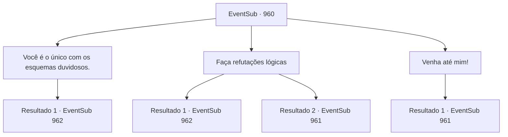

# Eventos secundários · 960

[Índice da tabela](index.md) · [Índice geral](../index.md)

ID: `pt:EventSub:960` · Fonte: `EventSub4` · Versão: 1.2.47.

Mapeamento estático dos arquivos; a disponibilidade e a execução dependem do estado da run.

## Texto do evento

*Sem texto no arquivo.*

## Dados de entrada

```json
{
  "id": 960,
  "grade": 1,
  "subEvent": "",
  "required": ""
}
```

## Mapa das escolhas



## Escolhas e resultados

### Escolha 1

Você é o único com os esquemas duvidosos.

Requisitos e outros campos da escolha:

```json
{
  "required": "8_365_1"
}
```

#### Resultado 1.1

Você tira as cartas que encontrou na mina, fazendo uma lista completa das transgressões de Lukas. Você expõe como Lukas conspirou com alguém chamado Hazel, sequestrando Edward e planejando tomar o controle da Família Ronan. Os soldados que eram leais a Lukas até alguns segundos atrás largaram suas armas, afastando-se do Bispo. 

 "N- nós não fazíamos ideia!"

 Lukas franze a testa para você, mas você não dá atenção. Você continua a condenar Lukas, dizendo a todos que ele era o responsável por planejar a traição. Você também se lembra de informar os aldeões que apenas retornando Edward em segurança ao Conde a aldeia poderia ser perdoada. 

 "Você está certo!"

 Os aldeões estão do seu lado. Eles avançam sobre Lukas. Os soldados se juntam aos aldeões para espancar Lukas - presumivelmente, porque não queriam ser vistos como cúmplices. |drawing_lukasDown| A surra finalmente chega ao fim. Lukas está no chão, mal respirando. Sua túnica de sacerdote foi reduzida a trapos. Sangue escorre dos rasgos e cortes em sua roupa. Você pode ver no rosto de Edward sua surpresa e choque.

Continuação registrada: [Evento 962](0962.md) na mesma tabela.

```json
{
  "required": "",
  "chance": "1",
  "nextEvent": 962,
  "type": 2,
  "reward": ""
}
```

### Escolha 2

Faça refutações lógicas

Requisitos e outros campos da escolha:

```json
{
  "required": ""
}
```

#### Resultado 2.1

Você convence as pessoas de que a condição de Edward é albinismo, uma característica genética completamente irrelevante para maldições ou demônios. Você também rebate as alegações de Lukas, virando o argumento contra ele ao dizer que ele acusou falsamente e insultou o Conde e a Condessa - acrescentando que apoiar a causa do bispo os tornaria igualmente culpados. Os aldeões não têm educação suficiente para entender corretamente o que você está falando - sendo mineiros durante toda a vida - mas acreditam que você soa mais convincente, de qualquer forma. 

 "...É, certo!"

 Os aldeões estão do seu lado. Eles atacam Lukas. Os soldados se juntam aos aldeões para espancar Lukas - presumivelmente, porque não queriam ser vistos como alguém que também insultou o Conde. |drawing_lukasDown| A surra finalmente chega ao fim. Lukas está no chão, mal respirando. Sua túnica de padre foi reduzida a trapos. Sangue escorre dos rasgos e cortes em sua roupa. Você pode ver no rosto de Edward sua surpresa e choque.

Continuação registrada: [Evento 962](0962.md) na mesma tabela.

```json
{
  "required": "",
  "chance": "1|0_7_1",
  "nextEvent": 962,
  "type": 0,
  "reward": ""
}
```

#### Resultado 2.2

Você faz o seu melhor para manter a calma e refutar logicamente. Mas seu temperamento leva a melhor sobre você. 

 "*FALCÃO*"

 Com grande precisão, você cospe em Lukas. Isso serviu como sinal - uma briga total entre os homens de Lukas e os aldeões começa. Você se move entre eles, abrindo caminho até Lukas.

Continuação registrada: [Evento 961](0961.md) na mesma tabela.

```json
{
  "required": "",
  "chance": "14",
  "nextEvent": 961,
  "type": 1,
  "reward": "6_0_187",
  "place": 1
}
```

### Escolha 3

Venha até mim!

Requisitos e outros campos da escolha:

```json
{
  "required": ""
}
```

#### Resultado 3.1

Você faz o que Lukas disse e avança contra ele. Isso serviu como o sinal - uma briga total entre os homens de Lukas e os aldeões começa. Você se move entre eles, abrindo caminho até Lukas.

Continuação registrada: [Evento 961](0961.md) na mesma tabela.

```json
{
  "required": "",
  "chance": "1",
  "nextEvent": 961,
  "type": 2,
  "reward": "6_0_187",
  "place": 1
}
```

## Referências que chegam a este evento

- [Evento 959 · escolha 1 · resultado 1](0959.md#escolha-1)
