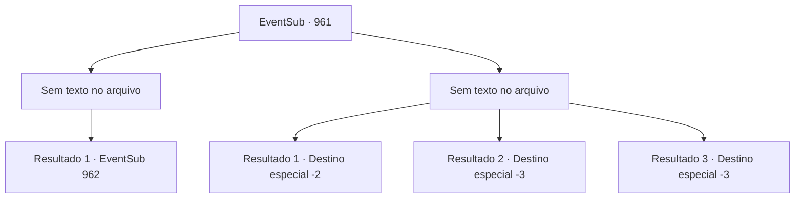

# Eventos secundários · 961

[Índice da tabela](index.md) · [Índice geral](../index.md)

ID: `pt:EventSub:961` · Fonte: `EventSub4` · Versão: 1.2.47.

Mapeamento estático dos arquivos; a disponibilidade e a execução dependem do estado da run.

## Texto do evento

*Sem texto no arquivo.*

## Dados de entrada

```json
{
  "id": 961,
  "grade": 1,
  "subEvent": "",
  "required": ""
}
```

## Mapa das escolhas



## Escolhas e resultados

### Escolha 1

*Sem texto no arquivo; o papel dessa opção depende da interface do jogo.*

Requisitos e outros campos da escolha:

```json
{
  "required": ""
}
```

#### Resultado 1.1

Você emerge vitorioso contra Lukas na batalha. Com seu líder derrotado, os soldados fogem. Agitados, os aldeões correm todos em direção a Lukas, espancando-o. |drawing_lukasDown| A surra finalmente chega ao fim. Lukas está no chão, mal respirando. Sua túnica de sacerdote foi reduzida a trapos. Sangue escorre pelas rasgaduras e cortes em sua roupa. Você pode ver no rosto de Edward sua surpresa e choque.

Continuação registrada: [Evento 962](0962.md) na mesma tabela.

```json
{
  "required": "",
  "chance": "1",
  "nextEvent": 962,
  "type": 2,
  "reward": ""
}
```

### Escolha 2

*Sem texto no arquivo; o papel dessa opção depende da interface do jogo.*

Requisitos e outros campos da escolha:

```json
{
  "required": ""
}
```

#### Resultado 2.1

O ataque de Lukas te nocauteia. Finalmente, quando você recobra a consciência, percebe que Lupin está te ajudando a levantar. Você se levanta e olha ao redor. Nota que Edward e Lukas não estão em lugar algum. 

 "Você está bem? O que aconteceu?"

 Você dá a Lupin uma breve explicação do que aconteceu na mina de prata. Lupin leva a mão ao rosto em resposta. 

 "*suspiro*... Bem... Eu deveria saber. A boa notícia é que o Jovem Mestre Edward ainda está vivo... Mesmo Lukas não pensaria em machucá-lo diretamente..."

 Ele murmura para si mesmo, mordendo o polegar. Após uma breve deliberação, Lupin olha para você mais uma vez. 

 "Devo voltar ao meu senhor e informá-lo sobre esta notícia. Entrarei em contato com você novamente mais tarde."

 Ele então monta em seu cavalo e parte. E assim o cavaleiro se afasta cada vez mais, deixando para trás apenas poeira.

Continuação registrada: [Destino especial `-2`](../destinos-especiais.md).

```json
{
  "required": "1_0_2|1_1_2",
  "chance": "1",
  "nextEvent": -2,
  "type": 2,
  "reward": "12_12_4|0_0_-1|0_1_-1"
}
```

#### Resultado 2.2

Em meio à batalha, o mangual de alguém atinge sua cabeça. Um alto 'ESTALO!' ecoa em seus ouvidos, e o mundo começa a tremer. Então, a escuridão te envolve.

Continuação registrada: [Destino especial `-3`](../destinos-especiais.md).

```json
{
  "required": "2_0_2",
  "chance": "1",
  "nextEvent": -3,
  "type": 2,
  "reward": "0_0_-1|0_1_-1"
}
```

#### Resultado 2.3

Em meio à batalha, o mangual de alguém atinge sua cabeça. Um alto 'ESTALO!' ecoa em seus ouvidos, e o mundo começa a tremer. Então, a escuridão te envolve.

Continuação registrada: [Destino especial `-3`](../destinos-especiais.md).

```json
{
  "required": "2_1_2",
  "chance": "1",
  "nextEvent": -3,
  "type": 2,
  "reward": "0_0_-1|0_1_-1"
}
```

## Referências que chegam a este evento

- [Evento 960 · escolha 2 · resultado 2](0960.md#escolha-2)
- [Evento 960 · escolha 3 · resultado 1](0960.md#escolha-3)
