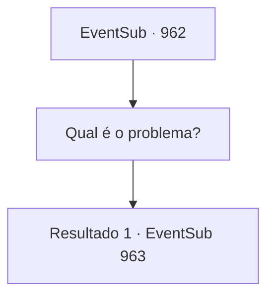

# Eventos secundários · 962

[Índice da tabela](index.md) · [Índice geral](../index.md)

ID: `pt:EventSub:962` · Fonte: `EventSub4` · Versão: 1.2.47.

Mapeamento estático dos arquivos; a disponibilidade e a execução dependem do estado da run.

## Texto do evento

*Sem texto no arquivo.*

## Dados de entrada

```json
{
  "id": 962,
  "grade": 1,
  "subEvent": "",
  "required": ""
}
```

## Mapa das escolhas



## Escolhas e resultados

### Escolha 1

Qual é o problema?

Requisitos e outros campos da escolha:

```json
{
  "required": ""
}
```

#### Resultado 1.1

Você pergunta a Edward o que está errado. O garoto responde, perplexo com o que acabou de testemunhar. 

 "U- uh... Mas, o Senhor Lukas não é, tipo, o mensageiro dos Deuses? O Apóstolo?"

 Lukas está deitado no chão, mal respirando, lutando para se afastar da lama. Você percebe que Edward está confuso. 

 "Eu... Eu sempre tive medo dele... Eu acreditava que ele era o apóstolo das divindades... mas, mas..."

 Lukas olha para Edward com os olhos vermelhos. Ele ainda está tentando se levantar. 

 "ARRRgghh... SEUS VERMES...!"


Continuação registrada: [Evento 963](0963.md) na mesma tabela.

```json
{
  "required": "",
  "chance": "1",
  "nextEvent": 963,
  "type": 2,
  "reward": ""
}
```

## Referências que chegam a este evento

- [Evento 960 · escolha 1 · resultado 1](0960.md#escolha-1)
- [Evento 960 · escolha 2 · resultado 1](0960.md#escolha-2)
- [Evento 961 · escolha 1 · resultado 1](0961.md#escolha-1)
