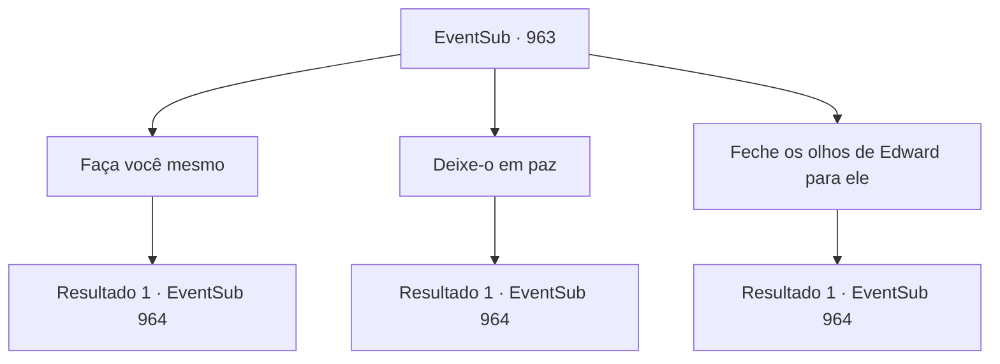

# Eventos secundários · 963

[Índice da tabela](index.md) · [Índice geral](../index.md)

ID: `pt:EventSub:963` · Fonte: `EventSub4` · Versão: 1.2.47.

Mapeamento estático dos arquivos; a disponibilidade e a execução dependem do estado da run.

## Texto do evento

*Sem texto no arquivo.*

## Dados de entrada

```json
{
  "id": 963,
  "grade": 1,
  "subEvent": "",
  "required": ""
}
```

## Mapa das escolhas



## Escolhas e resultados

### Escolha 1

Faça você mesmo

Requisitos e outros campos da escolha:

```json
{
  "required": ""
}
```

#### Resultado 1.1

Você encoraja Edward a enfrentar e destruir seus medos. Depois de ouvir seu conselho em silêncio, ele pega uma lança do chão e volta seu olhar para Lukas. 

 "ED... WARD...! SEM VOCÊ, TUDO ISSO VAI....!"

 Lukas finalmente consegue se levantar, então se aproxima de Edward. Lukas estende os braços para o menino, tentando estrangulá-lo até a morte. A respiração de Edward se intensifica. 

 "ARRRRRRGGGGGHHH---!!"

 Edward solta um grito de guerra, como se quisesse afastar seus medos, e então faz um poderoso golpe com a lança. A lança rasga a carne de Lukas, cravando-se profundamente nele com um som alto de estalo. Lukas cambaleia para trás, depois cai no chão, sem vida. Por um breve momento, tudo fica quieto. Mas logo... 

 "VIVA! LUKAS, O MALVADO, ESTÁ MORTO!!"

 Os locais irrompem em aplausos. Então, você nota Lupin se aproximando de você. 

 "O- o que aconteceu?!"


Continuação registrada: [Evento 964](0964.md) na mesma tabela.

```json
{
  "required": "",
  "chance": "1",
  "nextEvent": 964,
  "type": 2,
  "reward": "5_770_1"
}
```

### Escolha 2

Deixe-o em paz

Requisitos e outros campos da escolha:

```json
{
  "required": ""
}
```

#### Resultado 2.1


 "ED... WARD...! SEM VOCÊ, TUDO ISSO VAI....!"

 Lukas finalmente consegue se levantar, então se aproxima de Edward. Lukas estende os braços para o garotinho, tentando estrangulá-lo até a morte. No entanto, suas mãos não conseguem alcançar Edward. Os aldeões já estão em ação, batendo nas mãos do bispo com porretes. 

 "NÃO OUSE!"

 Todos estão participando da surra no ex-bispo agora, assim como um grupo de aventureiros faria com o corpo morto de um goblin que lhes deu trabalho. Finalmente, o corpo de Lukas fica imóvel, sem vida e inerte. 

 "VIVA! LUKAS, O MALIGNO, ESTÁ MORTO!!"

 Os locais explodem em aplausos. Então, você nota Lupin se aproximando de você. 

 "O- o que aconteceu?!"


Continuação registrada: [Evento 964](0964.md) na mesma tabela.

```json
{
  "required": "",
  "chance": "1",
  "nextEvent": 964,
  "type": 2,
  "reward": "5_770_2"
}
```

### Escolha 3

Feche os olhos de Edward para ele

Requisitos e outros campos da escolha:

```json
{
  "required": ""
}
```

#### Resultado 3.1

Você cobre os olhos de Edward com as mãos, para que o garotinho não tenha que testemunhar toda a violência que está prestes a acontecer. 

 "ED... WARD...! SEM VOCÊ, TUDO ISSO VAI....!"

 Lukas finalmente consegue se levantar, então se aproxima de Edward. Lukas estende os braços para o garotinho, tentando estrangulá-lo até a morte. No entanto, suas mãos não conseguem alcançar Edward. Os aldeões já estão agindo, batendo nas mãos do bispo com porretes. 

 "NÃO OUSE!"

 Todos estão participando da surra no ex-bispo agora, assim como um grupo de aventureiros faria com o corpo morto de um goblin que lhes deu trabalho. Finalmente, o corpo de Lukas fica imóvel, sem vida e inerte. 

 "VIVA! LUKAS, O MALIGNO, ESTÁ MORTO!!"

 Os locais irrompem em aplausos. Então, você percebe Lupin se aproximando de você. 

 "O- o que aconteceu?!"


Continuação registrada: [Evento 964](0964.md) na mesma tabela.

```json
{
  "required": "",
  "chance": "1",
  "nextEvent": 964,
  "type": 2,
  "reward": "5_770_3"
}
```

## Referências que chegam a este evento

- [Evento 962 · escolha 1 · resultado 1](0962.md#escolha-1)
