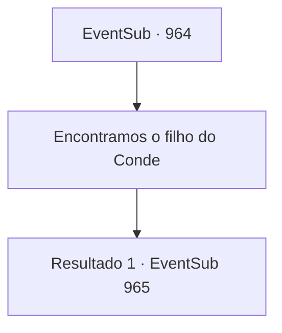

# Eventos secundários · 964

[Índice da tabela](index.md) · [Índice geral](../index.md)

ID: `pt:EventSub:964` · Fonte: `EventSub4` · Versão: 1.2.47.

Mapeamento estático dos arquivos; a disponibilidade e a execução dependem do estado da run.

## Texto do evento

*Sem texto no arquivo.*

## Dados de entrada

```json
{
  "id": 964,
  "grade": 1,
  "subEvent": "",
  "required": ""
}
```

## Mapa das escolhas



## Escolhas e resultados

### Escolha 1

Encontramos o filho do Conde

Requisitos e outros campos da escolha:

```json
{
  "required": ""
}
```

#### Resultado 1.1

Você conta a Lupin sobre o que aconteceu na mina de prata, depois o apresenta a Edward. Assim que Lupin vê o garoto, ele se ajoelha para mostrar respeito. Mas Edward apenas fica ali parado olhando para o cavaleiro, confuso. Lupin se levanta, se vira para você e continua. 

 "Hm... Ainda acho difícil de acreditar. Eu esperava que ele estivesse tramando algo, mas sequestrar o Jovem Mestre Edward ele mesmo...?"

 Lupin agradece a você repetidamente. 

 "Você fez um ótimo trabalho, aventureiro. Eu cuido disso a partir daqui. Vou levar o Jovem Mestre Edward para um lugar seguro."

 Ele então olha para o corpo de Lukas e acrescenta. 

 "Diga, você conseguiu alguma prova material que comprove os crimes deste homem? Tenho certeza de que os aldeões vão nos apoiar, mas algo mais tangível seria bom."


Continuação registrada: [Evento 965](0965.md) na mesma tabela.

```json
{
  "required": "",
  "chance": "1",
  "nextEvent": 965,
  "type": 2,
  "reward": ""
}
```

## Referências que chegam a este evento

- [Evento 963 · escolha 1 · resultado 1](0963.md#escolha-1)
- [Evento 963 · escolha 2 · resultado 1](0963.md#escolha-2)
- [Evento 963 · escolha 3 · resultado 1](0963.md#escolha-3)
