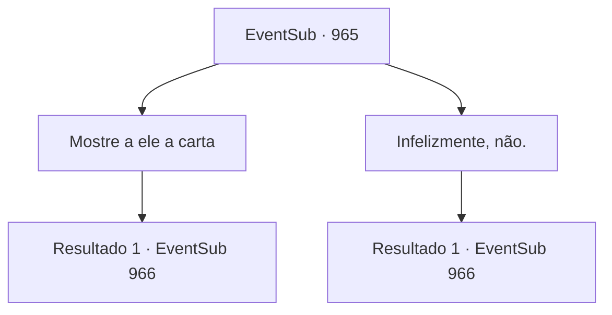

# Eventos secundários · 965

[Índice da tabela](index.md) · [Índice geral](../index.md)

ID: `pt:EventSub:965` · Fonte: `EventSub4` · Versão: 1.2.47.

Mapeamento estático dos arquivos; a disponibilidade e a execução dependem do estado da run.

## Texto do evento

*Sem texto no arquivo.*

## Dados de entrada

```json
{
  "id": 965,
  "grade": 1,
  "subEvent": "",
  "required": ""
}
```

## Mapa das escolhas



## Escolhas e resultados

### Escolha 1

Mostre a ele a carta

Requisitos e outros campos da escolha:

```json
{
  "required": "8_365_1"
}
```

#### Resultado 1.1

Enquanto Lupin lê o conteúdo da carta, seu rosto se contorce de fúria. 

 "Agora entendi... Lukas, aquele lixo covarde. Com a bajulação como disfarce, ele estava tramando planos sujos com Hazel o tempo todo...!"


Continuação registrada: [Evento 966](0966.md) na mesma tabela.

```json
{
  "required": "",
  "chance": "1",
  "nextEvent": 966,
  "type": 2,
  "reward": "4_365_1"
}
```

### Escolha 2

Infelizmente, não.

Requisitos e outros campos da escolha:

```json
{
  "required": "10_365_1"
}
```

#### Resultado 2.1

Você diz a ele que não há tal evidência. Lupin responde com um aceno. 

 "Bem. Isso não muda o fato de que ele prendeu injustamente o Jovem Mestre Edward. Eu gostaria que pudéssemos tê-lo submetido a um julgamento mais justo, mas... tudo está bem quando termina bem, suponho."

 Então, o velho que o guiou pela mina se aproxima de vocês dois e entrega um pedaço de pergaminho. 

 "Honrado cavaleiro! Aqui - encontrei esta carta na mina."

 Lupin pega o item do velho e lê. 

 "Hã, escrita pela Senhora Hazel, para Lukas. 'Pelo bem de nosso filho, Edward NÃO PODE se reunir com Ronan. Não deixe pontas soltas.'... O quê?"

 Enquanto Lupin lê o conteúdo da carta, seu rosto se contorce de fúria. 

 "Agora entendi... Lukas, aquele lixo covarde. Com a bajulação como disfarce, ele estava tramando planos sujos com Hazel o tempo todo...!"


Continuação registrada: [Evento 966](0966.md) na mesma tabela.

```json
{
  "required": "",
  "chance": "1",
  "nextEvent": 966,
  "type": 2,
  "reward": ""
}
```

## Referências que chegam a este evento

- [Evento 964 · escolha 1 · resultado 1](0964.md#escolha-1)
