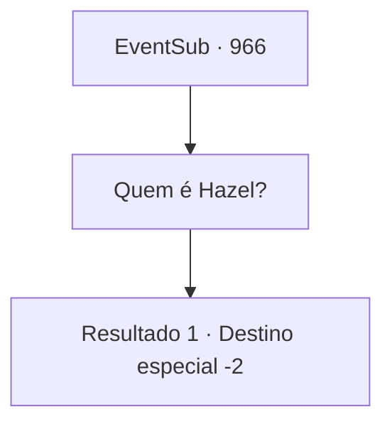

# Eventos secundários · 966

[Índice da tabela](index.md) · [Índice geral](../index.md)

ID: `pt:EventSub:966` · Fonte: `EventSub4` · Versão: 1.2.47.

Mapeamento estático dos arquivos; a disponibilidade e a execução dependem do estado da run.

## Texto do evento

*Sem texto no arquivo.*

## Dados de entrada

```json
{
  "id": 966,
  "grade": 1,
  "subEvent": "",
  "required": ""
}
```

## Mapa das escolhas



## Escolhas e resultados

### Escolha 1

Quem é Hazel?

Requisitos e outros campos da escolha:

```json
{
  "required": ""
}
```

#### Resultado 1.1


 "Segunda esposa do meu senhor. Aquela mulher ingrata! O Conde a acolhe de sua família humilde e é assim que ela o retribui?! Isso é inaceitável!"

 Lupin range os dentes, incapaz de conter a raiva. 

 "Marque minhas palavras - Hazel pagará por isso."

 Ele solta um longo suspiro e volta seu olhar para você. 

 "De qualquer forma - agradeço mais uma vez por toda a ajuda. Meu senhor entrará em contato com você em breve. Até lá, desejo-lhe sorte em suas viagens."

 Ele se despede de você e sai com Edward.

Continuação registrada: [Destino especial `-2`](../destinos-especiais.md).

```json
{
  "required": "",
  "chance": "1",
  "nextEvent": -2,
  "type": 2,
  "reward": "12_12_5"
}
```

## Referências que chegam a este evento

- [Evento 965 · escolha 1 · resultado 1](0965.md#escolha-1)
- [Evento 965 · escolha 2 · resultado 1](0965.md#escolha-2)
