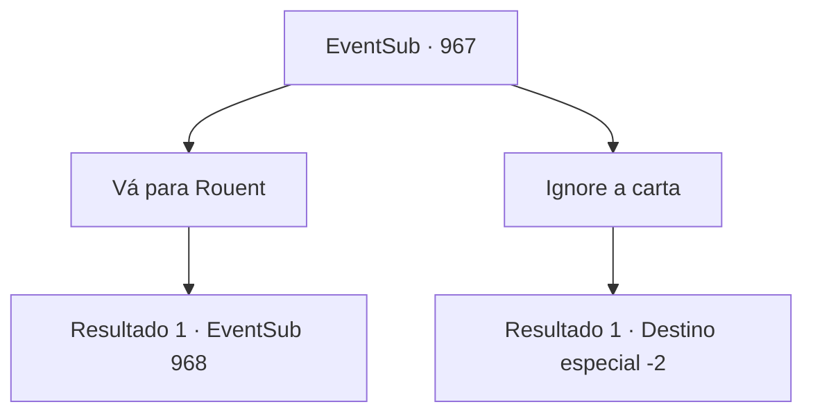

# Eventos secundários · 967

[Índice da tabela](index.md) · [Índice geral](../index.md)

ID: `pt:EventSub:967` · Fonte: `EventSub4` · Versão: 1.2.47.

Mapeamento estático dos arquivos; a disponibilidade e a execução dependem do estado da run.

## Texto do evento

Um pombo voa ruidosamente em sua direção. Amarrado em seu pescoço está um lenço inscrito com um tridente azul - o símbolo da Casa Ronan. Você estende o braço, para que o pombo possa pousar sobre ele. 

 "Coo coo... coo coo."

 O pombo se acomoda. Cuidadosamente, você desamarra a carta presa em seus pés. A carta é de Lupin.
 'Encontre-me na ponte sobre o rio em Rouent, a capital do Condado de Ronan. Avisarei os guardas com antecedência.'
 Tendo completado sua missão, o pombo abre as asas novamente e alça voo. Você silenciosamente o observa voar para longe no céu.

## Dados de entrada

```json
{
  "id": 967,
  "grade": 1,
  "subEvent": "",
  "required": "12_12_4|1_2_30"
}
```

## Mapa das escolhas



## Escolhas e resultados

### Escolha 1

Vá para Rouent

Requisitos e outros campos da escolha:

```json
{
  "required": ""
}
```

#### Resultado 1.1

|drawing_Rouent| Após alguns dias de viagem, você chega à cidade capital do Condado de Ronan, 'Rouent'. Os guardas da cidade imediatamente reconhecem seu rosto e o deixam entrar sem inspeção. Ao passar pelas grossas muralhas da cidade, uma rua principal bem polida, pontilhada de edifícios coloridos, o cumprimenta. Você segue pela rua principal, tentando encontrar a ponte que Lupin mencionou. Um rio, com cerca de trinta metros de largura, atravessa o coração da cidade. Você caminha até a ponte sobre o grande riacho e espera por Lupin lá.   Alguns momentos depois, enquanto você observa as trutas saltarem para cima e para baixo na água, um cavaleiro familiar se aproxima de você. Ele acena com as mãos para cumprimentá-lo e, em seguida, vai direto ao ponto. 

 "O Conde está fazendo tudo ao seu alcance para encontrar aquele garoto de cabelos brancos. Tenho certeza de que ele está convencido de que o garoto é de fato seu filho."

 Ele acrescenta que, apesar dos homens do Conde procurarem dia e noite pela área, Lukas e o garoto ainda não foram encontrados. 

 "O pior é que... alguns soldados dos grupos de busca foram feridos. Alguns até foram mortos."

 Lupin diz que ou Lukas mesmo ou outra pessoa deve ter atacado eles primeiro. 

 "É por isso que preciso da sua ajuda. Melhorar as chances quando somos nós dois, eu digo."


Continuação registrada: [Evento 968](0968.md) na mesma tabela.

```json
{
  "required": "",
  "chance": "1",
  "nextEvent": 968,
  "type": 2,
  "reward": ""
}
```

### Escolha 2

Ignore a carta

Requisitos e outros campos da escolha:

```json
{
  "required": ""
}
```

#### Resultado 2.1

Você ignora a carta de Lupin.

Continuação registrada: [Destino especial `-2`](../destinos-especiais.md).

```json
{
  "required": "",
  "chance": "1",
  "nextEvent": -2,
  "type": 2,
  "reward": "12_12_-1"
}
```

## Referências que chegam a este evento

Nenhum `nextEvent` positivo da mesma tabela aponta para este nó. Isso não prova que seja inacessível: sorteio e estado de história podem selecioná-lo.

