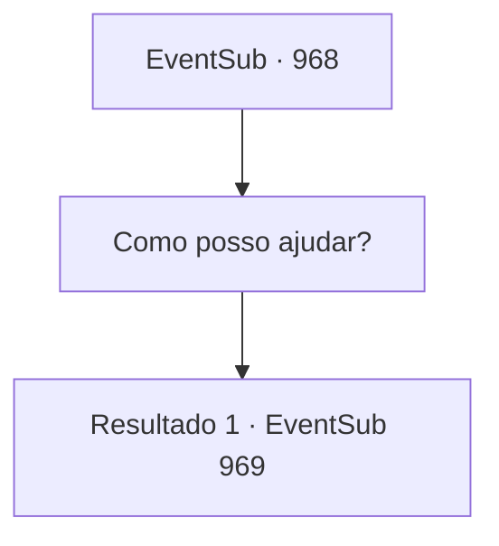

# Eventos secundários · 968

[Índice da tabela](index.md) · [Índice geral](../index.md)

ID: `pt:EventSub:968` · Fonte: `EventSub4` · Versão: 1.2.47.

Mapeamento estático dos arquivos; a disponibilidade e a execução dependem do estado da run.

## Texto do evento

*Sem texto no arquivo.*

## Dados de entrada

```json
{
  "id": 968,
  "grade": 1,
  "subEvent": "",
  "required": ""
}
```

## Mapa das escolhas



## Escolhas e resultados

### Escolha 1

Como posso ajudar?

Requisitos e outros campos da escolha:

```json
{
  "required": ""
}
```

#### Resultado 1.1

Lupin diz que rastreou dois locais muito prováveis que Lukas deve estar usando como esconderijo. Ele está pedindo para você acompanhá-lo. 

 "O primeiro lugar suspeito é a Cabana do Guarda-caça. O Conde não organizou uma caça oficial na última década. Presumo que o lugar esteja praticamente abandonado - perfeito para pessoas como Lukas que precisam de um lugar para se esconder."

 Ele acrescenta que os grupos de busca enviados para verificar as florestas do condado foram atingidos por flechas. O cúmplice de Lukas deve estar lá, ele conclui. 

 "O segundo candidato... são as Catacumbas. Este é um lugar que não recebe muitos visitantes em primeiro lugar. Não se encontrará lugar melhor para se esconder."

 Lupin também acrescenta que há rumores de um espírito maligno assombrando as Catacumbas. É um lugar evitado não apenas pelos soldados, mas também pelos cavaleiros.

Continuação registrada: [Evento 969](0969.md) na mesma tabela.

```json
{
  "required": "",
  "chance": "1",
  "nextEvent": 969,
  "type": 2,
  "reward": ""
}
```

## Referências que chegam a este evento

- [Evento 967 · escolha 1 · resultado 1](0967.md#escolha-1)
