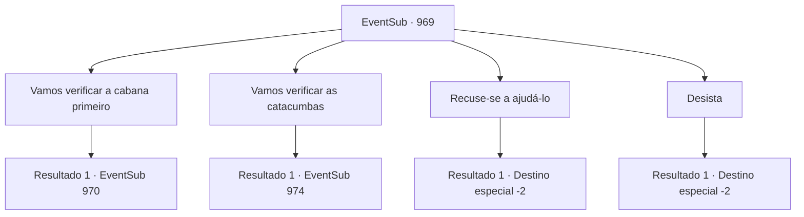

# Eventos secundários · 969

[Índice da tabela](index.md) · [Índice geral](../index.md)

ID: `pt:EventSub:969` · Fonte: `EventSub4` · Versão: 1.2.47.

Mapeamento estático dos arquivos; a disponibilidade e a execução dependem do estado da run.

## Texto do evento

*Sem texto no arquivo.*

## Dados de entrada

```json
{
  "id": 969,
  "grade": 1,
  "subEvent": "",
  "required": ""
}
```

## Mapa das escolhas



## Escolhas e resultados

### Escolha 1

Vamos verificar a cabana primeiro

Requisitos e outros campos da escolha:

```json
{
  "required": "5_771_0"
}
```

#### Resultado 1.1

Você e Lupin se dirigem à cabana do guarda-caça. Os terrenos de caça do Condado de Ronan estão cobertos por árvores coníferas. Espalhados pela terra estão rochas negras, solo úmido e musgo perene. Você se sente revigorado apenas ao cheirar o aroma da natureza. Sua mente se clareia. 

 "Vamos nos apressar. Logo será o pôr do sol."

 Lupin lidera o caminho até a cabana.  Após cerca de uma hora de caminhada, Lupin de repente sinaliza para você parar, levantando um braço. 

 "Espere... Eu sinto algo..."

 Você se vira para olhar na direção que Lupin está encarando. Lá, você percebe um cervo-d'água, olhando para você através da folhagem. Ele está definitivamente olhando na sua direção, mas seus olhos estão sem vida. 

 "Que diabos é essa coisa...?"

 Lupin deve ter sentido algo estranho sobre ele também.

Continuação registrada: [Evento 970](0970.md) na mesma tabela.

```json
{
  "required": "",
  "chance": "1",
  "nextEvent": 970,
  "type": 2,
  "reward": "5_771_1"
}
```

### Escolha 2

Vamos verificar as catacumbas

Requisitos e outros campos da escolha:

```json
{
  "required": ""
}
```

#### Resultado 2.1

Você e Lupin vão para as Catacumbas. Não fica muito longe da capital, mas dá para perceber que o lugar está abandonado há muito tempo. Trepadeiras decoram as paredes da entrada, e a área ao redor está desolada. |drawing_catacomb| Uma enorme colina impede que os raios de sol alcancem este lugar. A área parece sinistra e sombria, e ainda nem era noite. Lupin comenta nervosamente, fazendo o melhor para se manter calmo e alerta. 

 "... Melhor ter cuidado. Vamos."


Continuação registrada: [Evento 974](0974.md) na mesma tabela.

```json
{
  "required": "",
  "chance": "1",
  "nextEvent": 974,
  "type": 2,
  "reward": ""
}
```

### Escolha 3

Recuse-se a ajudá-lo

Requisitos e outros campos da escolha:

```json
{
  "required": "18_771_1"
}
```

#### Resultado 3.1

Você recusa o pedido de Lupin. Ele parece visivelmente chocado ao ouvir isso, mas logo recupera a compostura. 

 "Ahem... Entendo. Acho que não há o que fazer. Terei que encontrar outra pessoa, então."

 Ele se despede de você e vai embora.

Continuação registrada: [Destino especial `-2`](../destinos-especiais.md).

```json
{
  "required": "",
  "chance": "1",
  "nextEvent": -2,
  "type": 2,
  "reward": "12_12_-1"
}
```

### Escolha 4

Desista

Requisitos e outros campos da escolha:

```json
{
  "required": "5_771_1"
}
```

#### Resultado 4.1

Você diz a ele que já fez o suficiente. Ele parece visivelmente chocado ao ouvir isso, mas logo recupera a compostura. 

 "Ahem... Entendo. Acho que não há o que fazer. Terei que encontrar outra pessoa, então."

 Ele se despede de você e vai embora.

Continuação registrada: [Destino especial `-2`](../destinos-especiais.md).

```json
{
  "required": "",
  "chance": "1",
  "nextEvent": -2,
  "type": 2,
  "reward": "12_12_-1"
}
```

## Referências que chegam a este evento

- [Evento 968 · escolha 1 · resultado 1](0968.md#escolha-1)
- [Evento 973 · escolha 3 · resultado 1](0973.md#escolha-3)
