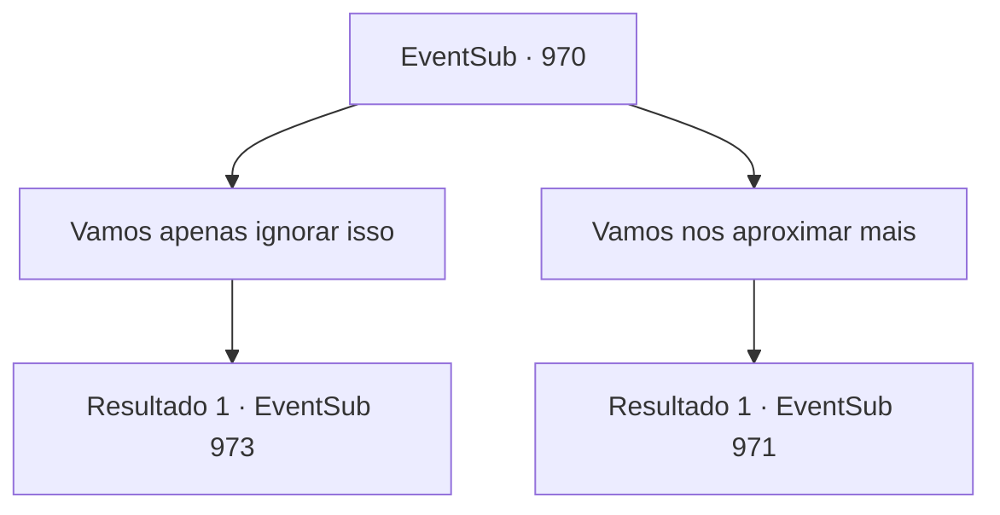

# Eventos secundários · 970

[Índice da tabela](index.md) · [Índice geral](../index.md)

ID: `pt:EventSub:970` · Fonte: `EventSub4` · Versão: 1.2.47.

Mapeamento estático dos arquivos; a disponibilidade e a execução dependem do estado da run.

## Texto do evento

*Sem texto no arquivo.*

## Dados de entrada

```json
{
  "id": 970,
  "grade": 1,
  "subEvent": "",
  "required": ""
}
```

## Mapa das escolhas



## Escolhas e resultados

### Escolha 1

Vamos apenas ignorar isso

Requisitos e outros campos da escolha:

```json
{
  "required": ""
}
```

#### Resultado 1.1

Você sugere deixar o animal em paz, ao que Lupin concorda. Você e Lupin passam pelo cervo-d'água e continuam andando. Logo, vocês encontram uma cabana de madeira. |drawing_hunterHouse| Dentro da cabana está um homem idoso, curtindo pele de animal. Ele percebe você e Lupin se aproximando, levanta-se e faz uma reverência respeitosa. Lupin o cumprimenta de volta, então pergunta se o Bispo Lukas foi visto nos terrenos de caça. O homem idoso balança a cabeça em resposta. 

 "Faz muito tempo desde que o Conde organizou uma caçada, mas meu dever de cuidar do terreno de caça ainda permanece. Então, se alguém visitasse a floresta, eu saberia. Vou lhe dizer isso - as únicas pessoas nesta floresta agora são vocês dois e eu."


Continuação registrada: [Evento 973](0973.md) na mesma tabela.

```json
{
  "required": "",
  "chance": "1",
  "nextEvent": 973,
  "type": 2,
  "reward": ""
}
```

### Escolha 2

Vamos nos aproximar mais

Requisitos e outros campos da escolha:

```json
{
  "required": ""
}
```

#### Resultado 2.1

Você se aproxima do cervo-d'água e encontra uma aranha gigante cravando suas presas venenosas em suas costas. Você e Lupin estão refletidos nos olhos compostos da aranha. 

 "G- GARRRGH!"

 Lupin salta para trás, horrorizado. A aranha gigante retira suas presas do cervo-d'água, se vira para você e então levanta suas patas dianteiras para intimidá-lo.

Continuação registrada: [Evento 971](0971.md) na mesma tabela.

```json
{
  "required": "",
  "chance": "1",
  "nextEvent": 971,
  "type": 2,
  "reward": ""
}
```

## Referências que chegam a este evento

- [Evento 969 · escolha 1 · resultado 1](0969.md#escolha-1)
