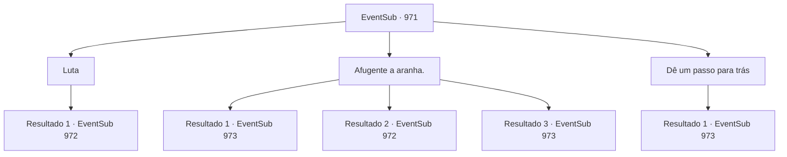

# Eventos secundários · 971

[Índice da tabela](index.md) · [Índice geral](../index.md)

ID: `pt:EventSub:971` · Fonte: `EventSub4` · Versão: 1.2.47.

Mapeamento estático dos arquivos; a disponibilidade e a execução dependem do estado da run.

## Texto do evento

*Sem texto no arquivo.*

## Dados de entrada

```json
{
  "id": 971,
  "grade": 1,
  "subEvent": "",
  "required": ""
}
```

## Mapa das escolhas



## Escolhas e resultados

### Escolha 1

Luta

Requisitos e outros campos da escolha:

```json
{
  "required": ""
}
```

#### Resultado 1.1

Você decide não deixar a aranha viver. Enquanto você se prepara para lutar, a aranha faz o mesmo, soltando um grito horrível.

Continuação registrada: [Evento 972](0972.md) na mesma tabela.

```json
{
  "required": "",
  "chance": "1",
  "nextEvent": 972,
  "type": 2,
  "reward": "6_0_5",
  "place": 1
}
```

### Escolha 2

Afugente a aranha.

Requisitos e outros campos da escolha:

```json
{
  "required": ""
}
```

#### Resultado 2.1

Você decide aceitar o desafio da aranha - levanta seus próprios braços bem alto e então ruge alto. Seu rugido funciona - a aranha gigante abaixa suas pernas e lentamente rasteja de volta para um buraco. 

 "Ufa... Minhas desculpas, aí. Eu sei que isso não é jeito de um cavaleiro se comportar... mas pelo amor de - ... eu simplesmente não suporto aranhas."

 Você nota Lupin corando de vergonha. Ele então limpa a garganta, se levanta e continua em frente. Logo, vocês dois encontram uma cabana de madeira. |drawing_hunterHouse| Dentro da cabana está um homem idoso, curtindo pele de animal. Ele nota você e Lupin se aproximando, se levanta e se inclina respeitosamente. Lupin o cumprimenta de volta, então pergunta se o Bispo Lukas foi visto nos campos de caça. O homem idoso balança a cabeça em resposta. 

 "Faz muito tempo desde que o Conde organizou uma caçada, mas meu dever de cuidar do campo de caça ainda permanece. Então, se alguém visitou a floresta, eu saberia. Vou te dizer isso - as únicas pessoas nesta floresta agora, são vocês dois e eu."


Continuação registrada: [Evento 973](0973.md) na mesma tabela.

```json
{
  "required": "21_1_4",
  "chance": "1|0_12_1",
  "nextEvent": 973,
  "type": 0,
  "reward": ""
}
```

#### Resultado 2.2

Você decide aceitar o desafio da aranha - você levanta seus próprios braços bem alto, então ruge alto. Sai pela culatra - os pelos urticantes da aranha se apertam enquanto ela salta sobre você. Parece que a aranha também estava pronta para aceitar seu desafio.

Continuação registrada: [Evento 972](0972.md) na mesma tabela.

```json
{
  "required": "21_1_4",
  "chance": "12",
  "nextEvent": 972,
  "type": 1,
  "reward": "6_3_5",
  "place": 1
}
```

#### Resultado 2.3

Você decide aceitar o desafio da aranha - levanta seus próprios braços bem alto e então ruge alto. Seu rugido funciona - a aranha gigante abaixa suas pernas e lentamente rasteja de volta para um buraco. 

 "Ufa... Minhas desculpas, aí. Eu sei que isso não é jeito de um cavaleiro se comportar... mas pelo amor de - ... eu simplesmente não suporto aranhas."

 Você nota Lupin corando de vergonha. Ele então limpa a garganta, se levanta e continua em frente. Logo, vocês dois encontram uma cabana de madeira. |drawing_hunterHouse| Dentro da cabana está um homem idoso, curtindo pele de animal. Ele nota você e Lupin se aproximando, se levanta e se inclina respeitosamente. Lupin o cumprimenta de volta, então pergunta se o Bispo Lukas foi visto nos campos de caça. O homem idoso balança a cabeça em resposta. 

 "Faz muito tempo desde que o Conde organizou uma caçada, mas meu dever de cuidar do campo de caça ainda permanece. Então, se alguém visitou a floresta, eu saberia. Vou te dizer isso - as únicas pessoas nesta floresta agora, são vocês dois e eu."


Continuação registrada: [Evento 973](0973.md) na mesma tabela.

```json
{
  "required": "20_1_4",
  "chance": "1",
  "nextEvent": 973,
  "type": 2,
  "reward": ""
}
```

### Escolha 3

Dê um passo para trás

Requisitos e outros campos da escolha:

```json
{
  "required": ""
}
```

#### Resultado 3.1

Você trava os olhos com a aranha, lentamente se afastando dela. A aranha faz o mesmo, recuando de volta para seu buraco, arrastando o cervo-d'água com os dentes. Você dá uma mão a Lupin, ajudando-o a se levantar. 

 "Ufa... Minhas desculpas por isso. Eu sei que não é assim que um cavaleiro deve se comportar... mas pelo amor de - ... eu simplesmente não suporto aranhas."

 Você nota Lupin corando de vergonha. Ele então limpa a garganta, se levanta e continua em frente. Logo, vocês dois se deparam com uma cabana de madeira. |drawing_hunterHouse| Dentro da cabana está um homem idoso, curtindo peles de animais. Ele nota você e Lupin se aproximando, se levanta e faz uma reverência respeitosa. Lupin o cumprimenta de volta, então pergunta se o Bispo Lukas foi visto nos campos de caça. O homem idoso balança a cabeça em resposta. 

 "Faz muito tempo desde que o Conde organizou uma caçada, mas meu dever de cuidar do campo de caça ainda permanece. Então, se alguém visitasse a floresta, eu saberia. Vou te dizer isso - as únicas pessoas nesta floresta agora são vocês dois e eu."


Continuação registrada: [Evento 973](0973.md) na mesma tabela.

```json
{
  "required": "",
  "chance": "1",
  "nextEvent": 973,
  "type": 2,
  "reward": ""
}
```

## Referências que chegam a este evento

- [Evento 970 · escolha 2 · resultado 1](0970.md#escolha-2)
