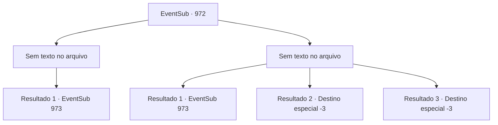

# Eventos secundários · 972

[Índice da tabela](index.md) · [Índice geral](../index.md)

ID: `pt:EventSub:972` · Fonte: `EventSub4` · Versão: 1.2.47.

Mapeamento estático dos arquivos; a disponibilidade e a execução dependem do estado da run.

## Texto do evento

*Sem texto no arquivo.*

## Dados de entrada

```json
{
  "id": 972,
  "grade": 1,
  "subEvent": "",
  "required": ""
}
```

## Mapa das escolhas



## Escolhas e resultados

### Escolha 1

*Sem texto no arquivo; o papel dessa opção depende da interface do jogo.*

Requisitos e outros campos da escolha:

```json
{
  "required": ""
}
```

#### Resultado 1.1

Você derrota a aranha gigante. Apesar dos seus esforços, o cervo-d'água já está morto. 

 "Ufa... Minhas desculpas, isso não é jeito de um cavaleiro se comportar, eu sei... mas pelo amor de - ... eu simplesmente não suporto aranhas."

 Você percebe Lupin corando de vergonha. Ele então limpa a garganta, se levanta e continua em frente. Logo, vocês dois encontram uma cabana de madeira. |drawing_hunterHouse| Dentro da cabana está um homem idoso, curtindo couro de animal. Ele percebe você e Lupin se aproximando, se levanta e faz uma reverência respeitosa. Lupin o cumprimenta de volta, então pergunta se o Bispo Lukas foi visto nos campos de caça. O homem idoso balança a cabeça em resposta. 

 "Faz muito tempo desde que o Conde organizou uma caçada, mas meu dever de cuidar do campo de caça ainda permanece. Então, se alguém visitou a floresta, eu saberia. Vou te dizer isso - as únicas pessoas nesta floresta agora, são vocês dois e eu."


Continuação registrada: [Evento 973](0973.md) na mesma tabela.

```json
{
  "required": "",
  "chance": "1",
  "nextEvent": 973,
  "type": 2,
  "reward": ""
}
```

### Escolha 2

*Sem texto no arquivo; o papel dessa opção depende da interface do jogo.*

Requisitos e outros campos da escolha:

```json
{
  "required": ""
}
```

#### Resultado 2.1

A aranha gigante te derruba no chão.   'SHIII--EEEK!'   As presas afiadas da aranha, cobertas também por pelos urticantes, se dirigem ao seu pescoço.   Nesse momento, com um ruído agudo, uma flecha atinge a aranha no abdômen.   A monstruosidade se vira dolorosamente, para discernir de onde veio a flecha.   Logo depois, outra flecha corta o ar e perfura a cabeça da aranha.   O habilidoso atirador se revela ser um homem idoso com uma barba enorme.   

 "Parece que cheguei a tempo. Você está bem?"

   Ele se apresenta como o guarda-caça, ajudando você a se levantar.   

 "O cavaleiro - Lupin - pediu minha ajuda. Siga-me."

   Você e Lupin seguem o guarda-caça.   Logo, os três se deparam com uma cabana de madeira.   |drawing_hunterHouse|   O guarda-caça coloca sua besta em uma cadeira do lado de fora, depois abre a porta da frente.   Lupin pergunta a ele se o Bispo Lukas foi visto nos terrenos de caça. O homem idoso balança a cabeça em resposta.   

 "Faz muito tempo desde que o Conde organizou uma caçada, mas meu dever de cuidar do terreno de caça ainda permanece. Então, se alguém visitou a floresta, eu saberia. Vou te dizer isso - as únicas pessoas nesta floresta agora, somos nós três."


Continuação registrada: [Evento 973](0973.md) na mesma tabela.

```json
{
  "required": "1_0_2|1_1_2",
  "chance": "1",
  "nextEvent": 973,
  "type": 2,
  "reward": "0_0_-1|0_1_-1"
}
```

#### Resultado 2.2

A aranha gigante te derruba no chão.
 'SHIII--EEEK!'
 As presas afiadas da aranha, cobertas também por pelos urticantes, se dirigem ao seu pescoço. Você sente uma forte pontada, e é a última coisa que sente antes de tudo escurecer.

Continuação registrada: [Destino especial `-3`](../destinos-especiais.md).

```json
{
  "required": "2_0_2",
  "chance": "1",
  "nextEvent": -3,
  "type": 2,
  "reward": "0_0_-1|0_1_-1"
}
```

#### Resultado 2.3

A aranha gigante te derruba no chão.
 'SHIII--EEEK!'
 As presas afiadas da aranha, cobertas também por pelos urticantes, se dirigem ao seu pescoço. Você sente uma forte pontada, e é a última coisa que sente antes de tudo escurecer.

Continuação registrada: [Destino especial `-3`](../destinos-especiais.md).

```json
{
  "required": "2_1_2",
  "chance": "1",
  "nextEvent": -3,
  "type": 2,
  "reward": "0_0_-1|0_1_-1"
}
```

## Referências que chegam a este evento

- [Evento 971 · escolha 1 · resultado 1](0971.md#escolha-1)
- [Evento 971 · escolha 2 · resultado 2](0971.md#escolha-2)
