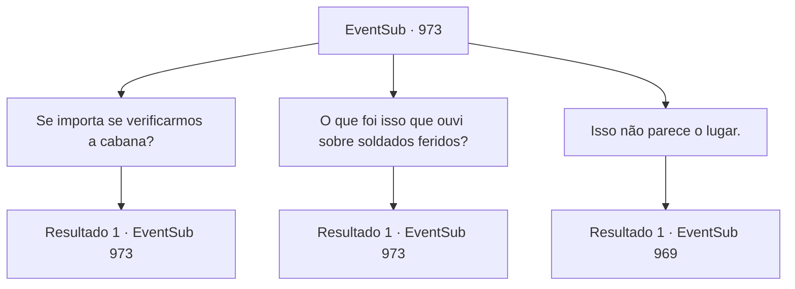

# Eventos secundários · 973

[Índice da tabela](index.md) · [Índice geral](../index.md)

ID: `pt:EventSub:973` · Fonte: `EventSub4` · Versão: 1.2.47.

Mapeamento estático dos arquivos; a disponibilidade e a execução dependem do estado da run.

## Texto do evento

*Sem texto no arquivo.*

## Dados de entrada

```json
{
  "id": 973,
  "grade": 1,
  "subEvent": "",
  "required": ""
}
```

## Mapa das escolhas



## Escolhas e resultados

### Escolha 1

Se importa se verificarmos a cabana?

Requisitos e outros campos da escolha:

```json
{
  "required": "5_771_0"
}
```

#### Resultado 1.1


 "Certo, vá em frente. Só não mexa com o equipamento de caça, por favor."

 Ele acrescenta que ter que consertar seu equipamento só porque um aventureiro indisciplinado mexeu nele seria a última coisa que ele gostaria. Você faz uma inspeção minuciosa de tudo na cabana - vários tipos de armadilhas, bestas, flechas, couro curtido e outros itens diversos usados na caça. No entanto, no final, você não consegue encontrar nada particularmente suspeito.

Continuação registrada: [Evento 973](0973.md) na mesma tabela.

```json
{
  "required": "",
  "chance": "1",
  "nextEvent": 973,
  "type": 2,
  "reward": "5_771_1"
}
```

### Escolha 2

O que foi isso que ouvi sobre soldados feridos?

Requisitos e outros campos da escolha:

```json
{
  "required": "5_772_0"
}
```

#### Resultado 2.1

Você se lembra de Lupin mencionando que alguns dos soldados das equipes de busca foram feridos. Ao recitar isso para o guarda-caça, ele responde um tanto constrangido, coçando a parte de trás da cabeça. 

 "Ah. Isso. Sim. Isso aconteceu."

 Ele diz que uma vez avistou uma equipe de busca lutando contra uma aranha gigante. Aparentemente, ele tentou ajudar atirando na aranha, mas uma de suas flechas acertou um dos soldados. 

 "Eu não queria atirar neles, com certeza. Mas estou ficando velho e... minha mira não é mais como antes."


Continuação registrada: [Evento 973](0973.md) na mesma tabela.

```json
{
  "required": "",
  "chance": "1",
  "nextEvent": 973,
  "type": 2,
  "reward": "5_772_1"
}
```

### Escolha 3

Isso não parece o lugar.

Requisitos e outros campos da escolha:

```json
{
  "required": "5_771_1|5_772_1"
}
```

#### Resultado 3.1

Você está certo. Não vejo nada fora do comum aqui. Lupin se despede do guarda-caça, pedindo desculpas pela visita repentina. O homem idoso diz para ele não se preocupar com isso e lhe entrega um punhado de itens. Você parece um aventureiro... Me lembra dos meus bons e velhos tempos. Aqui, pegue. Deve ser útil. É uma variedade de equipamentos que ele costumava usar. Você agradece ao guarda-caça, aceita o presente com alegria e deixa os campos de caça com Lupin.

Continuação registrada: [Evento 969](0969.md) na mesma tabela.

```json
{
  "required": "",
  "chance": "1",
  "nextEvent": 969,
  "type": 2,
  "reward": "3_361_1"
}
```

## Referências que chegam a este evento

- [Evento 970 · escolha 1 · resultado 1](0970.md#escolha-1)
- [Evento 971 · escolha 2 · resultado 1](0971.md#escolha-2)
- [Evento 971 · escolha 2 · resultado 3](0971.md#escolha-2)
- [Evento 971 · escolha 3 · resultado 1](0971.md#escolha-3)
- [Evento 972 · escolha 1 · resultado 1](0972.md#escolha-1)
- [Evento 972 · escolha 2 · resultado 1](0972.md#escolha-2)
- [Evento 973 · escolha 1 · resultado 1](0973.md#escolha-1)
- [Evento 973 · escolha 2 · resultado 1](0973.md#escolha-2)
