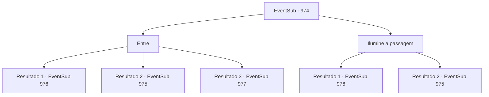

# Eventos secundários · 974

[Índice da tabela](index.md) · [Índice geral](../index.md)

ID: `pt:EventSub:974` · Fonte: `EventSub4` · Versão: 1.2.47.

Mapeamento estático dos arquivos; a disponibilidade e a execução dependem do estado da run.

## Texto do evento

*Sem texto no arquivo.*

## Dados de entrada

```json
{
  "id": 974,
  "grade": 1,
  "subEvent": "",
  "required": ""
}
```

## Mapa das escolhas



## Escolhas e resultados

### Escolha 1

Entre

Requisitos e outros campos da escolha:

```json
{
  "required": ""
}
```

#### Resultado 1.1

Você tem a habilidade de enxergar bem no escuro, então você toma a dianteira e entra nas Catacumbas. Você desce cuidadosamente os degraus de pedra rachada. Quanto mais fundo você vai, mais escuro fica. O interior das Catacumbas parece úmido e abafado. Você finalmente chega ao final da escadaria, encontrando uma passagem estreita, mal larga o suficiente para dois adultos. À frente, você avista uma armadilha bem colocada. O fio de tropeço está deliberadamente posicionado em um lugar onde qualquer um que descesse as escadas teria que pisar. A escuridão também ajuda a escondê-lo. Mas você consegue percebê-lo a tempo. Você simplesmente pula por cima dele e diz a Lupin para fazer o mesmo. 

 "Obrigado pelo aviso. Devo dizer, você tem ótimos olhos."

 Lupin faz o mesmo e pula sobre o fio de tropeço.

Continuação registrada: [Evento 976](0976.md) na mesma tabela.

```json
{
  "required": "-1|20_26_1|20_27_1",
  "chance": "1|0_14_1",
  "nextEvent": 976,
  "type": 0,
  "reward": ""
}
```

#### Resultado 1.2

Você tem a habilidade de enxergar bem no escuro, então você toma a dianteira e entra nas Catacumbas. Você desce cuidadosamente os degraus de pedra rachada. Quanto mais fundo você vai, mais escuro fica. O interior das Catacumbas parece úmido e abafado. Você finalmente chega ao fim da escadaria, encontrando um corredor estreito, mal largo o suficiente para dois adultos. Ao dar um passo à frente, você ouve algo estalar por perto. Imediatamente, você percebe uma bola de aço com espinhos voando em direção ao seu rosto.

Continuação registrada: [Evento 975](0975.md) na mesma tabela.

```json
{
  "required": "-1|20_26_1|20_27_1",
  "chance": "20",
  "nextEvent": 975,
  "type": 1,
  "reward": ""
}
```

#### Resultado 1.3

Lupin confiantemente toma a dianteira e entra nas Catacumbas. Você o segue. Você desce cuidadosamente os degraus de pedra rachada. Quanto mais você desce, mais escuro fica. O interior das Catacumbas parece úmido e abafado. Vocês dois finalmente chegam ao fim da escadaria. Nesse momento, você ouve um whoosh - o som de algo se movendo pelo ar. 

 "AAACCCCK-!!!"

 Então, com um estrondo alto, explode o grito de dor de Lupin. Você não tem ideia do que exatamente acabou de acontecer, mas está claro para você que algo atingiu Lupin e agora ele está no chão. Ele consegue se arrastar de volta para a escada, deitando-se nela. 

 "U- Ugh..."


Continuação registrada: [Evento 977](0977.md) na mesma tabela.

```json
{
  "required": "21_26_1|21_27_1",
  "chance": "1",
  "nextEvent": 977,
  "type": 2,
  "reward": "5_773_1"
}
```

### Escolha 2

Ilumine a passagem

Requisitos e outros campos da escolha:

```json
{
  "required": "-1|20_0_1|23_3_1"
}
```

#### Resultado 2.1

Você produz luz e então entra nas Catacumbas. Você desce cuidadosamente as escadas de pedra rachada. Quanto mais você desce, mais escuro fica. O interior das Catacumbas parece úmido e abafado. Você finalmente chega ao fim da escadaria, encontrando uma passagem estreita, mal larga o suficiente para dois adultos. À frente, você avista uma armadilha bem colocada. O fio de tropeço está deliberadamente colocado em um lugar onde qualquer um que descesse as escadas teria que pisar. Você simplesmente pula por cima dele e diz a Lupin para fazer o mesmo. 

 "Obrigado pelo aviso. Devo dizer, você tem ótimos olhos."

 Lupin faz o mesmo e pula sobre o fio de tropeço.

Continuação registrada: [Evento 976](0976.md) na mesma tabela.

```json
{
  "required": "",
  "chance": "1|0_14_1",
  "nextEvent": 976,
  "type": 0,
  "reward": ""
}
```

#### Resultado 2.2

Você produz luz e então entra nas Catacumbas. Você desce cuidadosamente os degraus de pedra rachada. Quanto mais fundo você vai, mais escuro fica. O interior das Catacumbas parece úmido e abafado. Você finalmente chega ao fim da escadaria, encontrando um corredor estreito, mal largo o suficiente para dois adultos. Ao dar um passo à frente, você ouve algo quebrar por perto. Imediatamente, você nota uma bola de aço com espinhos voando em direção ao seu rosto.

Continuação registrada: [Evento 975](0975.md) na mesma tabela.

```json
{
  "required": "",
  "chance": "16",
  "nextEvent": 975,
  "type": 1,
  "reward": ""
}
```

## Referências que chegam a este evento

- [Evento 969 · escolha 2 · resultado 1](0969.md#escolha-2)
