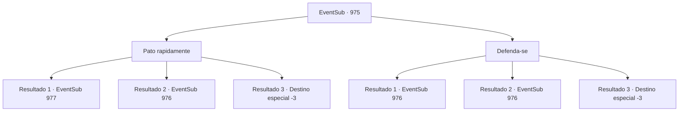

# Eventos secundários · 975

[Índice da tabela](index.md) · [Índice geral](../index.md)

ID: `pt:EventSub:975` · Fonte: `EventSub4` · Versão: 1.2.47.

Mapeamento estático dos arquivos; a disponibilidade e a execução dependem do estado da run.

## Texto do evento

*Sem texto no arquivo.*

## Dados de entrada

```json
{
  "id": 975,
  "grade": 1,
  "subEvent": "",
  "required": ""
}
```

## Mapa das escolhas



## Escolhas e resultados

### Escolha 1

Pato rapidamente

Requisitos e outros campos da escolha:

```json
{
  "required": ""
}
```

#### Resultado 1.1

Você rapidamente se abaixa, mal conseguindo desviar da bola com espinhos. A engenhoca passa voando pela sua cabeça. 

 "AAACCCCK-!!!"

 Então, com um estrondo alto, explode o grito de dor de Lupin. Ele deve ter sido atingido pela bola com espinhos. Ele consegue se arrastar de volta para as escadas, deitando-se nelas. 

 "U- Ugh..."


Continuação registrada: [Evento 977](0977.md) na mesma tabela.

```json
{
  "required": "",
  "chance": "1|0_6_1",
  "nextEvent": 977,
  "type": 0,
  "reward": "5_773_1"
}
```

#### Resultado 1.2

Você rapidamente se abaixa para desviar da bola com espinhos, mas não é rápido o suficiente. Com um estrondo alto, você se sente jogado no ar. Sua visão treme. Você acorda novamente e se encontra deitado nas escadas. 

 "...Você está bem?! EI!"

 Lupin está te dando tapas na bochecha, tentando verificar sua consciência. Você empurra a mão dele para o lado e se senta novamente. 

 "Ufa... Então você está vivo afinal. Graças aos Deuses."


Continuação registrada: [Evento 976](0976.md) na mesma tabela.

```json
{
  "required": "1_0_2",
  "chance": "16",
  "nextEvent": 976,
  "type": 1,
  "reward": "0_0_-1"
}
```

#### Resultado 1.3

Você rapidamente se abaixa para desviar da bola com espinhos, mas não é rápido o suficiente. Com um estrondo alto, você se sente jogado no ar. Sua visão treme. Sangue espirra da sua testa. E então, tudo fica preto.

Continuação registrada: [Destino especial `-3`](../destinos-especiais.md).

```json
{
  "required": "2_0_2",
  "chance": "16",
  "nextEvent": -3,
  "type": 1,
  "reward": "0_0_-1"
}
```

### Escolha 2

Defenda-se

Requisitos e outros campos da escolha:

```json
{
  "required": "20_9_1"
}
```

#### Resultado 2.1

Você bloqueia a bola com espinhos com sua arma. Lupin verifica a armadilha e comenta. 

 "Lukas, aquele bastardo astuto. Parece que ele preparou uma grande cerimônia de boas-vindas para os visitantes."


Continuação registrada: [Evento 976](0976.md) na mesma tabela.

```json
{
  "required": "",
  "chance": "1|0_6_1",
  "nextEvent": 976,
  "type": 0,
  "reward": ""
}
```

#### Resultado 2.2

Você tenta bloquear a bola com espinhos, sem sucesso. Com um estrondo alto, você se sente jogado no ar. Sua visão treme. Você acorda novamente e se encontra deitado nas escadas. 

 "...Você está bem?! EI!"

 Lupin está te dando tapas na bochecha, tentando verificar sua consciência. Você empurra a mão dele para o lado e se senta novamente. 

 "Ufa... Então você está vivo afinal. Graças aos Deuses."


Continuação registrada: [Evento 976](0976.md) na mesma tabela.

```json
{
  "required": "1_0_2",
  "chance": "10",
  "nextEvent": 976,
  "type": 1,
  "reward": "0_0_-1"
}
```

#### Resultado 2.3

Você rapidamente se abaixa para desviar da bola com espinhos, mas não é rápido o suficiente. Com um estrondo alto, você se sente jogado no ar. Sua visão treme. Sangue espirra da sua testa. E então, tudo fica preto.

Continuação registrada: [Destino especial `-3`](../destinos-especiais.md).

```json
{
  "required": "2_0_2",
  "chance": "10",
  "nextEvent": -3,
  "type": 1,
  "reward": "0_0_-1"
}
```

## Referências que chegam a este evento

- [Evento 974 · escolha 1 · resultado 2](0974.md#escolha-1)
- [Evento 974 · escolha 2 · resultado 2](0974.md#escolha-2)
