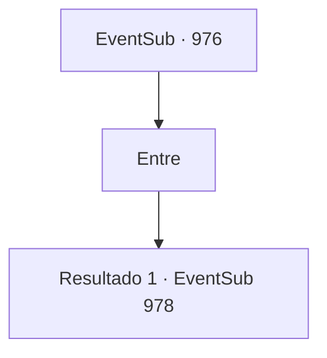

# Eventos secundários · 976

[Índice da tabela](index.md) · [Índice geral](../index.md)

ID: `pt:EventSub:976` · Fonte: `EventSub4` · Versão: 1.2.47.

Mapeamento estático dos arquivos; a disponibilidade e a execução dependem do estado da run.

## Texto do evento

*Sem texto no arquivo.*

## Dados de entrada

```json
{
  "id": 976,
  "grade": 1,
  "subEvent": "",
  "required": ""
}
```

## Mapa das escolhas



## Escolhas e resultados

### Escolha 1

Entre

Requisitos e outros campos da escolha:

```json
{
  "required": ""
}
```

#### Resultado 1.1

Você e Lupin avançam mais fundo nas Catacumbas. Exibidos ao longo das paredes negras estão pilhas de crânios empilhados uns sobre os outros. Você encontra reentrâncias nas paredes, nas quais há caixões de pedra. No final do longo corredor, você nota uma pequena luz de vela tremeluzente. Lupin olha ao redor da área, murmurando para si mesmo. 

 "Este lugar me dá arrepios. Imagino que é assim que o Inferno se parece..."

 Então, uma voz familiar ecoa do outro lado do corredor. 

 "Eu não esperava que você chegasse tão longe. Mas que pena - desista já! Edward já é MEU!"

 Lupin responde desembainhando sua espada. 

 "Posso sentir algo vil e maligno à frente. Não sei o que é, mas Lukas deve estar tramando algo realmente horrível. Quanto mais cedo o derrotarmos, melhor!"

 Então, ele avança corajosamente. |drawing_catacombCeremony| O corredor chega ao fim, e uma área ampla é revelada. Deitado no centro está ninguém menos que Edward. Você nota um círculo mágico sinistro desenhado ao redor dele, junto com algumas velas acesas, colocadas em um padrão que você não reconhece.

Continuação registrada: [Evento 978](0978.md) na mesma tabela.

```json
{
  "required": "",
  "chance": "1",
  "nextEvent": 978,
  "type": 2,
  "reward": ""
}
```

## Referências que chegam a este evento

- [Evento 974 · escolha 1 · resultado 1](0974.md#escolha-1)
- [Evento 974 · escolha 2 · resultado 1](0974.md#escolha-2)
- [Evento 975 · escolha 1 · resultado 2](0975.md#escolha-1)
- [Evento 975 · escolha 2 · resultado 1](0975.md#escolha-2)
- [Evento 975 · escolha 2 · resultado 2](0975.md#escolha-2)
- [Evento 977 · escolha 1 · resultado 1](0977.md#escolha-1)
- [Evento 977 · escolha 2 · resultado 1](0977.md#escolha-2)
