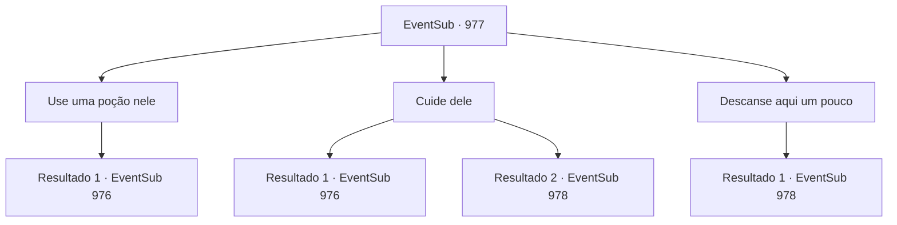

# Eventos secundários · 977

[Índice da tabela](index.md) · [Índice geral](../index.md)

ID: `pt:EventSub:977` · Fonte: `EventSub4` · Versão: 1.2.47.

Mapeamento estático dos arquivos; a disponibilidade e a execução dependem do estado da run.

## Texto do evento

*Sem texto no arquivo.*

## Dados de entrada

```json
{
  "id": 977,
  "grade": 1,
  "subEvent": "",
  "required": ""
}
```

## Mapa das escolhas



## Escolhas e resultados

### Escolha 1

Use uma poção nele

Requisitos e outros campos da escolha:

```json
{
  "required": "23_6_1"
}
```

#### Resultado 1.1

Você tira uma poção do seu inventário e a despeja na boca de Lupin. Logo, ele recobra a consciência. 

 "Ah... minha cabeça..."

 Ele se levanta, massageando a cabeça. 

 "Lukas, aquele bastardo astuto. Parece que ele preparou uma grande cerimônia de boas-vindas para os visitantes. Precisamos ser mais cuidadosos."


Continuação registrada: [Evento 976](0976.md) na mesma tabela.

```json
{
  "required": "",
  "chance": "1",
  "nextEvent": 976,
  "type": 2,
  "reward": "5_773_0|25_6_1"
}
```

### Escolha 2

Cuide dele

Requisitos e outros campos da escolha:

```json
{
  "required": ""
}
```

#### Resultado 2.1

Usando seu conhecimento médico, você cuida do ferimento de Lupin. Logo, ele recobra a consciência. 

 "Ah... minha cabeça..."

 Ele se levanta, massageando a cabeça. 

 "Lukas, aquele bastardo astuto. Parece que ele preparou uma grande cerimônia de boas-vindas para os visitantes. Precisamos ser mais cuidadosos."


Continuação registrada: [Evento 976](0976.md) na mesma tabela.

```json
{
  "required": "",
  "chance": "1|0_7_1",
  "nextEvent": 976,
  "type": 0,
  "reward": "5_773_0"
}
```

#### Resultado 2.2

Você faz o seu melhor para tratar o ferimento de Lupin, mas ele ainda está desacordado. Infelizmente, você encontra um bom lugar para ele descansar e segue sozinho para as Catacumbas mais profundas. Exibidos ao longo das paredes negras estão pilhas de crânios empilhados uns sobre os outros. Você encontra cavidades ao longo das paredes, nas quais há caixões de pedra. No final do longo corredor, você percebe uma pequena luz de vela tremeluzente. Então, uma voz familiar ecoa do outro lado do corredor. 

 "Eu não esperava que você chegasse tão longe. Mas que pena - desista já! Edward já é MEU!"

 Você segue na direção da voz. |drawing_catacombCeremony| O corredor chega ao fim, e uma área ampla é revelada. Deitado no centro está ninguém menos que Edward. Você percebe um círculo mágico sinistro desenhado ao redor dele, junto com algumas velas acesas, colocadas em um padrão que você não reconhece.

Continuação registrada: [Evento 978](0978.md) na mesma tabela.

```json
{
  "required": "",
  "chance": "10",
  "nextEvent": 978,
  "type": 1,
  "reward": ""
}
```

### Escolha 3

Descanse aqui um pouco

Requisitos e outros campos da escolha:

```json
{
  "required": ""
}
```

#### Resultado 3.1

Você encontra um bom lugar para ele descansar, indo sozinho para as Catacumbas mais profundas. Exibidos ao longo das paredes negras estão pilhas de crânios empilhados uns sobre os outros. Você encontra cavidades ao longo das paredes, nas quais estão caixões de pedra. No final do longo corredor, você nota uma pequena luz de vela tremeluzente. Então, uma voz familiar ecoa do outro lado do corredor. 

 "Eu não esperava que você chegasse tão longe. Mas que pena - desista já! Edward já é MEU!"

 Você segue na direção da voz. |drawing_catacombCeremony| O corredor chega ao fim, e uma área ampla é revelada. Deitado no centro está ninguém menos que Edward. Você nota um círculo mágico sinistro desenhado ao redor dele, junto com algumas velas acesas, colocadas em um padrão que você não reconhece.

Continuação registrada: [Evento 978](0978.md) na mesma tabela.

```json
{
  "required": "",
  "chance": "1",
  "nextEvent": 978,
  "type": 2,
  "reward": ""
}
```

## Referências que chegam a este evento

- [Evento 974 · escolha 1 · resultado 3](0974.md#escolha-1)
- [Evento 975 · escolha 1 · resultado 1](0975.md#escolha-1)
