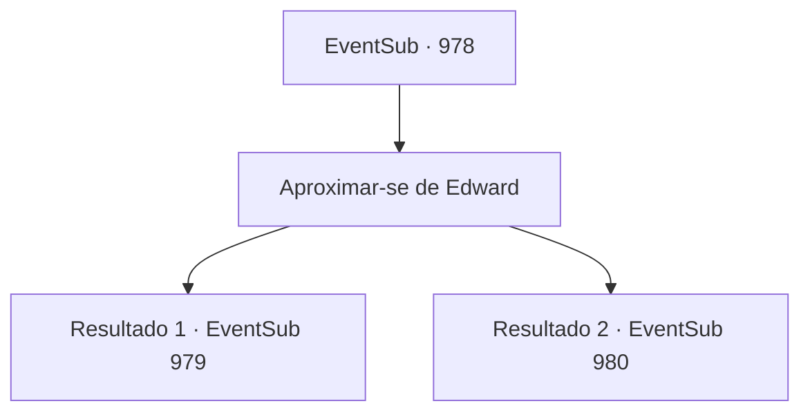

# Eventos secundários · 978

[Índice da tabela](index.md) · [Índice geral](../index.md)

ID: `pt:EventSub:978` · Fonte: `EventSub4` · Versão: 1.2.47.

Mapeamento estático dos arquivos; a disponibilidade e a execução dependem do estado da run.

## Texto do evento

*Sem texto no arquivo.*

## Dados de entrada

```json
{
  "id": 978,
  "grade": 1,
  "subEvent": "",
  "required": ""
}
```

## Mapa das escolhas



## Escolhas e resultados

### Escolha 1

Aproximar-se de Edward

Requisitos e outros campos da escolha:

```json
{
  "required": ""
}
```

#### Resultado 1.1

Você está prestes a se aproximar de Edward para ver como ele está, mas Lupin levanta a mão e sinaliza para você parar. 

 "Espere... Algo não está certo."

 Logo Lupin se prova certo - uma horda de esqueletos sai da escuridão. Suas órbitas vazias estão claramente direcionadas a você. Você e Lupin se preparam para lutar.

Continuação registrada: [Evento 979](0979.md) na mesma tabela.

```json
{
  "required": "18_773_1",
  "chance": "1",
  "nextEvent": 979,
  "type": 2,
  "reward": "6_0_12",
  "place": 7
}
```

#### Resultado 1.2

Você está prestes a se aproximar de Edward para ver como ele está. Então, uma horda de esqueletos sai da escuridão. Suas órbitas vazias estão claramente direcionadas a você. Você e Lupin se preparam para lutar.

Continuação registrada: [Evento 980](0980.md) na mesma tabela.

```json
{
  "required": "5_773_1",
  "chance": "1",
  "nextEvent": 980,
  "type": 2,
  "reward": "6_3_12",
  "place": 7
}
```

## Referências que chegam a este evento

- [Evento 976 · escolha 1 · resultado 1](0976.md#escolha-1)
- [Evento 977 · escolha 2 · resultado 2](0977.md#escolha-2)
- [Evento 977 · escolha 3 · resultado 1](0977.md#escolha-3)
