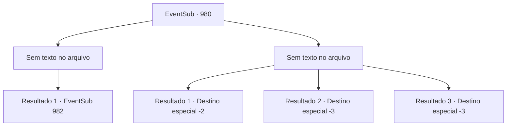

# Eventos secundários · 980

[Índice da tabela](index.md) · [Índice geral](../index.md)

ID: `pt:EventSub:980` · Fonte: `EventSub4` · Versão: 1.2.47.

Mapeamento estático dos arquivos; a disponibilidade e a execução dependem do estado da run.

## Texto do evento

*Sem texto no arquivo.*

## Dados de entrada

```json
{
  "id": 980,
  "grade": 1,
  "subEvent": "",
  "required": ""
}
```

## Mapa das escolhas



## Escolhas e resultados

### Escolha 1

*Sem texto no arquivo; o papel dessa opção depende da interface do jogo.*

Requisitos e outros campos da escolha:

```json
{
  "required": ""
}
```

#### Resultado 1.1

Você despedaça os esqueletos. Pó e fragmentos de ossos se espalham por todo o lugar. Então, algum tipo de força invisível começa a puxar os ossos, convergindo-os em um só lugar. Os ossos coletados começam a formar uma estrutura humanoide. Ela começa a emanar uma aura maligna e mortal. Lukas finalmente se revela, parado atrás da coisa gigante. 

 "Aqui será seu túmulo. MORRA!"

 Seguindo as ordens de Lukas, o golem de ossos começa a se mover.

Continuação registrada: [Evento 982](0982.md) na mesma tabela.

```json
{
  "required": "",
  "chance": "1",
  "nextEvent": 982,
  "type": 2,
  "reward": "6_0_184",
  "place": 7
}
```

### Escolha 2

*Sem texto no arquivo; o papel dessa opção depende da interface do jogo.*

Requisitos e outros campos da escolha:

```json
{
  "required": ""
}
```

#### Resultado 2.1

Os esqueletos te encurralam no chão com seus ataques. Lukas explode em risadas. 

 "BAHAHAHA! Bem feito! MORRA!"

 Seguindo as ordens de Lukas, os esqueletos marcham em sua direção. Você corre apressadamente de volta para o corredor. Antes mesmo de perceber, você está fora das Catacumbas. Você imediatamente volta para o castelo do Conde, para informar o Conde Ronan sobre o que aconteceu.

Continuação registrada: [Destino especial `-2`](../destinos-especiais.md).

```json
{
  "required": "1_0_2|1_1_2",
  "chance": "1",
  "nextEvent": -2,
  "type": 2,
  "reward": "0_0_-1|0_1_-1|12_12_11"
}
```

#### Resultado 2.2

Os esqueletos te encurralam no chão com seus ataques. Você é apunhalado no pescoço pela lâmina enferrujada do esqueleto. Sangue carmesim jorra do seu pescoço e molha o chão. 

 "*gorgolejo*... *tosse*"

 Instintivamente, você cobre seu ferimento com as mãos, mas é tudo inútil. De repente, tudo fica frio. Infelizmente, você desaba na poça do seu próprio sangue.

Continuação registrada: [Destino especial `-3`](../destinos-especiais.md).

```json
{
  "required": "2_0_2",
  "chance": "1",
  "nextEvent": -3,
  "type": 2,
  "reward": "0_0_-1|0_1_-1"
}
```

#### Resultado 2.3

Os esqueletos te encurralam no chão com seus ataques. Você é apunhalado no pescoço pela lâmina enferrujada do esqueleto. Sangue carmesim jorra do seu pescoço e molha o chão. 

 "*gorgolejo*... *tosse*"

 Instintivamente, você cobre seu ferimento com as mãos, mas é tudo inútil. De repente, tudo fica frio. Infelizmente, você desaba na poça do seu próprio sangue.

Continuação registrada: [Destino especial `-3`](../destinos-especiais.md).

```json
{
  "required": "2_1_2",
  "chance": "1",
  "nextEvent": -3,
  "type": 2,
  "reward": "0_0_-1|0_1_-1"
}
```

## Referências que chegam a este evento

- [Evento 978 · escolha 1 · resultado 2](0978.md#escolha-1)
