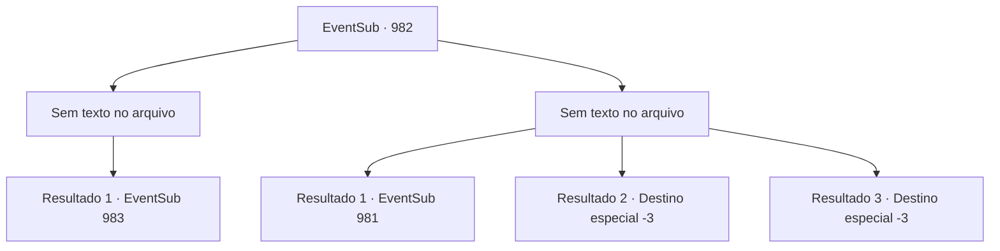

# Eventos secundários · 982

[Índice da tabela](index.md) · [Índice geral](../index.md)

ID: `pt:EventSub:982` · Fonte: `EventSub4` · Versão: 1.2.47.

Mapeamento estático dos arquivos; a disponibilidade e a execução dependem do estado da run.

## Texto do evento

*Sem texto no arquivo.*

## Dados de entrada

```json
{
  "id": 982,
  "grade": 1,
  "subEvent": "",
  "required": ""
}
```

## Mapa das escolhas



## Escolhas e resultados

### Escolha 1

*Sem texto no arquivo; o papel dessa opção depende da interface do jogo.*

Requisitos e outros campos da escolha:

```json
{
  "required": ""
}
```

#### Resultado 1.1

Você desfere um golpe decisivo no golem, despedaçando-o. 

 "Tck... Kyahahah... AHAHAHAHA!"

 Com o rosto pressionado contra o chão, Lukas começa a rir maniacamente. 

 "Já está - JÁ ESTÁ TUDO ACABADO! Eu tenho Edward sob meu controle... Sem mim, ele não passa de uma casca sem alma!"

 Então, do corredor, aparece Lupin. Ele cambaleia em sua direção, depois saca sua arma assim que vê Lukas.

Continuação registrada: [Evento 983](0983.md) na mesma tabela.

```json
{
  "required": "",
  "chance": "1",
  "nextEvent": 983,
  "type": 2,
  "reward": ""
}
```

### Escolha 2

*Sem texto no arquivo; o papel dessa opção depende da interface do jogo.*

Requisitos e outros campos da escolha:

```json
{
  "required": ""
}
```

#### Resultado 2.1

Você luta bravamente, mas simplesmente não consegue encontrar uma maneira de derrotar o gigante golem de ossos. Com um golpe de seus punhos colossais, você é jogado desamparadamente ao chão. Lukas está diante de você, zombando. 

 "Hora de terminar isso."

 Lukas levanta ambos os braços - o golem faz o mesmo, presumivelmente para encerrar a batalha. Então, a voz de Lupin ecoa do fundo. 

 "PARE!! Seu monstro!"

 Ele ainda está sangrando da testa, do ferimento que sofreu com a armadilha de bola com espinhos mais cedo. Mesmo assim, ele ainda consegue avançar contra o golem de ossos com sua arma levantada.

Continuação registrada: [Evento 981](0981.md) na mesma tabela.

```json
{
  "required": "1_0_2|1_1_2",
  "chance": "1",
  "nextEvent": 981,
  "type": 2,
  "reward": "0_0_-1|0_1_-1|6_0_184",
  "place": 7
}
```

#### Resultado 2.2

Você luta valentemente, mas simplesmente não consegue encontrar uma maneira de derrotar o gigante golem de ossos. Com um golpe de seus punhos colossais, você é jogado desamparadamente ao chão. Lukas está diante de você, zombando. 

 "Você me lembra uma barata. Fraca, mas tenaz. Agora, é hora de acabarmos com isso."

 Lukas levanta ambos os braços - o golem faz o mesmo, presumivelmente para encerrar a batalha. Então, o punho colossal desce sobre você.

Continuação registrada: [Destino especial `-3`](../destinos-especiais.md).

```json
{
  "required": "2_0_2",
  "chance": "1",
  "nextEvent": -3,
  "type": 2,
  "reward": "0_0_-1|0_1_-1"
}
```

#### Resultado 2.3

Você luta valentemente, mas simplesmente não consegue encontrar uma maneira de derrotar o gigante golem de ossos. Com um golpe de seus punhos colossais, você é jogado desamparadamente ao chão. Lukas está diante de você, zombando. 

 "Você me lembra uma barata. Fraca, mas tenaz. Agora, é hora de acabarmos com isso."

 Lukas levanta ambos os braços - o golem faz o mesmo, presumivelmente para encerrar a batalha. Então, o punho colossal desce sobre você.

Continuação registrada: [Destino especial `-3`](../destinos-especiais.md).

```json
{
  "required": "2_1_2",
  "chance": "1",
  "nextEvent": -3,
  "type": 2,
  "reward": "0_0_-1|0_1_-1"
}
```

## Referências que chegam a este evento

- [Evento 980 · escolha 1 · resultado 1](0980.md#escolha-1)
