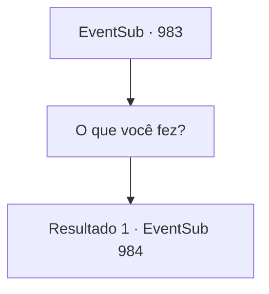

# Eventos secundários · 983

[Índice da tabela](index.md) · [Índice geral](../index.md)

ID: `pt:EventSub:983` · Fonte: `EventSub4` · Versão: 1.2.47.

Mapeamento estático dos arquivos; a disponibilidade e a execução dependem do estado da run.

## Texto do evento

*Sem texto no arquivo.*

## Dados de entrada

```json
{
  "id": 983,
  "grade": 1,
  "subEvent": "",
  "required": ""
}
```

## Mapa das escolhas



## Escolhas e resultados

### Escolha 1

O que você fez?

Requisitos e outros campos da escolha:

```json
{
  "required": ""
}
```

#### Resultado 1.1

Lukas responde olhando para você com raiva. 

 "Heehee... Eu o transformei no meu próprio fantoche. Vá em frente, me mate. Você nunca será capaz de restaurar a alma do garoto novamente."

 Lupin range os dentes de raiva. 

 "Isso não vai acontecer! {1}, você poderia dar uma olhada no círculo mágico?"


Continuação registrada: [Evento 984](0984.md) na mesma tabela.

```json
{
  "required": "",
  "chance": "1",
  "nextEvent": 984,
  "type": 2,
  "reward": ""
}
```

## Referências que chegam a este evento

- [Evento 981 · escolha 1 · resultado 1](0981.md#escolha-1)
- [Evento 982 · escolha 1 · resultado 1](0982.md#escolha-1)
