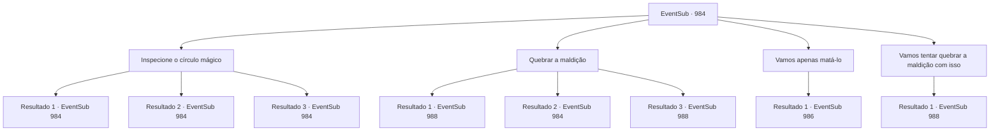

# Eventos secundários · 984

[Índice da tabela](index.md) · [Índice geral](../index.md)

ID: `pt:EventSub:984` · Fonte: `EventSub4` · Versão: 1.2.47.

Mapeamento estático dos arquivos; a disponibilidade e a execução dependem do estado da run.

## Texto do evento

*Sem texto no arquivo.*

## Dados de entrada

```json
{
  "id": 984,
  "grade": 1,
  "subEvent": "",
  "required": ""
}
```

## Mapa das escolhas



## Escolhas e resultados

### Escolha 1

Inspecione o círculo mágico

Requisitos e outros campos da escolha:

```json
{
  "required": "5_796_0"
}
```

#### Resultado 1.1

Você verifica o círculo mágico desenhado ao redor de Edward. Está inscrito com uma maldição, destinada a limitar as habilidades cognitivas da vítima e forçá-la a obedecer às ordens de um certo indivíduo. Lukas zomba de você. 

 "Tsk... Então você reconhece, afinal. Isso mesmo - tudo o que acabei de dizer é verdade."

 "É mesmo? Então o que fazemos? A maldição pode ser desfeita?"

 Lupin pergunta a você com a voz trêmula, ansioso para salvar Edward.

Continuação registrada: [Evento 984](0984.md) na mesma tabela.

```json
{
  "required": "21_0_4",
  "chance": "1|0_7_1",
  "nextEvent": 984,
  "type": 0,
  "reward": "5_796_1"
}
```

#### Resultado 1.2

Você verifica o círculo mágico desenhado ao redor de Edward. A única coisa que você consegue perceber é que é muito complicado. Lukas zomba de você. 

 "Bahaha! Simples como você não entenderia! Agora, o que você vai fazer? Se você se desculpar pela sua grosseria e se curvar, eu posso considerar levantar essa maldição para você!"

 Lupin responde pressionando a cabeça de Lukas com mais força. Ele então se vira para você e pergunta. 

 "O que devemos fazer...?"


Continuação registrada: [Evento 984](0984.md) na mesma tabela.

```json
{
  "required": "21_0_4",
  "chance": "20",
  "nextEvent": 984,
  "type": 1,
  "reward": "5_796_9"
}
```

#### Resultado 1.3

Você verifica o círculo mágico desenhado ao redor de Edward. Está inscrito com uma maldição, destinada a limitar as habilidades cognitivas da vítima e forçá-la a obedecer às ordens de um certo indivíduo. Lukas zomba de você. 

 "Tsk... Então você reconhece, afinal. Isso mesmo - tudo o que acabei de dizer é verdade."

 "É mesmo? Então o que fazemos? A maldição pode ser desfeita?"

 Lupin pergunta a você com a voz trêmula, ansioso para salvar Edward.

Continuação registrada: [Evento 984](0984.md) na mesma tabela.

```json
{
  "required": "20_0_4",
  "chance": "1",
  "nextEvent": 984,
  "type": 2,
  "reward": "5_796_1"
}
```

### Escolha 2

Quebrar a maldição

Requisitos e outros campos da escolha:

```json
{
  "required": "5_796_1"
}
```

#### Resultado 2.1

Você reúne sua concentração, dissipando a maldição complexa que Lukas colocou em Edward. Por um momento, sua expressão fica vazia, como se ele tivesse acabado de acordar de um longo sonho. Logo, seus olhos voltam ao normal. 

 "Onde estou eu -... *suspiro*"

 Edward se senta e olha ao redor, nota Lukas, então se afasta, horrorizado. 

 "A- ARGH!!"

 Lupin joga Lukas para o lado, se aproxima de Edward e o abraça apertado. 

 "Tudo vai ficar bem, Jovem Mestre. Estou aqui."

 Enquanto isso, Lukas aproveita a oportunidade e tira um pergaminho do bolso. 

 "*tosse*... Droga... MALDIÇÃO!"

 Você tenta detê-lo, mas não é rápido o suficiente. Com um clarão brilhante, Lukas desaparece.

Continuação registrada: [Evento 988](0988.md) na mesma tabela.

```json
{
  "required": "21_0_4",
  "chance": "1|0_7_1|0_12_1",
  "nextEvent": 988,
  "type": 0,
  "reward": "5_796_2"
}
```

#### Resultado 2.2

Você tenta dissipar a maldição que Lukas lançou em Edward, mas sem sucesso. Edward ainda está no chão, silencioso e vazio. Lukas ri, vendo você falhar.

Continuação registrada: [Evento 984](0984.md) na mesma tabela.

```json
{
  "required": "21_0_4",
  "chance": "40",
  "nextEvent": 984,
  "type": 1,
  "reward": "5_796_9"
}
```

#### Resultado 2.3

Você reúne sua concentração, dissipando a maldição complexa que Lukas colocou em Edward. Por um momento, sua expressão fica vazia, como se ele tivesse acabado de acordar de um longo sonho. Logo, seus olhos voltam ao normal. 

 "Onde estou eu -... *suspiro*"

 Edward se senta e olha ao redor, nota Lukas, então se afasta, horrorizado. 

 "A- ARGH!!"

 Lupin joga Lukas para o lado, se aproxima de Edward e o abraça apertado. 

 "Tudo vai ficar bem, Jovem Mestre. Estou aqui."

 Enquanto isso, Lukas aproveita a oportunidade e tira um pergaminho do bolso. 

 "*tosse*... Droga... MALDIÇÃO!"

 Você tenta detê-lo, mas não é rápido o suficiente. Com um clarão brilhante, Lukas desaparece.

Continuação registrada: [Evento 988](0988.md) na mesma tabela.

```json
{
  "required": "20_0_4",
  "chance": "1",
  "nextEvent": 988,
  "type": 2,
  "reward": "5_796_2"
}
```

### Escolha 3

Vamos apenas matá-lo

Requisitos e outros campos da escolha:

```json
{
  "required": ""
}
```

#### Resultado 3.1

Você diz a Lupin que Lukas deveria ser morto aqui e agora, em vez de dar a ele a vantagem de arrastar Edward por aí. Lukas fica visivelmente surpreso ao ouvir isso. 

 "O- o quê?! Você não se importaria com o que acontece com o filho do Conde?!"

 Lupin fecha os olhos, bastante dolorosamente. 

 "*suspiro*... Você tem razão. Melhor remover a causa de todo o problema, em vez de deixá-lo pressionar o Conde. Certo. Faça isso. Mas não posso assumir total responsabilidade pelo que acontecerá a seguir."


Continuação registrada: [Evento 986](0986.md) na mesma tabela.

```json
{
  "required": "",
  "chance": "1",
  "nextEvent": 986,
  "type": 2,
  "reward": ""
}
```

### Escolha 4

Vamos tentar quebrar a maldição com isso

Requisitos e outros campos da escolha:

```json
{
  "required": "23_9_1"
}
```

#### Resultado 4.1

Com um item para te ajudar, você dissipa a complexa maldição que Lukas colocou em Edward. Por um momento, sua expressão fica vazia, como se ele tivesse acabado de acordar de um longo sonho. Logo, seus olhos voltam ao normal. 

 "Onde estou eu -... *suspiro*"

 Edward se senta e olha ao redor, nota Lukas, então se afasta, horrorizado. 

 "A- ARGH!!"

 Lupin joga Lukas para o lado, se aproxima de Edward e o abraça apertado. 

 "Tudo vai ficar bem, Jovem Mestre. Eu estou aqui."

 Enquanto isso, Lukas aproveita a oportunidade e tira um pergaminho de seus bolsos. 

 "*tosse*... Droga... MALDITO SEJA!"

 Você tenta detê-lo, mas não é rápido o suficiente. Com um clarão brilhante, Lukas desaparece.

Continuação registrada: [Evento 988](0988.md) na mesma tabela.

```json
{
  "required": "",
  "chance": "1",
  "nextEvent": 988,
  "type": 2,
  "reward": "5_796_2"
}
```

## Referências que chegam a este evento

- [Evento 983 · escolha 1 · resultado 1](0983.md#escolha-1)
- [Evento 984 · escolha 1 · resultado 1](0984.md#escolha-1)
- [Evento 984 · escolha 1 · resultado 2](0984.md#escolha-1)
- [Evento 984 · escolha 1 · resultado 3](0984.md#escolha-1)
- [Evento 984 · escolha 2 · resultado 2](0984.md#escolha-2)
