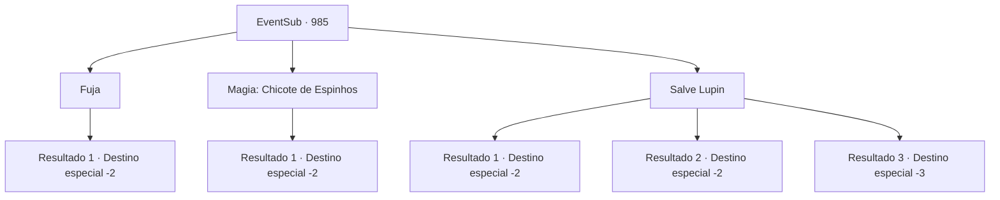

# Eventos secundários · 985

[Índice da tabela](index.md) · [Índice geral](../index.md)

ID: `pt:EventSub:985` · Fonte: `EventSub4` · Versão: 1.2.47.

Mapeamento estático dos arquivos; a disponibilidade e a execução dependem do estado da run.

## Texto do evento

*Sem texto no arquivo.*

## Dados de entrada

```json
{
  "id": 985,
  "grade": 1,
  "subEvent": "",
  "required": ""
}
```

## Mapa das escolhas



## Escolhas e resultados

### Escolha 1

Fuja

Requisitos e outros campos da escolha:

```json
{
  "required": ""
}
```

#### Resultado 1.1

Você foge das Catacumbas, deixando Lupin sozinho. Alguns segundos depois, após uma série de baques, tudo fica em silêncio. Você imediatamente volta ao castelo do Conde, para informar o Conde Ronan sobre o que aconteceu.

Continuação registrada: [Destino especial `-2`](../destinos-especiais.md).

```json
{
  "required": "",
  "chance": "1",
  "nextEvent": -2,
  "type": 2,
  "reward": "12_12_11"
}
```

### Escolha 2

Magia: Chicote de Espinhos

Requisitos e outros campos da escolha:

```json
{
  "required": "20_0_1|1_14_16"
}
```

#### Resultado 2.1

Você lança Chicote de Espinhos, puxando Lukas em cima de Lupin. 

 "...Hã...?"

 O punho do golem desaba sobre os dois. Com um estrondo alto, toda a Catacumba treme. Quando a poeira se dissipa, Lupin rasteja para fora do que sobrou do punho do golem. Ele está coberto de sangue - Lupin esclarece que o sangue não é dele. 

 "...Obrigado por isso. Quanto a Lukas..."

 Ele fala, olhando para a pilha de carne dilacerada que costumava ser Lukas, preso sob o golem de ossos que parou de funcionar. 

 "Eu o teria submetido a um julgamento oficial, mas... acho que isso não é mais uma opção."

 Você deixa a Catacumba com Lupin e Edward. 

 "Ufa... Você salvou minha vida lá atrás, a propósito. Não posso te agradecer o suficiente. Passe no castelo do Conde Ronan, se tiver tempo."

 E então, Lupin sai com Edward.

Continuação registrada: [Destino especial `-2`](../destinos-especiais.md).

```json
{
  "required": "",
  "chance": "1",
  "nextEvent": -2,
  "type": 2,
  "reward": "12_12_6"
}
```

### Escolha 3

Salve Lupin

Requisitos e outros campos da escolha:

```json
{
  "required": ""
}
```

#### Resultado 3.1

Você corre em direção a Lupin, agarrando-o e saindo do caminho do perigo. O local onde ele estava há alguns segundos foi esmagado pelo punho do golem. Lukas revela um sorriso diabólico. 

 "Kyahahaha! Veja como você caiu, oh Lupin, o nobre cavaleiro! De que adianta sua esgrima, quando agora você está rolando como um verme desesperado?!"

 Você percebe que o punho do golem danificou a estrutura das Catacumbas, causando rachaduras nas paredes. Lukas levanta as mãos novamente, ao que o Necrotitan segue, levantando seu punho. O golem desfere outro golpe no chão, desta vez fazendo o teto desabar. 

 "AAAAAHHHH--!!"

 Lukas é esmagado sob uma pilha de pedras, e o corpo do Necrotitan se despedaça em uma pilha de ossos. Edward, mesmo enquanto tudo está desmoronando ao seu redor, fica ali parado, sem reação. Lupin tenta entender o que está acontecendo e logo grita. 

 "*suspiro* J- JOVEM MESTRE!"

 Você e Lupin rapidamente pegam Edward e correm para fora das Catacumbas em colapso. Não muito tempo depois, toda a estrutura desaparece. 

 "Ufa... Você salvou minha vida lá atrás, a propósito. Não posso te agradecer o suficiente. Passe no castelo do Conde Ronan, se tiver tempo."

 E então, Lupin sai com Edward.

Continuação registrada: [Destino especial `-2`](../destinos-especiais.md).

```json
{
  "required": "",
  "chance": "1|0_6_1",
  "nextEvent": -2,
  "type": 0,
  "reward": "12_12_6|5_797_1"
}
```

#### Resultado 3.2

Você tenta empurrar Lupin para fora do perigo. Mas o punho do golem é mais rápido que você. Infelizmente, o poderoso punho transforma o nobre cavaleiro em uma panqueca de Lupin. 

 "Gahaha... KYAHAHAHA!!"

 Lukas explode em uma risada satisfeita. O golem então vira a cabeça para você. Você sai correndo, deixando as Catacumbas, antes que o punho te alcance também. Você imediatamente volta para o castelo do Conde, para informar o Conde Ronan sobre o que aconteceu.

Continuação registrada: [Destino especial `-2`](../destinos-especiais.md).

```json
{
  "required": "1_0_2",
  "chance": "20",
  "nextEvent": -2,
  "type": 1,
  "reward": "12_12_11|0_0_-1"
}
```

#### Resultado 3.3

Você corre em direção a Lupin, agarrando-o e tentando sair do caminho do perigo. Mas, infelizmente, o punho é mais rápido, e vocês dois são transformados em duas panquecas humanas.

Continuação registrada: [Destino especial `-3`](../destinos-especiais.md).

```json
{
  "required": "2_0_2",
  "chance": "20",
  "nextEvent": -3,
  "type": 1,
  "reward": "0_0_-1"
}
```

## Referências que chegam a este evento

- [Evento 981 · escolha 2 · resultado 1](0981.md#escolha-2)
