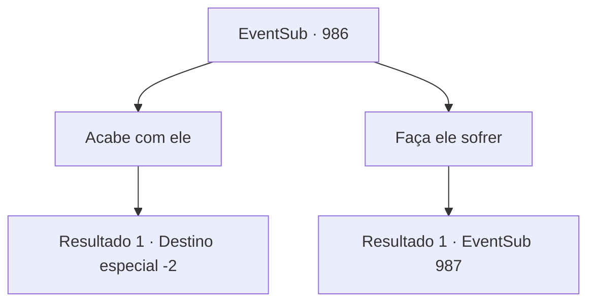

# Eventos secundários · 986

[Índice da tabela](index.md) · [Índice geral](../index.md)

ID: `pt:EventSub:986` · Fonte: `EventSub4` · Versão: 1.2.47.

Mapeamento estático dos arquivos; a disponibilidade e a execução dependem do estado da run.

## Texto do evento

*Sem texto no arquivo.*

## Dados de entrada

```json
{
  "id": 986,
  "grade": 1,
  "subEvent": "",
  "required": ""
}
```

## Mapa das escolhas



## Escolhas e resultados

### Escolha 1

Acabe com ele

Requisitos e outros campos da escolha:

```json
{
  "required": ""
}
```

#### Resultado 1.1

Você pega a espada de Lupin e corta o pescoço de Lupin. Ele estava tentando dizer algo, mas infelizmente, ele não possuía mais a capacidade de falar. O corpo sem cabeça de Lukas desaba no chão. Lupin cobre os olhos de Edward para ele. 

 "Eu o teria submetido a um julgamento oficial, mas... acho que isso não é mais uma opção."

 Você deixa as Catacumbas com Lupin e Edward. 

 "Você salvou minha vida lá atrás, a propósito. Não posso te agradecer o suficiente. Passe no castelo do Conde Ronan, se tiver tempo."

 E então, Lupin sai com Edward.

Continuação registrada: [Destino especial `-2`](../destinos-especiais.md).

```json
{
  "required": "",
  "chance": "1",
  "nextEvent": -2,
  "type": 2,
  "reward": "12_12_6|0_3_-3"
}
```

### Escolha 2

Faça ele sofrer

Requisitos e outros campos da escolha:

```json
{
  "required": ""
}
```

#### Resultado 2.1

Você coloca um pé em um dos dedos de Lukas e pisa o mais forte possível. 

 "A- AACCCKKKK...!! PARE- P - POR FAVOR!!"

 O dedo dele nem está quebrado ainda... mas ele cede mesmo assim, com os olhos cheios de lágrimas. 

 "*ofegante*... *ofegante*... M- meus dedos..."

 Você levanta o pé novamente, e Lukas balança a cabeça apressadamente, espantado. 

 "T- TÁ BOM...! Eu vou levantar a maldição. M- mas por favor, poupe minha vida!"


Continuação registrada: [Evento 987](0987.md) na mesma tabela.

```json
{
  "required": "",
  "chance": "1",
  "nextEvent": 987,
  "type": 2,
  "reward": "0_3_-1"
}
```

## Referências que chegam a este evento

- [Evento 984 · escolha 3 · resultado 1](0984.md#escolha-3)
