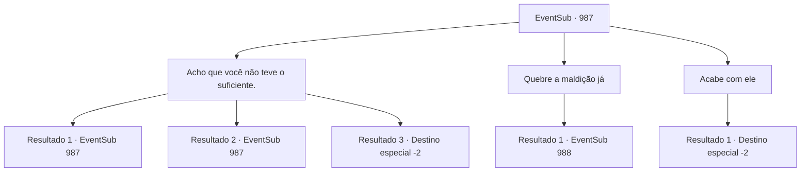

# Eventos secundários · 987

[Índice da tabela](index.md) · [Índice geral](../index.md)

ID: `pt:EventSub:987` · Fonte: `EventSub4` · Versão: 1.2.47.

Mapeamento estático dos arquivos; a disponibilidade e a execução dependem do estado da run.

## Texto do evento

*Sem texto no arquivo.*

## Dados de entrada

```json
{
  "id": 987,
  "grade": 1,
  "subEvent": "",
  "required": ""
}
```

## Mapa das escolhas



## Escolhas e resultados

### Escolha 1

Acho que você não teve o suficiente.

Requisitos e outros campos da escolha:

```json
{
  "required": "18_827_3"
}
```

#### Resultado 1.1

Você bate mais em Lukas.   O corpo dele se contorce violentamente, como uma minhoca que foi coberta de sal.   <link=shake>

 "P- por favor...! *tosse*...! Misericórdia..."

</link>

Continuação registrada: [Evento 987](0987.md) na mesma tabela.

```json
{
  "required": "5_827_0",
  "chance": "1",
  "nextEvent": 987,
  "type": 2,
  "reward": "5_827_1|0_3_-1"
}
```

#### Resultado 1.2

Lukas está claramente exausto, mas você continua batendo nele. Ele está visivelmente enfraquecido - ele nem está se mexendo mais. 

 "Ack...! E- Eu sinto muito, é tudo minha culpa. Por favor-..."

 Até Lupin se encolhe ao ver o quão miserável e desesperadamente Lukas está implorando para você parar.

Continuação registrada: [Evento 987](0987.md) na mesma tabela.

```json
{
  "required": "5_827_1",
  "chance": "1",
  "nextEvent": 987,
  "type": 2,
  "reward": "5_827_2|0_3_-1"
}
```

#### Resultado 1.3


 "U- ugh..."

 Você dá a Lukas uma última surra. Lupin cobre os olhos de Edward para ele. Lukas está deitado no chão, imóvel. 

 "Eu teria feito um julgamento oficial, mas... acho que isso não é mais uma opção."

 Você sai das Catacumbas com Lupin e Edward. 

 "Você salvou minha vida lá atrás, a propósito. Não posso te agradecer o suficiente. Passe no castelo do Conde Ronan, se tiver tempo."

 E então, Lupin sai com Edward.

Continuação registrada: [Destino especial `-2`](../destinos-especiais.md).

```json
{
  "required": "5_827_2",
  "chance": "1",
  "nextEvent": -2,
  "type": 2,
  "reward": "12_12_6|5_827_3|0_3_-5|5_798_1"
}
```

### Escolha 2

Quebre a maldição já

Requisitos e outros campos da escolha:

```json
{
  "required": ""
}
```

#### Resultado 2.1

Você decide poupar Lukas. Ele se curva para agradecer, então levanta a maldição sobre Edward. Os olhos de Edward voltam ao normal. 

 "Onde estou eu -... *suspiro*"

 Edward se senta e olha ao redor, nota Lukas, então se afasta, horrorizado. Lupin se aproxima de Edward e o abraça apertado, assegurando-lhe que tudo ficará bem. Enquanto isso, Lukas aproveita a oportunidade e tira um pergaminho do bolso. 

 "*tosse*... Droga... MALDITO SEJA!"

 Você tenta impedi-lo, mas não é rápido o suficiente. Com um clarão brilhante, Lukas desaparece.

Continuação registrada: [Evento 988](0988.md) na mesma tabela.

```json
{
  "required": "",
  "chance": "1",
  "nextEvent": 988,
  "type": 2,
  "reward": "5_796_2"
}
```

### Escolha 3

Acabe com ele

Requisitos e outros campos da escolha:

```json
{
  "required": ""
}
```

#### Resultado 3.1

Você pega a espada de Lupin e corta o pescoço de Lupin. Ele estava tentando dizer algo, mas infelizmente, ele não possuía mais a capacidade de falar. O corpo sem cabeça de Lukas desaba no chão. Lupin cobre os olhos de Edward para ele. 

 "Eu o teria submetido a um julgamento oficial, mas... acho que isso não é mais uma opção."

 Você deixa as Catacumbas com Lupin e Edward. 

 "Você salvou minha vida lá atrás, a propósito. Não posso te agradecer o suficiente. Passe no castelo do Conde Ronan, se tiver tempo."

 E então, Lupin sai com Edward.

Continuação registrada: [Destino especial `-2`](../destinos-especiais.md).

```json
{
  "required": "",
  "chance": "1",
  "nextEvent": -2,
  "type": 2,
  "reward": "12_12_6|0_3_-5|5_798_1"
}
```

## Referências que chegam a este evento

- [Evento 986 · escolha 2 · resultado 1](0986.md#escolha-2)
- [Evento 987 · escolha 1 · resultado 1](0987.md#escolha-1)
- [Evento 987 · escolha 1 · resultado 2](0987.md#escolha-1)
