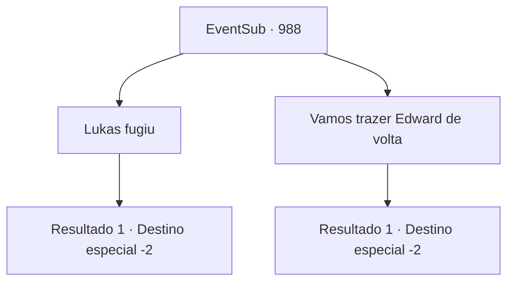

# Eventos secundários · 988

[Índice da tabela](index.md) · [Índice geral](../index.md)

ID: `pt:EventSub:988` · Fonte: `EventSub4` · Versão: 1.2.47.

Mapeamento estático dos arquivos; a disponibilidade e a execução dependem do estado da run.

## Texto do evento

*Sem texto no arquivo.*

## Dados de entrada

```json
{
  "id": 988,
  "grade": 1,
  "subEvent": "",
  "required": ""
}
```

## Mapa das escolhas



## Escolhas e resultados

### Escolha 1

Lukas fugiu

Requisitos e outros campos da escolha:

```json
{
  "required": "18_796_2"
}
```

#### Resultado 1.1

Você conta a Lupin que Lukas escapou. Lupin estala a língua. 

 "Tsk... Teria sido muito melhor se o capturássemos aqui. Mas, infelizmente."

 Ele continua, verificando Edward. 

 "...Temo que o Jovem Mestre não esteja bem. Seu corpo precisa descansar. Não acho que possamos chegar ao castelo do Conde neste estado."

 Ele acrescenta que vai encontrar um lugar para se esconder nas proximidades para recuperar energia. Ele rapidamente escreve uma carta e a entrega a você. 

 "Não se preocupe comigo. Sei como me esconder quando preciso. É vital que você entregue a carta nas mãos do Conde. Escrevi que vou precisar de alguns reforços para escolta. Prometa-me que a entregará."

 Você pega a carta e se despede deles.

Continuação registrada: [Destino especial `-2`](../destinos-especiais.md).

```json
{
  "required": "",
  "chance": "1",
  "nextEvent": -2,
  "type": 2,
  "reward": "12_12_7|3_366_1"
}
```

### Escolha 2

Vamos trazer Edward de volta

Requisitos e outros campos da escolha:

```json
{
  "required": "5_796_2"
}
```

#### Resultado 2.1

Você sugere levar Edward imediatamente para o castelo do Conde, mas Lupin recusa. 

 "...Temo que o Jovem Mestre não esteja bem. Seu corpo precisa de descanso. Não acho que possamos chegar ao castelo do Conde neste estado."

 Ele acrescenta que vai encontrar um lugar para se esconder nas proximidades para recuperar energia, aguardando reforços para escolta. Ele rapidamente escreve uma carta e a entrega a você. 

 "Não se preocupe comigo. Sei como me esconder quando preciso. Mas me prometa - é vital que você entregue a carta nas mãos do Conde."

 Você pega a carta e se despede deles.

Continuação registrada: [Destino especial `-2`](../destinos-especiais.md).

```json
{
  "required": "",
  "chance": "1",
  "nextEvent": -2,
  "type": 2,
  "reward": "12_12_7|3_366_1"
}
```

## Referências que chegam a este evento

- [Evento 984 · escolha 2 · resultado 1](0984.md#escolha-2)
- [Evento 984 · escolha 2 · resultado 3](0984.md#escolha-2)
- [Evento 984 · escolha 4 · resultado 1](0984.md#escolha-4)
- [Evento 987 · escolha 2 · resultado 1](0987.md#escolha-2)
