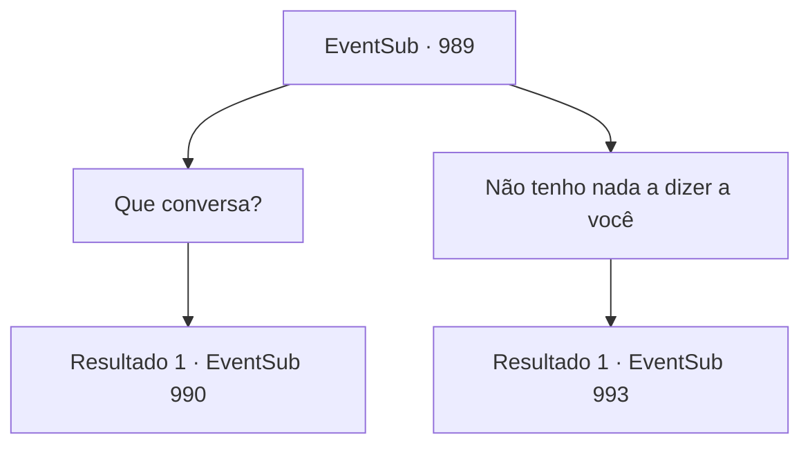

# Eventos secundários · 989

[Índice da tabela](index.md) · [Índice geral](../index.md)

ID: `pt:EventSub:989` · Fonte: `EventSub4` · Versão: 1.2.47.

Mapeamento estático dos arquivos; a disponibilidade e a execução dependem do estado da run.

## Texto do evento

Com a carta de Lupin em mãos, você está a caminho de 'Rouent', a capital do Condado de Ronan. Então, você se depara com um grupo de soldados armados. Entre eles está Lukas, que logo se apresenta diante de você. Pela maneira arrogante como ele está olhando para você, você assume que Lukas se sente confiante de que tem a vantagem aqui. 

 "Espere, parece que você está sozinho! Bem, isso tornará tudo muito mais fácil, sem aquele Lupin cabeça-dura. Vamos ter uma conversa, você e eu, certo?"


## Dados de entrada

```json
{
  "id": 989,
  "grade": 1,
  "subEvent": "",
  "required": "12_12_7|1_2_35"
}
```

## Mapa das escolhas



## Escolhas e resultados

### Escolha 1

Que conversa?

Requisitos e outros campos da escolha:

```json
{
  "required": ""
}
```

#### Resultado 1.1

Lukas responde imediatamente. 

 "Eu ia perguntar, por que você está tão determinado a trazer Edward de volta para Ronan de qualquer maneira. Você acha que o garoto ficará feliz quando voltar? Não. Absolutamente não. Ele vai se envolver em política familiar e morrer uma morte terrível. Sou eu quem pode lhe dar verdadeira liberdade."


Continuação registrada: [Evento 990](0990.md) na mesma tabela.

```json
{
  "required": "",
  "chance": "1",
  "nextEvent": 990,
  "type": 2,
  "reward": ""
}
```

### Escolha 2

Não tenho nada a dizer a você

Requisitos e outros campos da escolha:

```json
{
  "required": ""
}
```

#### Resultado 2.1

Em vez de responder a Lukas, você avança contra ele. Um homem perto de Lukas bloqueia sua aproximação com sua espada larga. 

 "Ah, bem. Eu tentei."

 Ele faz um gesto para seus soldados. Todos eles sacam suas armas e avançam contra você.

Continuação registrada: [Evento 993](0993.md) na mesma tabela.

```json
{
  "required": "",
  "chance": "1",
  "nextEvent": 993,
  "type": 2,
  "reward": "6_0_25",
  "place": 1
}
```

## Referências que chegam a este evento

Nenhum `nextEvent` positivo da mesma tabela aponta para este nó. Isso não prova que seja inacessível: sorteio e estado de história podem selecioná-lo.

